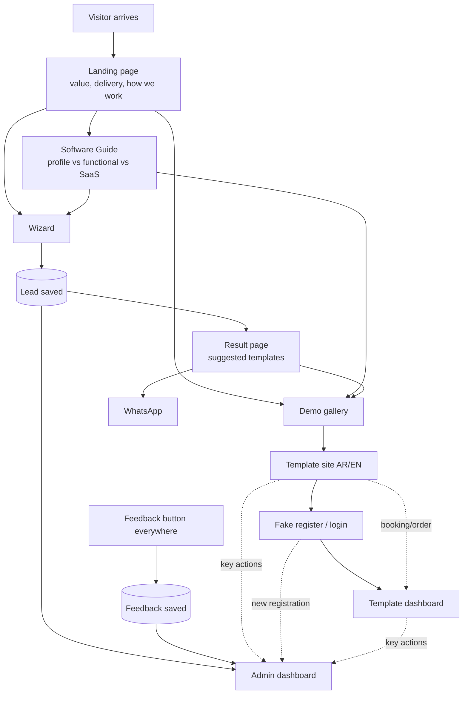
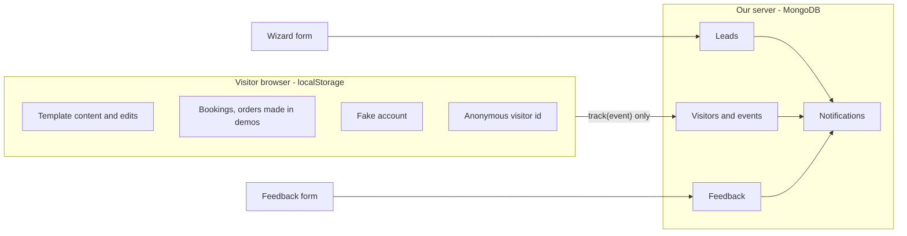
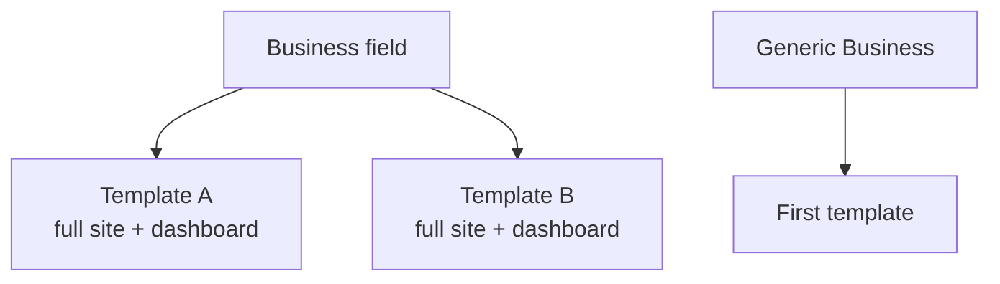

# 02 · Flows and user stories

## The whole journey in plain words

1. A visitor arrives from an ad, a social post, or a WhatsApp link. The site opens in their browser language (Arabic by default).
2. The **landing page** explains what we deliver and the value it brings to their business, and how we work.
3. The visitor can read the **Software Guide** to understand the difference between a profile website,
   a functional website with a dashboard, and a SaaS product, and which one fits them.
4. They start the **wizard**: choose business website (and their field), SaaS, or other; describe the idea if needed;
   leave their name and WhatsApp. This is saved as a lead and the admin is notified.
5. The result page suggests demo templates for their field and offers to continue on **WhatsApp**.
6. Anyone can also browse the **gallery** freely and open any demo.
7. Inside a demo they use a complete business website in Arabic or English and can perform real actions (book, order, ask).
8. They open the dashboard: a **fake register/login** (saved in their browser) and then a working **dashboard**
   where they see their actions and can edit the content in Arabic and English.
9. A **feedback** button is available everywhere. A **WhatsApp** button is available when they want to send or book a project.
10. The **admin** logs into a private dashboard and sees visitors, leads, demo registrations, activity, feedback, and notifications.

## Overall flow

## Where data lives

## Content structure

No color variants of one template; variety comes from different complete templates.

## User stories

### A. Visitor (business owner)

| # | As a visitor I want to… | So that… |
|---|---|---|
| A1 | read a landing page in Arabic or English about what we deliver and the value for my business | I understand the value before any tech |
| A2 | learn the difference between a profile website, a functional website with dashboard, and SaaS | I choose what I really need |
| A3 | browse all demos freely and filter by business field | I find examples close to my business |
| A4 | fill a short wizard: business website (pick field), SaaS idea, or other | I describe my need without a call |
| A5 | see suggested templates for my field after the wizard | I see an example right away |
| A6 | continue on WhatsApp with one click and a prefilled message | I talk to the agency immediately |
| A7 | send feedback from any page | I can ask or comment |

### B. Demo user (inside a template)

| # | As a demo user I want to… | So that… |
|---|---|---|
| B1 | use a complete, realistic business website | I see exactly what my final site could be |
| B2 | switch the site between Arabic and English | I know it works for my customers |
| B3 | perform real actions (book, order, ask) | I experience what my customers would |
| B4 | register and log in with name and password (saved in my browser) | it feels like a real product I own |
| B5 | see my site actions appear in the dashboard | I understand how it saves time and brings business |
| B6 | edit content in Arabic and/or English, my choice | I picture it with my own business |
| B7 | use the dashboard in Arabic or English | I can operate it comfortably |
| B8 | keep my changes when I return, and reset when I want | I explore without fear |

### C. Admin (owner)

| # | As admin I want to… | So that… |
|---|---|---|
| C1 | log into a private dashboard | only I see the data |
| C2 | see visitors over time, sources, countries, devices, languages | I know if marketing works |
| C3 | see every wizard submission as a lead and manage its status | I follow up with each one |
| C4 | be notified of new registrations per demo | I know which templates attract people |
| C5 | see key actions per template and each visitor's journey | I know what works, what doesn't, and where people stop |
| C6 | read feedback | I hear directly from visitors |
| C7 | compare fields and templates | I decide what to build next |

Detailed flows per feature: `docs/features/`.
