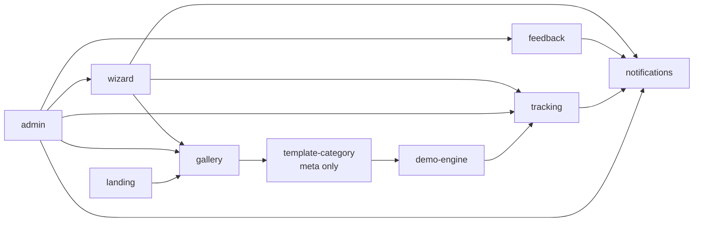
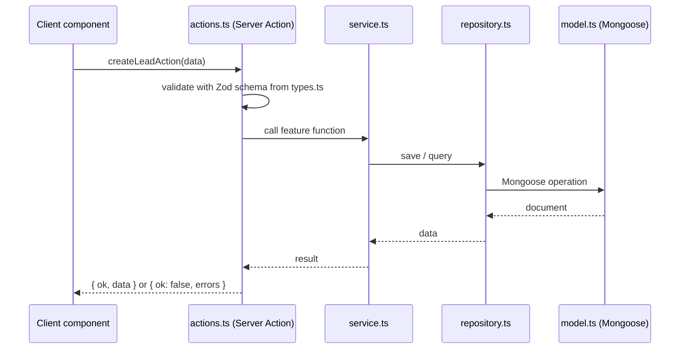
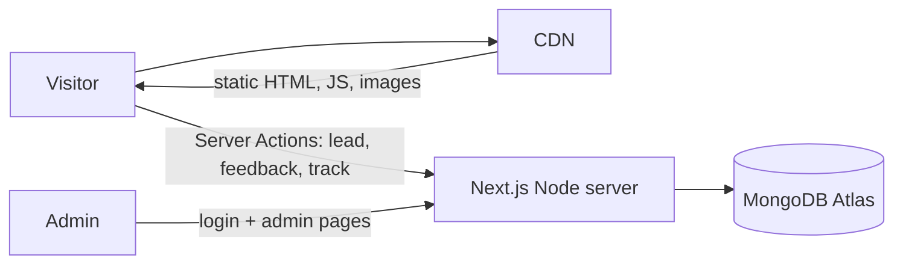

# 03 · Architecture

## Stack

| Need | Choice | Why |
|---|---|---|
| Framework | **Next.js (App Router)** + TypeScript strict | One full-stack app for site, demos, admin, and server logic; very mature, large ecosystem |
| Routing | App Router, file-based, in `src/app/` | `[locale]` segment, layouts, static generation per route |
| Server reads | Server Components call the feature's service directly | No API layer for reading data |
| Server writes | **Server Actions** (`"use server"`) in each feature's `actions.ts` | Typed calls from the UI, Zod-validated; no separate REST API |
| Styling | Tailwind CSS only | Full control over every layout; our own UI primitives |
| Translation | Our own small i18n in `shared/i18n` (JSON messages + `t()`) | `/ar` and `/en` routes, RTL; no extra dependency (KISS) |
| Database | MongoDB + Mongoose | `model.ts` per feature documents each data shape |
| Validation | Zod | One schema for forms, actions, env, and localStorage |
| Demo state | Zustand + persist (client components only) | localStorage save/load, version reset, selective re-render |
| Charts (admin) | chosen in Phase 3, simple library | Admin statistics |
| Rendering | Public pages statically generated; demos run in the browser; Node server for actions and admin | Good SEO, low cost (see below) |
| Hosting | small VPS + Cloudflare CDN (decided, see below) | Code stays host-agnostic |

## Server and client components (the one rule to remember)

- Files in `src/app/` and feature components are **Server Components by default**.
- A component that uses state, effects, browser APIs, Zustand, or event handlers starts with `"use client"`.
  Keep `"use client"` as low in the tree as possible (the interactive part only, not the whole page).
- `model.ts`, `repository.ts`, `service.ts` start with `import "server-only"`, so importing them in a client component fails the build.
- Demos are client components (they read localStorage). Their pages are static shells; the content appears after the
  store loads in the browser (see `.claude/rules/storage.md`, hydration).

## Folder structure

```
src/
  app/                                Next.js App Router route files only (thin)
    layout.tsx                        root html shell
    page.tsx                          / → redirect to /ar or /en (see proxy.ts)
    [locale]/
      layout.tsx                      validates locale, sets lang/dir, header/footer, feedback + WhatsApp buttons
      page.tsx                        → features/landing
      guide/page.tsx                  → features/software-guide
      start/page.tsx                  → features/wizard
      start/result/page.tsx           → features/wizard
      demos/page.tsx                  → features/gallery
      demos/<category>/<variant>/...  → features/template-<category> (one per category)
      admin/login/page.tsx            → features/admin
      admin/(protected)/...           → features/admin (layout.tsx checks the session)
    sitemap.ts, robots.ts
  proxy.ts                            redirects / and paths without a locale (browser language or saved choice)
  features/
    landing/
    software-guide/
    wizard/
    gallery/
    feedback/
    tracking/
    notifications/
    admin/
    demo-engine/
    template-<category>/              e.g. template-restaurant (2 variants inside)
  shared/
    db/
    ui/
    i18n/
    env.ts
scripts/
theme-sources/
docs/
```

`proxy.ts` is the Next.js request hook (called `middleware.ts` in older versions). It only redirects; no business logic.

## Feature dependencies (one way, no cycles)



Everything may import from `shared/`. `shared/` imports from no feature.

## Request flow (server features)

**Reads:** a page (Server Component) calls the feature's service and renders the result.
**Writes:** a client component calls a **Server Action** from the feature's `actions.ts`. The action validates input
with the Zod schema from `types.ts`, calls the service, and returns a result. It contains no business logic itself.



## Routes

| Route | Feature |
|---|---|
| `/[locale]` | landing |
| `/[locale]/guide` | software-guide |
| `/[locale]/start`, `/[locale]/start/result` | wizard |
| `/[locale]/demos` | gallery |
| `/[locale]/demos/<category>/<variant>/...` | template-<category> (variant site) |
| `/[locale]/demos/<category>/<variant>/register`, `/login` | template-<category> via demo-engine fake auth |
| `/[locale]/demos/<category>/<variant>/dashboard/...` | template-<category> (shared dashboard + variant modules) |
| `/[locale]/admin/login`, `/[locale]/admin/...` | admin |

## Server Actions

| Action | Feature |
|---|---|
| `recordEventAction` | tracking (called by `track()`) |
| `createLeadAction` | wizard |
| `createFeedbackAction` | feedback |
| `loginAction`, `logoutAction`, admin updates (lead status, mark read…) | admin (each checks the session) |

Admin pages read their data in Server Components through the services, after checking the session.
Feedback is a floating button + modal on every page, not a separate route.

## Image uploads (not decided)

Version 1 uses the built-in image library only. If uploads are enabled later, they go to the owner's existing
**AWS S3 bucket**: a Server Action returns a short-lived upload URL, the browser uploads directly to S3,
and only the image URL is saved. The S3 implementation is **to be created** when the decision is made.

## Admin authentication

- A single admin. Email and bcrypt password hash in `.env` (`ADMIN_EMAIL`, `ADMIN_PASSWORD_HASH`).
- Login creates a signed, httpOnly session cookie (`SESSION_SECRET`), using Next.js `cookies()` and a small signing helper.
- `admin/(protected)/layout.tsx` checks the session and redirects to login; every admin Server Action and
  service read checks it again (a layout check alone is not enough).
- `scripts/hash-password` (first script) produces the hash.

## Configuration (`.env`)

See `.env.example`. Public values are read through `src/shared/env.ts`, secrets through `src/shared/env.server.ts` (`getServerEnv()`, server only). Both validate with Zod.
Variables starting with `NEXT_PUBLIC_` are public (sent to the browser). The others are server-only and never prefixed.

| Variable | Purpose |
|---|---|
| `NEXT_PUBLIC_BRAND_NAME` | Brand name shown in the UI (not decided yet) |
| `NEXT_PUBLIC_WHATSAPP_NUMBER` | Number for every WhatsApp button |
| `NEXT_PUBLIC_DEFAULT_LOCALE` | Fallback locale (`ar`) |
| `NEXT_PUBLIC_SITE_URL` | Absolute site URL |
| `MONGODB_URI` | Database connection |
| `ADMIN_EMAIL` | Admin login |
| `ADMIN_PASSWORD_HASH` | Admin password hash |
| `SESSION_SECRET` | Signs the admin session cookie |

## Why Next.js (decision record)

The project first planned TanStack Start, then moved to **Next.js** (owner's decision):

| | Next.js | TanStack Start |
|---|---|---|
| Maturity | Very mature, huge community, many answers and examples | Younger, smaller community |
| AI tools and hiring | Best known by AI tools and developers | Less known |
| SEO | Static generation, `generateMetadata`, sitemap/robots built in | Same, with fewer helpers |
| Mental model | Server/client components, caching rules to learn | Simpler, explicit |
| Dev speed | Turbopack dev server, fast enough | Vite, slightly faster |
| Hosting | Any Node host (`output: "standalone"`); Vercel needs Pro for commercial use | Any Node host |

Trade-off accepted: a little more to learn (server vs client components, caching) for maturity and support.
We keep caching simple: public pages are static; admin pages are dynamic; no custom cache tricks.

## Rendering strategy (what needs a server)

| Part | How it is served | Server needed |
|---|---|---|
| Landing, Software Guide, Gallery | **Statically generated** at build time (`generateStaticParams` for `ar`/`en`), served from the CDN | No |
| Demo templates + their dashboards | Static shells; everything runs in the browser (localStorage) | No |
| Wizard, Feedback, Tracking | Server Actions → MongoDB | Yes (small) |
| Admin dashboard | Dynamic, protected; Server Components + Server Actions → MongoDB | Yes (small) |



SEO rules:
- Public pages (landing, guide, gallery) are static, with `generateMetadata`: title, description, Open Graph,
  and `alternates.languages` (`hreflang`) between `/ar` and `/en`.
- `sitemap.ts` and `robots.ts` in `src/app/` cover the public pages.
- Demos are indexable only on their home page if useful; template dashboards and the admin are `noindex`.

## Hosting (decided: Option A, VPS + Cloudflare)

Target: about **$0–5/month** at the start.

| Piece | Option A: VPS (simplest) | Option B: AWS (owner already has an account) |
|---|---|---|
| App | `next build` with `output: "standalone"`, run with Node on a small VPS (~$5/month), Cloudflare free CDN in front | OpenNext (e.g. with SST): Lambda for the server, S3 + CloudFront for static files; or AWS Amplify Hosting |
| Database | MongoDB Atlas free tier (512MB) | MongoDB Atlas free tier (512MB) |
| Trade-off | One machine, predictable cost, easy to reason about | Near zero at low traffic, more setup |

Notes:
- **Vercel**: the Hobby plan is non-commercial; Pro (~$20/month) is the easy option if budget allows later.
- **Avoid edge runtimes for the server part**: Mongoose needs the Node.js runtime (the default).

## Host-agnostic rules

- No Vercel-only APIs. Everything must run with `next start` / standalone Node.
- Country: read a known country header if present (e.g. Cloudflare `cf-ipcountry`), otherwise `unknown`.
- MongoDB connection is cached across hot reloads and serverless invocations in `shared/db`.
