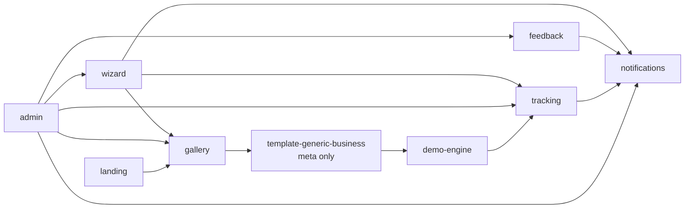
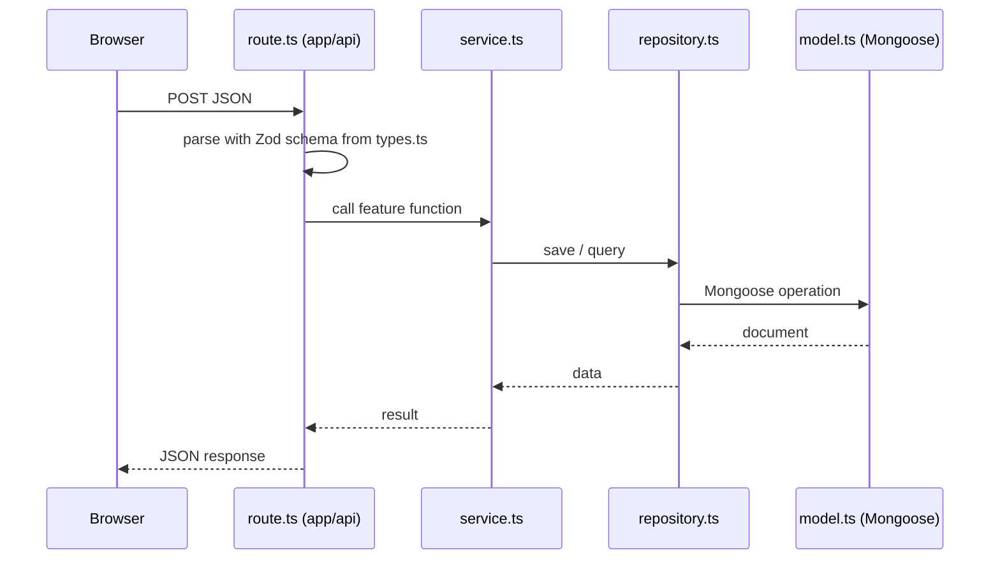

# 03 · Architecture

## Stack

| Need | Choice | Why |
|---|---|---|
| Framework | Next.js (App Router) + TypeScript strict | One app for site, demos, admin, and API |
| Styling | Tailwind CSS only | Full control over every layout; our own UI primitives |
| Translation | next-intl | `/ar` and `/en` routes, RTL |
| Database | MongoDB + Mongoose | `model.ts` per feature documents each data shape |
| Validation | Zod | One schema for forms, API, env, and localStorage |
| Demo state | Zustand + persist | localStorage save/load, version reset, selective re-render |
| Charts (admin) | chosen in Phase 3, simple library | Admin statistics |
| Hosting | not decided | Code stays host-agnostic |

## Folder structure

```
src/
  app/
    [locale]/
      layout.tsx
      page.tsx                        → features/landing
      guide/page.tsx                  → features/software-guide
      start/page.tsx                  → features/wizard
      start/result/page.tsx           → features/wizard
      demos/page.tsx                  → features/gallery
      demos/generic-business/...      → features/template-generic-business
      admin/login/page.tsx            → features/admin
      admin/(protected)/...           → features/admin
    api/
      track/route.ts                  → features/tracking
      leads/route.ts                  → features/wizard
      feedback/route.ts               → features/feedback
  features/
    landing/
    software-guide/
    wizard/
    gallery/
    feedback/
    tracking/
    notifications/
    admin/
    demo-engine/
    template-generic-business/
  shared/
    db/
    ui/
    i18n/
    env.ts
scripts/
theme-sources/
docs/
```

## Feature dependencies (one way, no cycles)



Everything may import from `shared/`. `shared/` imports from no feature.

## Request flow (server features)



## Routes

| Route | Feature |
|---|---|
| `/[locale]` | landing |
| `/[locale]/guide` | software-guide |
| `/[locale]/start`, `/[locale]/start/result` | wizard |
| `/[locale]/demos` | gallery |
| `/[locale]/demos/<slug>/...` | template-<slug> (site) |
| `/[locale]/demos/<slug>/register`, `/login` | template-<slug> via demo-engine fake auth |
| `/[locale]/demos/<slug>/dashboard/...` | template-<slug> (dashboard) |
| `/[locale]/admin/login`, `/[locale]/admin/...` | admin |
| `POST /api/track` | tracking |
| `POST /api/leads` | wizard |
| `POST /api/feedback` | feedback |

Feedback is a floating button + modal on every page, not a separate route.

## Admin authentication

- A single admin. Email and bcrypt password hash in `.env` (`ADMIN_EMAIL`, `ADMIN_PASSWORD_HASH`).
- Login creates a signed, httpOnly session cookie (`SESSION_SECRET`). Admin routes and admin API check it.
- `scripts/hash-password` (first script) produces the hash.

## Configuration (`.env`)

See `.env.example`. Read only through `src/shared/env.ts` (validated with Zod).

| Variable | Purpose |
|---|---|
| `NEXT_PUBLIC_BRAND_NAME` | Brand name shown in the UI (not decided yet) |
| `NEXT_PUBLIC_WHATSAPP_NUMBER` | Number for every WhatsApp button |
| `NEXT_PUBLIC_DEFAULT_LOCALE` | Fallback locale (`ar`) |
| `NEXT_PUBLIC_SITE_URL` | Absolute site URL |
| `MONGODB_URI` | Database connection |
| `ADMIN_EMAIL` | Admin login |
| `ADMIN_PASSWORD_HASH` | Admin password hash |
| `SESSION_SECRET` | Signs the admin session cookie |

## Host-agnostic rules

- Use only standard Next.js features. No platform-only APIs.
- Country: read a known country header if present (e.g. Cloudflare or Vercel), otherwise `unknown`.
- MongoDB connection is cached across hot reloads and serverless invocations in `shared/db`.
