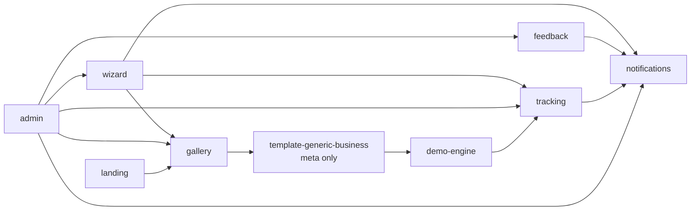
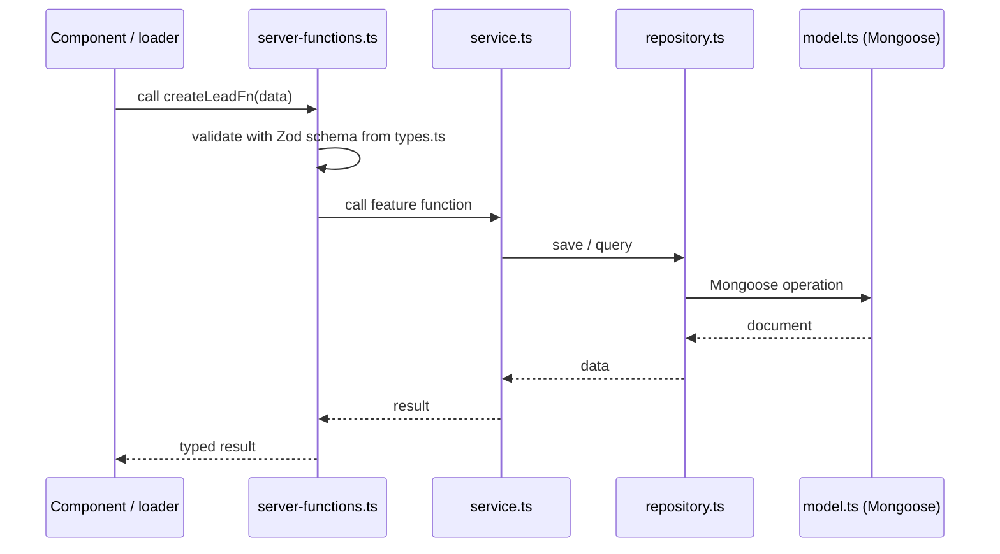
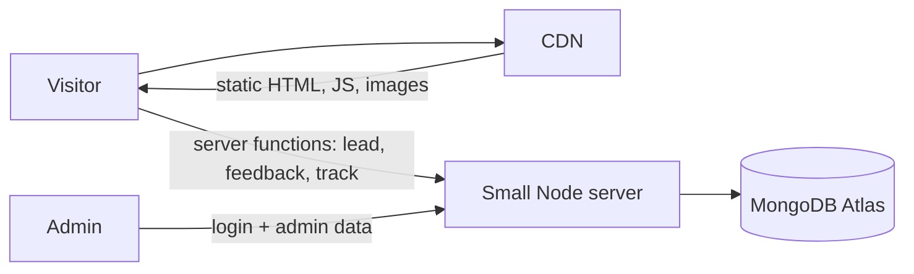

# 03 · Architecture

## Stack

| Need | Choice | Why |
|---|---|---|
| Framework | **TanStack Start** (React + Vite) + TypeScript strict | One full-stack app for site, demos, admin, and server logic |
| Routing | TanStack Router (file-based, in `src/routes/`) | Type-safe routes, params, and search params; loaders for data |
| Server logic | TanStack Start server functions (`createServerFn`) | Typed calls from the UI to the server, Zod-validated; no separate REST API |
| Styling | Tailwind CSS only | Full control over every layout; our own UI primitives |
| Translation | Our own small i18n in `shared/i18n` (JSON messages + `t()`) | `/ar` and `/en` routes, RTL; no extra dependency (KISS) |
| Database | MongoDB + Mongoose | `model.ts` per feature documents each data shape |
| Validation | Zod | One schema for forms, API, env, and localStorage |
| Demo state | Zustand + persist | localStorage save/load, version reset, selective re-render |
| Admin data | Route loaders calling server functions | Simple; TanStack Query added only if a real need appears |
| Charts (admin) | chosen in Phase 3, simple library | Admin statistics |
| Rendering | Prerender public pages; demos run in the browser; small server for server functions | Low cost, good SEO (see below) |
| Hosting | not decided (VPS or AWS, see below) | Code stays host-agnostic |

## Folder structure

```
src/
  routes/                             TanStack Router file-based routes (thin)
    __root.tsx                        html shell, lang/dir from locale
    index.tsx                         redirect / → /ar or /en (browser language or saved choice)
    $locale/
      route.tsx                       validates locale, header/footer, feedback + WhatsApp buttons
      index.tsx                       → features/landing
      guide.tsx                       → features/software-guide
      start/index.tsx                 → features/wizard
      start/result.tsx                → features/wizard
      demos/index.tsx                 → features/gallery
      demos/generic-business/...      → features/template-generic-business
      admin/login.tsx                 → features/admin
      admin/_protected/...            → features/admin (beforeLoad checks the session)
  features/
    landing/
    software-guide/
    wizard/
    gallery/
    feedback/
    tracking/
    notifications/
    admin/
    demo-engine/
    template-generic-business/
  shared/
    db/
    ui/
    i18n/
    env.ts
scripts/
theme-sources/
docs/
```

## Feature dependencies (one way, no cycles)



Everything may import from `shared/`. `shared/` imports from no feature.

## Request flow (server features)

UI components and route loaders call **server functions**. A server function lives in the feature
(`server-functions.ts`), validates input with the Zod schema from `types.ts`, calls the service, and returns the result.
It contains no business logic itself.



## Routes

| Route | Feature |
|---|---|
| `/$locale` | landing |
| `/$locale/guide` | software-guide |
| `/$locale/start`, `/$locale/start/result` | wizard |
| `/$locale/demos` | gallery |
| `/$locale/demos/<slug>/...` | template-<slug> (site) |
| `/$locale/demos/<slug>/register`, `/login` | template-<slug> via demo-engine fake auth |
| `/$locale/demos/<slug>/dashboard/...` | template-<slug> (dashboard) |
| `/$locale/admin/login`, `/$locale/admin/...` | admin |

## Server functions

| Function | Feature |
|---|---|
| `recordEventFn` | tracking (called by `track()`) |
| `createLeadFn` | wizard |
| `createFeedbackFn` | feedback |
| `loginFn`, `logoutFn`, admin queries and updates | admin (each checks the session) |

Feedback is a floating button + modal on every page, not a separate route.

## Image uploads (not decided)

Version 1 uses the built-in image library only. If uploads are enabled later, they go to the owner's existing
**AWS S3 bucket**: a server function returns a short-lived upload URL, the browser uploads directly to S3,
and only the image URL is saved. The S3 implementation is **to be created** when the decision is made.

## Admin authentication

- A single admin. Email and bcrypt password hash in `.env` (`ADMIN_EMAIL`, `ADMIN_PASSWORD_HASH`).
- Login creates a signed, httpOnly session cookie (`SESSION_SECRET`) using TanStack Start's session helpers.
  Admin routes check it in `beforeLoad`; every admin server function checks it again.
- `scripts/hash-password` (first script) produces the hash.

## Configuration (`.env`)

See `.env.example`. Read only through `src/shared/env.ts` (validated with Zod).
Variables starting with `VITE_` are public (sent to the browser). The others are server-only and never prefixed.

| Variable | Purpose |
|---|---|
| `VITE_BRAND_NAME` | Brand name shown in the UI (not decided yet) |
| `VITE_WHATSAPP_NUMBER` | Number for every WhatsApp button |
| `VITE_DEFAULT_LOCALE` | Fallback locale (`ar`) |
| `VITE_SITE_URL` | Absolute site URL |
| `MONGODB_URI` | Database connection |
| `ADMIN_EMAIL` | Admin login |
| `ADMIN_PASSWORD_HASH` | Admin password hash |
| `SESSION_SECRET` | Signs the admin session cookie |

## Why TanStack Start (decision record)

Compared with Next.js for this project:

| | TanStack Start | Next.js |
|---|---|---|
| Dev speed | Vite: fast start and instant updates | Heavier dev server (memory/CPU) |
| Mental model | Explicit routes, loaders, server functions (fits KISS) | Server/client components, caching rules |
| SEO | Server rendering + prerendering + per-route `head` | Same, with more built-in helpers |
| Static + server in one app | Prerendered pages and server functions together | Full static export drops server features |
| Hosting | Any Node host, no lock-in | Easiest host (Vercel) needs Pro (~$20/month) for commercial use |
| Maturity | Younger, smaller community; we write a few small things ourselves | Very mature, large ecosystem |

Conclusion: cost depends on hosting, not the framework. TanStack Start fits our priorities (low cost, fast development,
simple code, no lock-in) and SEO is equal for the pages that need it.

## Rendering strategy (what needs a server)

| Part | How it is served | Server needed |
|---|---|---|
| Landing, Software Guide, Gallery | **Prerendered** to static HTML at build time, served from the CDN | No |
| Demo templates + their dashboards | Static files; everything runs in the browser (localStorage) | No |
| Wizard, Feedback, Tracking | Server functions → MongoDB | Yes (small) |
| Admin dashboard | Server-rendered/protected; server functions → MongoDB | Yes (small) |



SEO rules:
- Public pages (landing, guide, gallery) are prerendered, with a title, description, Open Graph tags,
  and `hreflang` links between `/ar` and `/en` in each route's `head`.
- A `sitemap.xml` and `robots.txt` are generated for the public pages.
- Demos are indexable only on their home page if useful; template dashboards and the admin are `noindex`.

## Hosting options (not decided)

Target: about **$0–5/month** at the start.

| Piece | Option A: VPS (simplest) | Option B: AWS (owner already has an account) |
|---|---|---|
| Static pages and assets | Served by the Node app, cached by Cloudflare's free CDN | S3 + CloudFront |
| Server functions | Same Node app on a small VPS (~$5/month) | AWS Lambda (free tier: 1M requests/month) |
| Database | MongoDB Atlas free tier (512MB) | MongoDB Atlas free tier (512MB) |
| Trade-off | One machine, predictable cost, easy to reason about | Near zero at low traffic, more setup |

Notes:
- **Avoid Vercel's Hobby plan**: it is for non-commercial use; this is a commercial site.
- **Avoid Cloudflare Workers for the server part**: Mongoose needs a full Node runtime.
- Whichever is chosen, the code stays the same; only the TanStack Start (Nitro) deployment preset changes.

## Host-agnostic rules

- TanStack Start builds a standard Node server that runs on most hosts. No platform-only APIs.
- Country: read a known country header if present (e.g. Cloudflare or Vercel), otherwise `unknown`.
- MongoDB connection is cached across hot reloads and serverless invocations in `shared/db`.
