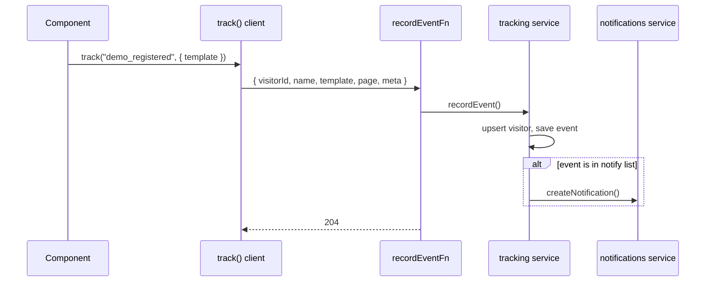

# 04 · Data models and tracking

All server data is in MongoDB. Each model lives in `model.ts` of the feature that owns it.
Shapes below are the plan; `model.ts` becomes the source of truth once written.

## Models

### Lead (`features/wizard/model.ts`)

| Field | Type | Notes |
|---|---|---|
| `type` | `"business" \| "saas" \| "other"` | |
| `field` | string, optional | business field slug, for `business` |
| `idea` | string, optional | free text, for `saas`/`other` (optional for business) |
| `name` | string | |
| `whatsapp` | string | |
| `email` | string, optional | |
| `locale` | `"ar" \| "en"` | |
| `visitorId` | string | links to tracking |
| `status` | `"new" \| "contacted" \| "won" \| "lost"` | default `new` |
| `notes` | string, optional | admin notes |
| `createdAt`, `updatedAt` | Date | timestamps |

### Visitor (`features/tracking/model.ts`)

| Field | Type | Notes |
|---|---|---|
| `visitorId` | string, unique | random id from the browser |
| `firstSeenAt`, `lastSeenAt` | Date | |
| `country` | string | from header or `unknown` |
| `device` | `"mobile" \| "tablet" \| "desktop"` | from user agent |
| `locale` | `"ar" \| "en"` | last used |
| `source` | object | `utmSource`, `utmMedium`, `utmCampaign`, `referrer` (first visit) |

### Event (`features/tracking/model.ts`)

| Field | Type | Notes |
|---|---|---|
| `visitorId` | string | indexed |
| `name` | event name from the list | indexed |
| `template` | string, optional | template slug |
| `page` | string | path |
| `meta` | object, optional | small, no personal data |
| `createdAt` | Date | indexed |

### Feedback (`features/feedback/model.ts`)

| Field | Type | Notes |
|---|---|---|
| `visitorId` | string | |
| `message` | string | |
| `contact` | string, optional | if the visitor wants a reply |
| `page` | string | where it was sent from |
| `template` | string, optional | |
| `read` | boolean | default false |
| `createdAt` | Date | |

### Notification (`features/notifications/model.ts`)

| Field | Type | Notes |
|---|---|---|
| `type` | `"new_lead" \| "demo_registered" \| "demo_action" \| "whatsapp_clicked" \| "feedback"` | |
| `title` | string | short text for the list |
| `template` | string, optional | |
| `link` | string, optional | admin page of the related item |
| `read` | boolean | default false |
| `createdAt` | Date | |

No user model: the admin is configured in `.env`.

## Tracking events

The list and the "notifies admin" flag are in `.claude/rules/analytics.md` (single source of truth).

`track()` never blocks the UI and never throws to the caller. A failed send is ignored.

## Admin metrics (computed from events and leads)

- Visitors per day/week/month, unique visitors, devices, countries, languages, sources.
- Wizard conversion: `wizard_started` → `wizard_completed`.
- Per template: `demo_opened` → `demo_registered` → `demo_action`, plus `content_edited` counts.
- WhatsApp clicks, feedback count.
