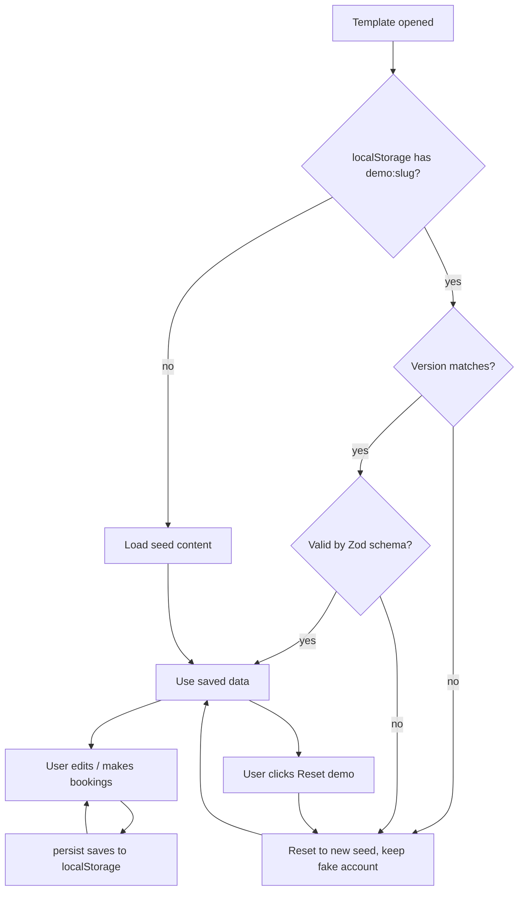
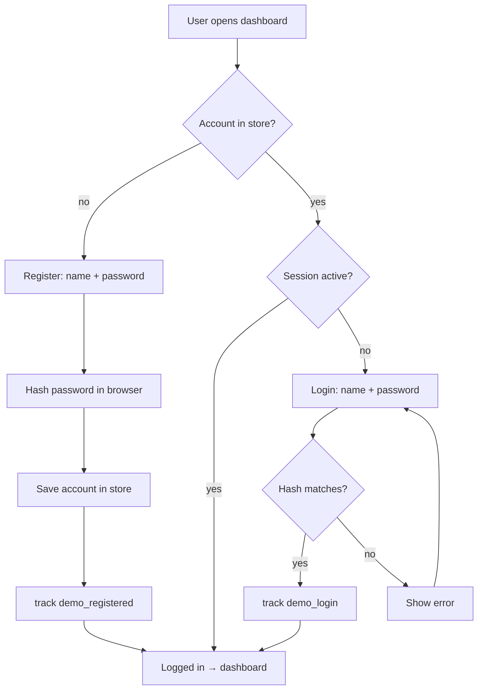
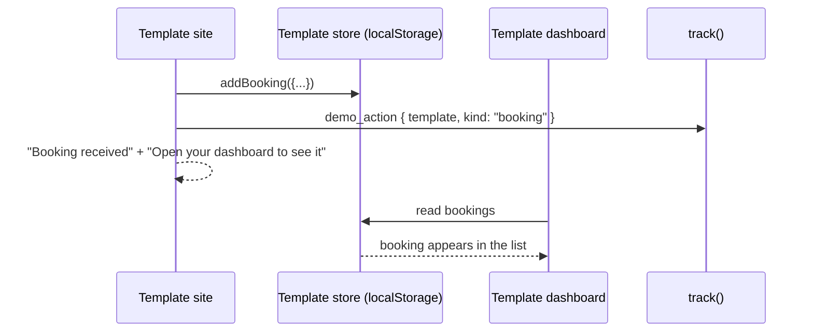

# 05 · Demo engine

The shared core every template uses, in `src/features/demo-engine/`. It is written once so each template
only adds its design, content, and business modules. Templates import from it; it never imports a template.

## What it provides

| Part | What it does |
|---|---|
| `storage/` | Helper to create a template's Zustand persist store: key `demo:<slug>`, version, seed (with sample dates made relative to today), reset that keeps the account, Zod validation of loaded data, sync between tabs (browser `storage` event) |
| `fake-auth/` | Register and login pages/components (name + password hashed in the browser + optional business name), a guard for dashboard routes, logout |
| `dashboard-shell/` | Sidebar, header, language switch, RTL-ready layout, page title, empty states, value-tip box |
| `palettes/` | Applies the selected palette (CSS variables) to a template's site and dashboard |
| `editor/` | Bilingual field editors: text `{ar,en}`, rich text, image picker from the library, list editor (add/remove/reorder) |
| `image-library/` | Bundled, optimized images grouped by topic |
| `banner/` | "Live demo, saved only in your browser" bar with Dashboard, WhatsApp, and Reset buttons |
| tracking | Calls `track()` for `demo_opened`, `demo_registered`, `demo_login`, `content_edited`, `demo_reset` |

Business-specific modules (bookings, menu, appointments, listings) live in each template, not here.
If two templates need the same module, it is copied first; it moves into the engine only when a third needs it (KISS).

## Template store lifecycle

## Fake auth flow

## Closed loop (the selling moment)

## Demo banner

Always visible on template site and dashboard, small, dismissible per session:
"This is a live demo: your changes are saved only in your browser" · Open dashboard · Talk to us on WhatsApp · Reset demo.
