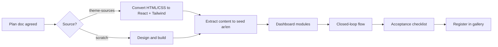
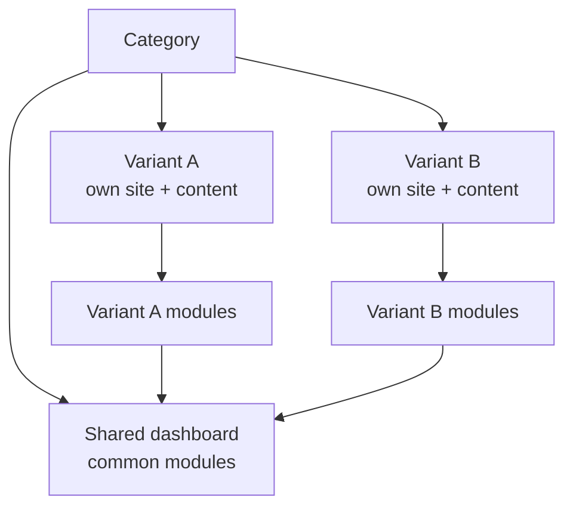

# 06 · Template contract

The rules a template must satisfy are in `.claude/rules/templates.md` (single source of truth).
This page explains how a template is planned and accepted.

## Planning a template

Each **category** gets one plan doc `docs/features/template-<category>.md`, agreed before building. It covers the
shared dashboard and **both variants**. For each variant:

1. **Business profile**: the kind of business, who the customers are, what the owner wants (more bookings, more calls, trust…).
2. **Value map**: for each page and section, the business goal it serves and the value message.
3. **Pages and sections** of the public site.
4. **Closed-loop flows**: site action → what appears in the dashboard.
5. **Dashboard modules**: shared modules (both variants) + variant modules (one variant only).
6. **Data schema**: the store shape (Zod) and seed content outline (ar/en).
7. **Source**: from scratch or from `theme-sources/<name>/`.
8. Flow diagrams (Mermaid) and user stories, like every feature doc.

## Acceptance checklist

- [ ] Every section has a stated business goal; no filler, no content shared with the other variant
- [ ] Real Arabic and English content
- [ ] At least one closed-loop flow works end to end
- [ ] Fake register/login protects the dashboard
- [ ] Dashboard edits content in both languages and manages the business data; it shows exactly the shared modules + this variant's modules
- [ ] Language switch on site and dashboard; RTL correct everywhere
- [ ] Seed, version, and reset work
- [ ] Demo banner present
- [ ] Key actions tracked
- [ ] `meta.ts` catalog entry and screenshot; visible in the gallery
- [ ] Mobile-first, accessible, images optimized
- [ ] Template contract checks pass; unit tests for its rules; E2E of each closed loop in ar and en

## Template pipeline

## Categories

Each category has 2 variants: two different kinds of business, each with its own content and website design,
sharing one dashboard. Variants below are proposals, confirmed in each category's plan doc.

| Category | Variant A (proposal) | Variant B (proposal) | Status |
|---|---|---|---|
| Restaurants & cafés | Fine dining: table reservations | Fast food: online orders | **in progress**: shared layer + fine dining built, fast food next (`docs/features/template-restaurant.md`) |
| Clinics | Dental clinic: appointment booking | Medical center (several doctors): booking by doctor | not planned |
| Real estate | Real estate agency: listings + viewing requests | Property developer: projects + unit inquiries | not planned |
| Gyms & fitness | Gym: memberships + trial requests | Fitness studio: class schedule + class booking | not planned |
| Training & education | Training center: course registration | Language / tutoring center: level test + enrollment | not planned |
| Service companies | Maintenance company: service requests | Cleaning company: quote + booking | not planned |
| Marketing agencies | Full-service agency: social media, branding, web development, media production, media buying, SEO, influencer marketing, advertising; proposal requests | Performance agency (proposal): ads, media buying, SEO; free audit requests | not planned |

First category: **Restaurants & cafés**. Plan one category fully (both variants), build it, then repeat.
Designs come later from the owner's HTML/CSS in `theme-sources/`; plans are written without them.

