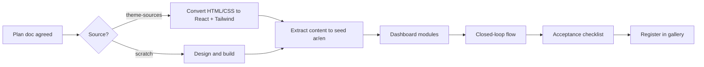
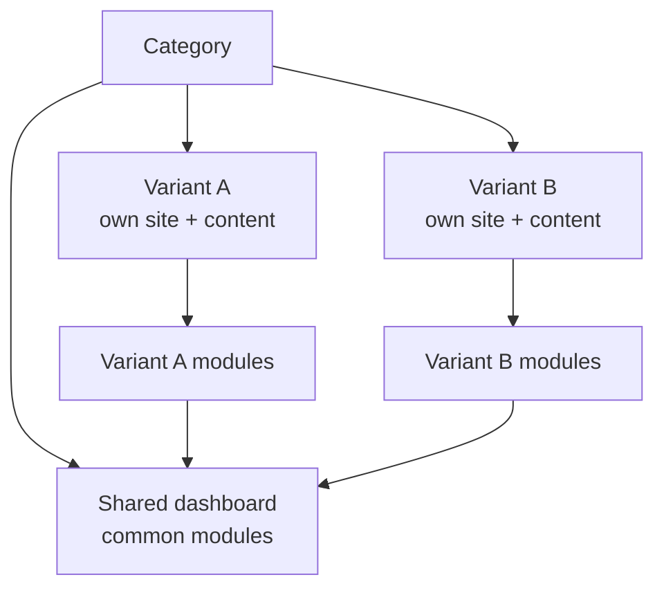

# 06 · Template contract

The rules a template must satisfy are in `.claude/rules/templates.md` (single source of truth).
This page explains how a template is planned and accepted.

## Planning a template

Each **category** gets one plan doc `docs/features/template-<category>.md`, agreed before building. It covers the
shared dashboard and **both variants**. For each variant:

1. **Business profile**: the kind of business, who the customers are, what the owner wants (more bookings, more calls, trust…).
2. **Value map**: for each page and section, the business goal it serves and the value message.
3. **Pages and sections** of the public site.
4. **Closed-loop flows**: site action → what appears in the dashboard.
5. **Dashboard modules**: shared modules (both variants) + variant modules (one variant only).
6. **Data schema**: the store shape (Zod) and seed content outline (ar/en).
7. **Source**: from scratch or from `theme-sources/<name>/`.
8. Flow diagrams (Mermaid) and user stories, like every feature doc.

## Acceptance checklist

- [ ] Every section has a stated business goal; no filler, no content shared with the other variant
- [ ] Real Arabic and English content
- [ ] At least one closed-loop flow works end to end
- [ ] Fake register/login protects the dashboard
- [ ] Dashboard edits content in both languages and manages the business data; it shows exactly the shared modules + this variant's modules
- [ ] Language switch on site and dashboard; RTL correct everywhere
- [ ] Seed, version, and reset work
- [ ] Demo banner present
- [ ] Key actions tracked
- [ ] `meta.ts` catalog entry and screenshot; visible in the gallery
- [ ] Mobile-first, accessible, images optimized
- [ ] Template contract checks pass; unit tests for its rules; E2E of each closed loop in ar and en

## Template pipeline

## Categories

Each category has 2 variants: two different kinds of business, each with its own content and website design,
sharing one dashboard. Variants below are proposals, confirmed in each category's plan doc.

| Category | Variant A (design) | Variant B (design) | Status |
|---|---|---|---|
| Restaurants | Zaytouna, fine dining (Verdant Table + Ironhorn) | Smash Lab, fast food ordering (Sole Trattoria) | built: both variants (`template-restaurant.md`); photos load from the CDN, check them in a real browser |
| Cafés | Café & eatery: booking + pickup orders (Hearthbean) | Specialty coffee: orders + beans (Sage & Grain) | not planned; shares the restaurant feature and dashboard |
| Real estate | Agency: buy/rent listings + viewings (Hartwell) | Developer: projects, units, viewings (Solenne) | planning |
| Clinics | Specialist doctor: dental implants (Dr. Vale) | Medical centre: booking by doctor (derived from Dr. Vale) | not planned |
| Logistics | Freight forwarder: calculator, tracking, quotes (Orbis + Meridian) | Warehousing & 3PL: estimator, quotes (Stackwell) | planning |
| Marketing & creative | Full-service marketing agency, 8 services (KZ Digital) | Brand & interior design studio (Olivine) | not planned |
| Online stores | Home décor shop (Solène) | Coffee roaster shop + subscriptions (Ember & Oak) | not planned |
| Gyms & fitness, Training & education, Service companies | — | — | no design yet; in the wizard only |

Designs: `theme-sources/`, analysed in `docs/09-design-sources.md`. Each design is the variant's home page;
other pages follow its visual language. Plan a category fully (both variants), build it, then repeat.

