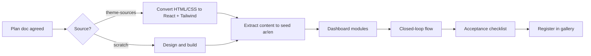

# 06 · Template contract

The rules a template must satisfy are in `.claude/rules/templates.md` (single source of truth).
This page explains how a template is planned and accepted.

## Planning a template

Each template gets `docs/features/template-<slug>.md`, agreed before building, containing:

1. **Business profile**: the field, who the customers are, what the owner wants (more bookings, more calls, trust…).
2. **Value map**: for each page and section, the business goal it serves and the value message.
3. **Pages and sections** of the public site.
4. **Closed-loop flows**: site action → what appears in the dashboard.
5. **Dashboard modules**: content editing + business management for this field.
6. **Data schema**: the store shape (Zod) and seed content outline (ar/en).
7. **Source**: from scratch or from `theme-sources/<name>/`.
8. Flow diagrams (Mermaid) and user stories, like every feature doc.

## Acceptance checklist

- [ ] Every section has a stated business goal; no filler
- [ ] Real Arabic and English content
- [ ] At least one closed-loop flow works end to end
- [ ] Fake register/login protects the dashboard
- [ ] Dashboard edits content in both languages and manages the business data
- [ ] Language switch on site and dashboard; RTL correct everywhere
- [ ] Seed, version, and reset work
- [ ] Demo banner present
- [ ] Key actions tracked
- [ ] `meta.ts` catalog entry and screenshot; visible in the gallery
- [ ] Mobile-first, accessible, images optimized

## Template pipeline

## Planned templates

| Field | Template | Status |
|---|---|---|
| Generic business | Generic Business | to be planned (next step) |
