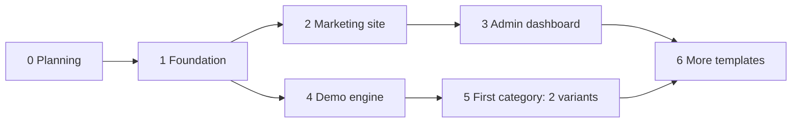

# 07 · Roadmap

| Phase | Scope | Status |
|---|---|---|
| **0. Planning** | Vision, flows, architecture, data, demo engine, template contract, rules, skills | done |
| **0b. Planning** | Software Guide (decisions closed, content draft ready); category/variant model agreed; Restaurants & cafés plan | done |
| **1. Foundation** | Next.js (App Router) + TS strict, Tailwind tokens, own i18n AR/EN + RTL (`[locale]` + `proxy.ts`), `shared/ui` primitives, `shared/db`, `shared/env`, tracking Server Action, **test setup** (Vitest, in-memory MongoDB, Playwright, contract checks, GitHub Actions CI; see `docs/08-testing.md`) | built |
| **2. Marketing site** | Landing, Software Guide, wizard + result, gallery, feedback, WhatsApp buttons | built; landing copy approved |
| **3. Admin dashboard** | Login, overview, leads, demos, visitors + journeys, activity, feedback, notifications | built (English UI; no login rate limit yet) |
| **4. Demo engine** | (core built: storage, fake auth, banner, shell, palettes, value tips) Storage helper (with the Next.js hydration pattern), fake auth, dashboard shell, editors, image library, banner | |
| **5. First category** | Restaurants & cafés: 2 variants + shared dashboard, built against the contract | |
| **6. More categories** | Next categories from `docs/06-template-contract.md`, designs from `theme-sources/`, order guided by admin stats | |

## Decisions

| Decision | Status |
|---|---|
| Brand name, logo, colors, fonts | not decided; placeholders via `.env` and tokens |
| Hosting | decided: small VPS running Next.js + Cloudflare free CDN; MongoDB Atlas free tier. See `docs/03-architecture.md` |
| Image uploads | not in v1 (image library only); later, if wanted, the AWS S3 implementation |
| Admin dashboard language | decided: English first, Arabic later if needed |
| Wizard business list | = gallery category list + "other" (decided) |
| First category | Restaurants & cafés (decided) |
| Theme designs (HTML/CSS) | owner provides later in `theme-sources/`; plans are written without them |
| Landing page text | Claude drafts value-first copy in ar/en for the owner's review (phase 2) |
| Restaurant details | decided: default currency SAR; free stock food photos (commercial use allowed); Event requests and Offers in v1 |
| Cross-template features | decided: optional business name, color palettes, value tips, relative sample data (`.claude/rules/templates.md`) |
