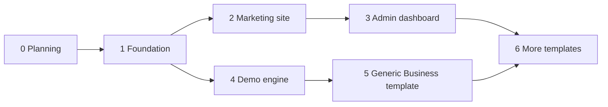

# 07 · Roadmap

| Phase | Scope | Status |
|---|---|---|
| **0. Planning** | Vision, flows, architecture, data, demo engine, template contract, rules, skills | done |
| **0b. Planning next** | Software Guide content plan; Generic Business template + dashboard plan | next |
| **1. Foundation** | Next.js + TS strict, Tailwind tokens, next-intl AR/EN + RTL, `shared/ui` primitives, `shared/db`, `shared/env`, tracking API | |
| **2. Marketing site** | Landing, Software Guide, wizard + result, gallery, feedback, WhatsApp buttons | |
| **3. Admin dashboard** | Login, overview, leads, demos, activity, feedback, notifications | |
| **4. Demo engine** | Storage helper, fake auth, dashboard shell, editors, image library, banner | |
| **5. First template** | Generic Business, built against the contract | |
| **6. More templates** | New fields and templates (often from `theme-sources/`), guided by admin stats | |

## Open decisions

| Decision | Status |
|---|---|
| Brand name, logo, colors, fonts | not decided; placeholders via `.env` and tokens |
| Hosting | not decided; code stays host-agnostic |
| Admin dashboard language | proposal: English first, Arabic later if needed |
| Wizard business field list | to define with the Software Guide plan |
| First fields after Generic Business | decided later from admin stats |
