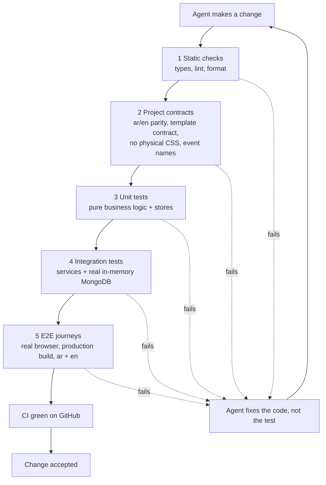
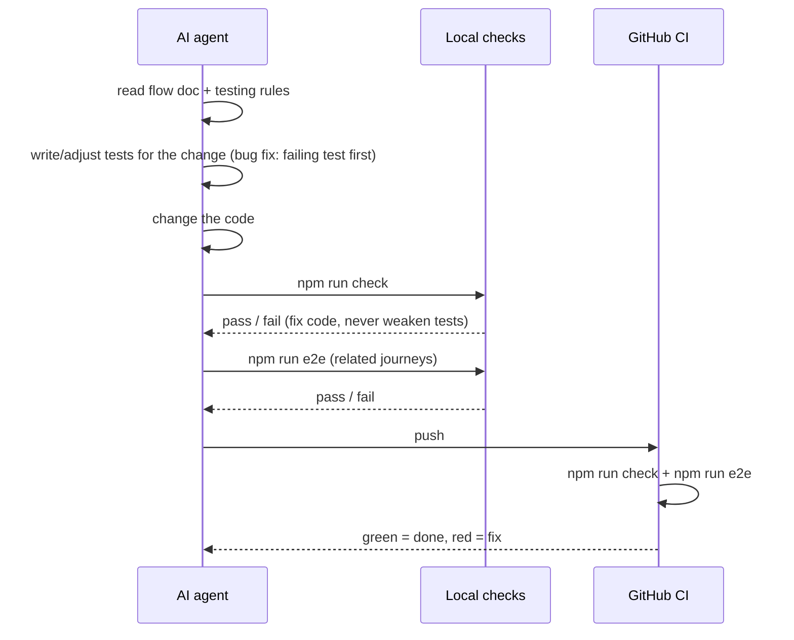

# 08 · Testing strategy

Goal: **confidence that every change, addition, or fix by an AI agent breaks nothing**, with tests that protect real
business behavior. The rules (what is allowed, forbidden, required) are in `.claude/rules/testing.md`.

## The safety net in layers

Each layer catches a different kind of mistake. The cheap, fast layers run first.

| Layer | Tool | Catches | Speed |
|---|---|---|---|
| 1 Static | tsc, ESLint, Prettier | type errors, wrong imports, unused code, messy diffs | seconds |
| 2 Contracts | Vitest | missing Arabic text, broken seed, template missing a required part, `ml-4` instead of `ms-4` | seconds |
| 3 Unit | Vitest | wrong totals, wrong quiz result, wrong slot availability, broken store reset | seconds |
| 4 Integration | Vitest + mongodb-memory-server | lead not saved, notification not created, admin data without session | seconds |
| 5 E2E | Playwright + axe | a real journey broken: form, redirect, RTL layout, closed loop, accessibility | minutes |

## Layer 2: project contracts (the most valuable for agents)

These tests read the project itself and fail when a rule in `.claude/rules/` is broken. They grow automatically:
a new template or content key is checked without writing a new test.

| Contract | Check |
|---|---|
| ar/en parity | `shared/i18n` messages, Software Guide content, every template seed: same keys and item ids in `ar` and `en`, no empty text |
| Content schemas | Guide content and every seed parse with their Zod schema |
| Template contract | For every entry in the gallery catalog: `meta` valid, store has key `demo:<category>-<variant>`, version, seed valid, reset keeps the account, `dashboard.ts` lists only existing modules, routes exist |
| Categories | Wizard business list = gallery categories + `other` |
| Event names | Every `track()` call uses a name from the analytics list (enforced by the TypeScript type from the Zod enum, plus a check that `analytics.md` and the enum match) |
| Logical CSS | No `ml-/mr-/pl-/pr-/left-/right-/text-left/text-right` in `src/` |
| Server-only | `model.ts`, `repository.ts`, `service.ts` start with `import "server-only"` |
| Feature boundaries | No import cycles between features; `demo-engine` never imports a template; `shared/` never imports a feature |

## Layer 3: unit tests (examples)

| Area | Examples |
|---|---|
| Software Guide quiz | most answers wins; tie → simpler type; result maps to the right wizard type |
| Wizard | lead schema: business needs a category, system/saas/other need an idea; WhatsApp number format |
| Restaurant fine dining | free slots hide full slots and closed days; guests 1–12; status changes allowed only along the defined path |
| Restaurant fast food | totals = lines + delivery fee; minimum order per area; order keeps name/price snapshot after a menu edit |
| Value tips | tip shown for a booking outside opening hours; no tip when data does not justify it |
| Demo engine store | old version → reset to seed keeping the account; invalid data → reset; reset demo keeps the account; sample dates are relative to "today" |
| Fake auth | same password → login ok; wrong password → error; password never stored in plain text |
| Env | missing `MONGODB_URI` fails with a clear message |

## Layer 4: integration tests (examples)

| Story | Test |
|---|---|
| W6 | `createLead` saves the lead and creates a `new_lead` notification |
| T1/T3 | `recordEvent` upserts the visitor once, saves the event, and notifies only for events in the notify list |
| T4 | `recordEvent` refuses metadata with personal or demo content fields |
| F3 | `createFeedback` creates a notification; marking read updates the unread count |
| Admin | every admin service read/update refuses without a valid session |
| Notifications | grouping by day and type returns the right counts |

## Layer 5: E2E journeys

Run against a production build with an in-memory MongoDB, on a desktop and a phone viewport.

| Journey | Steps checked |
|---|---|
| Lead journey | landing (ar) → guide quiz → wizard prefilled → submit → result shows demos + WhatsApp link → admin login → lead and notification visible |
| Language | switch AR/EN on landing, a demo site, and a demo dashboard: `<html dir>` and text change, choice remembered |
| Fine dining loop | open demo → reserve → register with business name → reservation visible in dashboard → confirm it → business name shown on site |
| Fast food loop | add to cart → checkout delivery → status page → in a second page of the same browser, dashboard moves order to "preparing" → status page updates |
| Demo reset | edit a dish → reset → seed restored, still logged in |
| Feedback | send feedback from a page → admin sees it |
| Admin protection | admin pages redirect to login without a session |
| Accessibility | axe finds no serious issues on landing, guide, wizard, gallery, one demo page, in ar and en |
| SEO basics | public pages have title, description, `hreflang`; dashboards and admin are `noindex` |

Not in v1: visual screenshot comparison (fragile across machines). Reconsider once designs are final.

## How a change flows

## Setup (phase 1)

- Install: `vitest`, `mongodb-memory-server`, `@playwright/test`, `@axe-core/playwright`, `eslint` + Next.js config, `prettier`.
- Scripts: `check`, `test`, `e2e` in `package.json`.
- `tests/helpers/db.ts`: start/stop in-memory MongoDB, clear collections between tests.
- `tests/contracts/`: the contract checks above (written in phase 1, they grow with the project).
- `.github/workflows/ci.yml`: install, `npm run check`, build, `npm run e2e`.
- Branch protection on the main branch: CI must pass.
