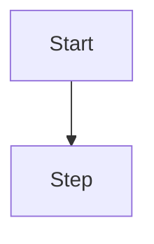
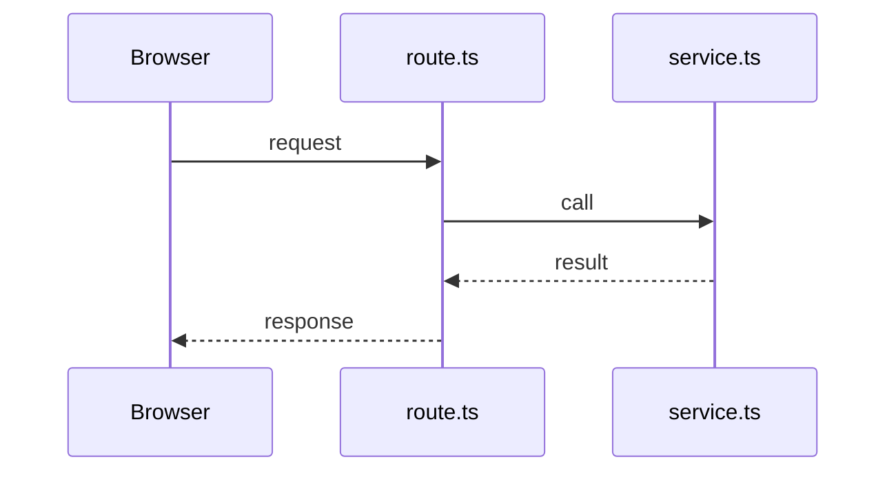

# Feature: <name>

Status: planned | in progress | done

## Purpose

What business value this feature brings, in one or two sentences.

## Flow in plain words

1. …
2. …

## User stories

| # | As a … I want to… | So that… |
|---|---|---|
| X1 | | |

## Flow diagram



## Sequence (only if the browser talks to the server)



## Data

What is stored, where (MongoDB / localStorage), and its shape.

## Files

```
src/features/<name>/
  ...
```

## Out of scope

- …
