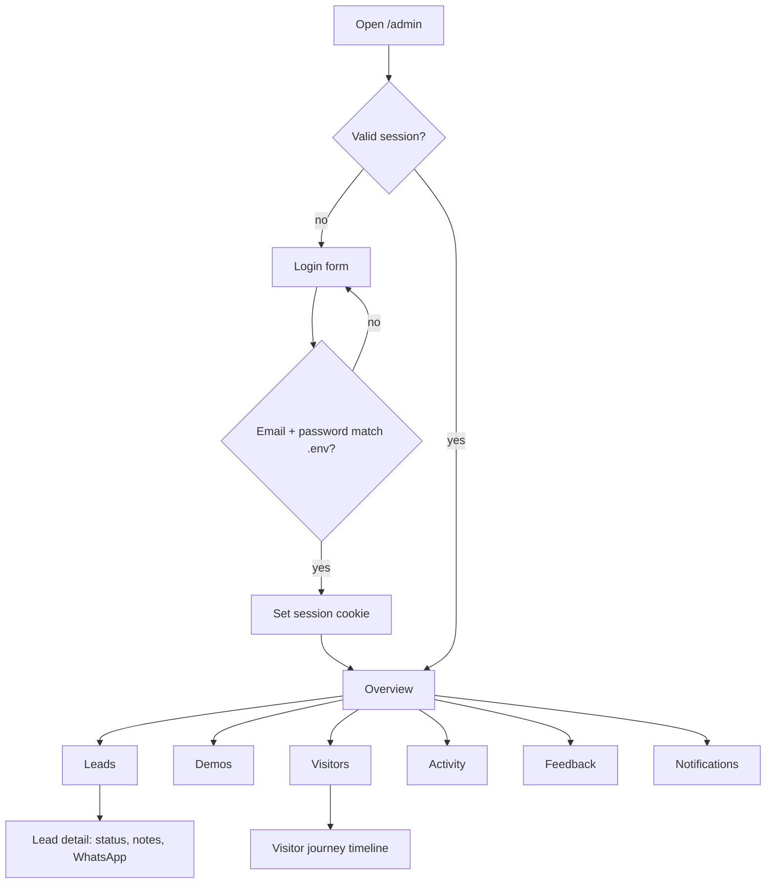

# Feature: Admin dashboard

Status: built (v1, English first; Arabic text is a first translation)

## Purpose

A private dashboard for the owner to see how the project performs: visitors, leads, demo registrations and activity,
feedback, and notifications, to follow up with people and decide what to build next.

## Questions the dashboard must answer (marketing and improvement)

| Question | Where |
|---|---|
| **Who** uses the site? (country, device, language, source/campaign) | Overview, Visitors |
| **How many** visitors per day/week/month? | Overview |
| **How many created a demo account**, in which template? | Overview, Demos |
| **What do they do** in each template, and where do they stop? | Demos (funnel), Visitors (journey), Activity |
| Which marketing source brings leads? | Overview (sources → leads) |
| Which business categories are requested most? | Leads, Overview |

## Flow in plain words

1. The owner opens `/[locale]/admin/login` and signs in with the email and password configured in `.env`.
2. A signed, httpOnly session cookie is created. All admin pages and admin Server Actions check it; without it → login.
3. Pages:
   - **Overview**: visitors (day/week/month), wizard conversion, registrations, WhatsApp clicks, top templates,
     sources, countries, devices, languages.
   - **Leads**: table with filters (type, field, status, date), lead details, status change, notes, WhatsApp button per lead.
   - **Demos**: per template: opened → registered → actions funnel, content edits, last activity.
   - **Visitors**: list of anonymous visitors (country, device, language, source, first/last seen, registered in which demos,
     lead yes/no). Opening one shows their **journey**: the timeline of their key events across the site and demos.
   - **Activity**: latest key events, filter by template and event.
   - **Feedback**: inbox, read/unread.
   - **Notifications**: full list (bell in the header everywhere).
4. Logout clears the session.

## User stories

See C1–C7 in `docs/02-flows.md`.

## Flow diagram



## Data

Reads from `wizard` (leads), `tracking` (visitors, events), `feedback`, `notifications`, and `gallery` (template names).
Look: the admin uses the BOCHKE identity (dark, green "glass" cards, `.brand-site` wrapper and site fonts), with the logo and language switch in its header.

Writes: lead status/notes, feedback read flag, notification read flag. No admin model; credentials in `.env`.

## Tests

| Level | Test | Protects |
|---|---|---|
| Unit | session cookie: valid, tampered, expired, other secret, malformed (`auth/session.test.ts`) | C1 |
| Unit | password: right/wrong, case-sensitive, Arabic, no password configured never matches (`auth/password.test.ts`) | C1 |
| Unit | conversion, funnel, windows, top lists, source labels, per-template stats (`metrics.test.ts`) | C2, C5, C7 |
| Unit | notification grouping by day and type (`notifications/group.test.ts`), notification to admin page (`paths.test.ts`) | N1, N2 |
| Unit | action inputs reject bad ids, statuses, types (`types.test.ts`) | C3 |
| Integration | every admin read and update refuses without a valid session; a refused update changes nothing (`service.test.ts`) | C1 |
| Integration | visitors per window, wizard conversion, WhatsApp clicks, devices, countries, sources, per-demo funnel, journey from seeded events | C2, C5, C7 |
| Integration | leads newest first, status filter and change, notes; feedback mark read; notifications unread count, read one, mark all read | C3, C6, N1, N3 |
| Integration | login lockout: five wrong passwords block the correct one for 15 minutes, another client key is not blocked (`auth/admin-session.test.ts`) | C1 |
| E2E | admin pages redirect to login without a session; wrong password and wrong email fail; pages are `noindex` | C1 |
| E2E | login works; a wizard lead appears in Leads and its status change is saved; unread notification count is visible; sign out | C1, C3, N1 |

E2E uses a TEST admin from `e2e/helpers/admin-credentials.json` (never real credentials).

## Files

```
src/features/admin/
  auth/           password.ts (constant-time compare with ADMIN_PASSWORD), session.ts (signed cookie), admin-session.ts (requireAdmin, login, logout)
  components/     one page component per section + shell, sidebar, tables, bars
  messages/       en.json, ar.json
  actions.ts      loginAction, logoutAction, lead status/notes, feedback read, notifications read/open
  service.ts      composes the owning features; every function calls requireAdmin() first
  metrics.ts      pure calculations (rates, funnels, windows, top lists)
  paths.ts        admin URLs, notification type to admin page
```

## Decisions made while building

- Times are shown in UTC; "today" starts at 00:00 UTC. Visitor counts per window use distinct visitors with any event.
- Lists show the latest 100 visitors and events. Leads, feedback, and notifications (500) are not paged yet.
- The unread count in the sidebar is read on each page load (no polling).
- A notification opens its related page by type (`new_lead` to Leads, `feedback` to Feedback, demo events to Demos,
  WhatsApp to Activity); the stored `link` is ignored, so it can never redirect elsewhere.
- Login is locked for 15 minutes after five wrong passwords from the same hashed ip + email
  (`src/shared/rate-limit.ts`); a correct password is refused while blocked.

## Out of scope (v1)

- Multiple admins, roles, exports, charts library, sources-to-leads table, filters by template in Activity.
