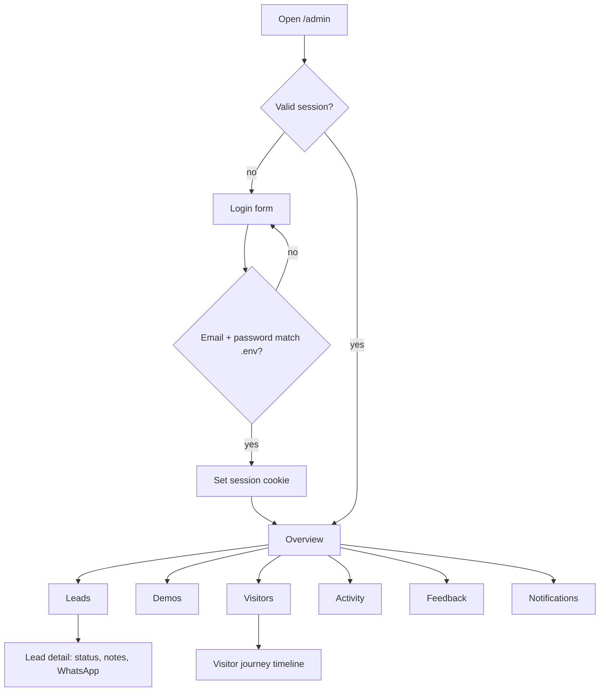

# Feature: Admin dashboard

Status: planned

## Purpose

A private dashboard for the owner to see how the project performs: visitors, leads, demo registrations and activity,
feedback, and notifications, to follow up with people and decide what to build next.

## Questions the dashboard must answer (marketing and improvement)

| Question | Where |
|---|---|
| **Who** uses the site? (country, device, language, source/campaign) | Overview, Visitors |
| **How many** visitors per day/week/month? | Overview |
| **How many created a demo account**, in which template? | Overview, Demos |
| **What do they do** in each template, and where do they stop? | Demos (funnel), Visitors (journey), Activity |
| Which marketing source brings leads? | Overview (sources → leads) |
| Which business fields are requested most? | Leads, Overview |

## Flow in plain words

1. The owner opens `/admin/login` and signs in with the email and password configured in `.env`.
2. A signed, httpOnly session cookie is created. All admin pages and admin APIs check it; without it → login.
3. Pages:
   - **Overview**: visitors (day/week/month), wizard conversion, registrations, WhatsApp clicks, top templates,
     sources, countries, devices, languages.
   - **Leads**: table with filters (type, field, status, date), lead details, status change, notes, WhatsApp button per lead.
   - **Demos**: per template: opened → registered → actions funnel, content edits, last activity.
   - **Visitors**: list of anonymous visitors (country, device, language, source, first/last seen, registered in which demos,
     lead yes/no). Opening one shows their **journey**: the timeline of their key events across the site and demos.
   - **Activity**: latest key events, filter by template and event.
   - **Feedback**: inbox, read/unread.
   - **Notifications**: full list (bell in the header everywhere).
4. Logout clears the session.

## User stories

See C1–C7 in `docs/02-flows.md`.

## Flow diagram



## Data

Reads from `wizard` (leads), `tracking` (visitors, events), `feedback`, `notifications`, and `gallery` (template names).
Writes: lead status/notes, feedback read flag, notification read flag. No admin model; credentials in `.env`.

## Files

```
src/features/admin/
  auth/           login, session check, logout
  components/     layout, sidebar, stat cards, charts, tables
  overview/
  leads/
  demos/
  visitors/
  activity/
  server-functions.ts   loginFn, logoutFn, admin queries/updates (each checks the session)
```

## Out of scope (v1)

- Multiple admins, roles, exports. Admin UI language: English first (open decision).
