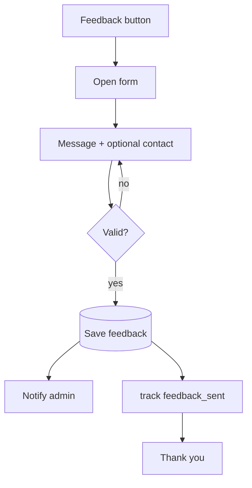
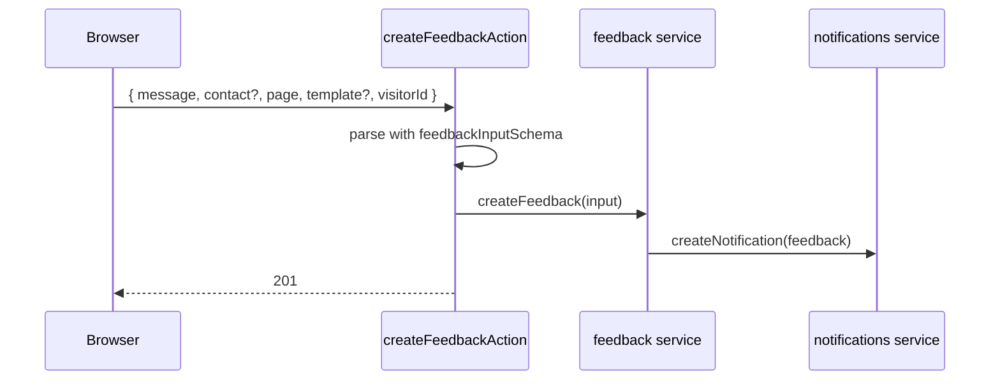

# Feature: Feedback

Status: planned

## Purpose

Let any visitor send a message or comment from any page, so the admin hears directly from them.
(Project requests go through the wizard or WhatsApp.)

## Flow in plain words

1. A floating **Feedback** button is on every page (main site, template sites, template dashboards).
2. It opens a small form: message (required), contact (optional, if they want a reply).
3. The page and template are attached automatically.
4. Submit → saved → admin notified → "Thank you" message.

## User stories

| # | As a visitor I want to… | So that… |
|---|---|---|
| F1 | send a message from any page without leaving it | giving feedback is effortless |
| F2 | leave my contact only if I want a reply | I stay anonymous otherwise |

| # | As admin I want to… | So that… |
|---|---|---|
| F3 | read feedback in my dashboard and mark it read | I don't miss any |

## Flow diagram



## Sequence



## Data

MongoDB `Feedback` (see `docs/04-data-and-tracking.md`).

## Tests

| Level | Test | Protects |
|---|---|---|
| Unit | feedback schema: message required, contact optional | F1, F2 |
| Integration | `createFeedback` saves and creates a notification; mark read works | F3 |
| E2E | send feedback from a page without leaving it; admin sees it | F1, F3 |

## Files

```
src/features/feedback/
  components/     feedback-button, feedback-form
  model.ts
  repository.ts
  actions.ts  createFeedbackAction
  service.ts      createFeedback, listFeedback, markRead
  types.ts
```
