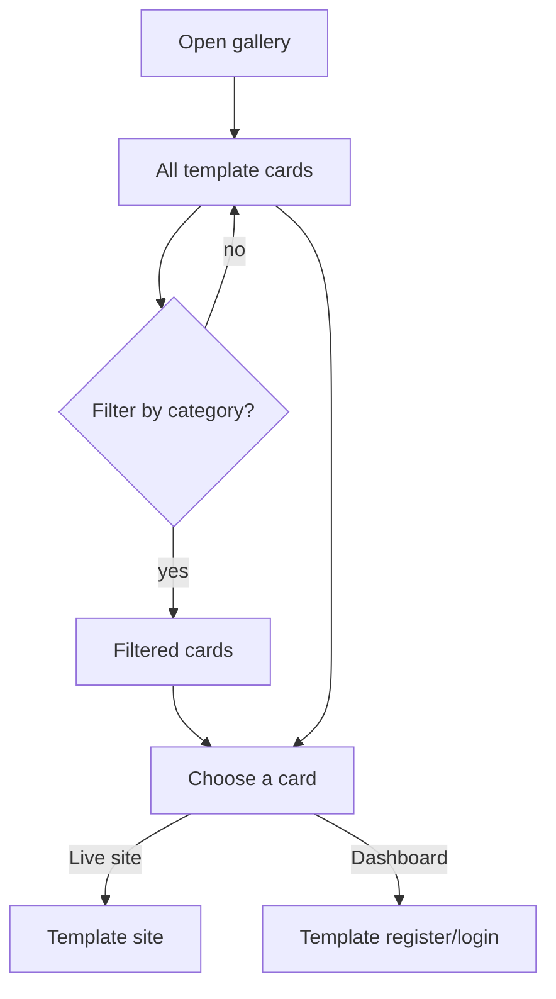

# Feature: Gallery

Status: planned

## Purpose

Show every demo template, open to everyone, so visitors find an example close to their business and open it.

## Flow in plain words

1. The visitor opens `/demos` (from the header, landing, or the wizard result).
2. They see demo cards grouped by business category. Each category shows its 2 variants: screenshot, name,
   kind of business, one-line value pitch (ar/en).
3. They filter by category.
4. A card opens the template's live site. A second button opens its dashboard directly.

## User stories

| # | As a visitor I want to… | So that… |
|---|---|---|
| G1 | see all demos without signing up | I explore freely |
| G2 | filter by my business category | I find relevant examples fast |
| G3 | understand each template's value from its card | I choose which to open |

## Flow diagram



## Data

No database. Two static lists:
- `categories.ts`: category slug, name ar/en, order. Also used by the wizard.
- `catalog.ts`: every variant's `meta.ts` (slug, category, variant, name ar/en, pitch ar/en, screenshot).
Adding a variant = adding its `meta` to the catalog. A category with no variants yet is hidden in the gallery.

## Files

```
src/features/gallery/
  components/     demo-card, category-filter, gallery-grid
  categories.ts   category list (slug, ar, en)
  catalog.ts      list of variant metas; getDemosByCategory(category)
  types.ts        templateMetaSchema
```

## Out of scope

- Search, ratings, prices.
