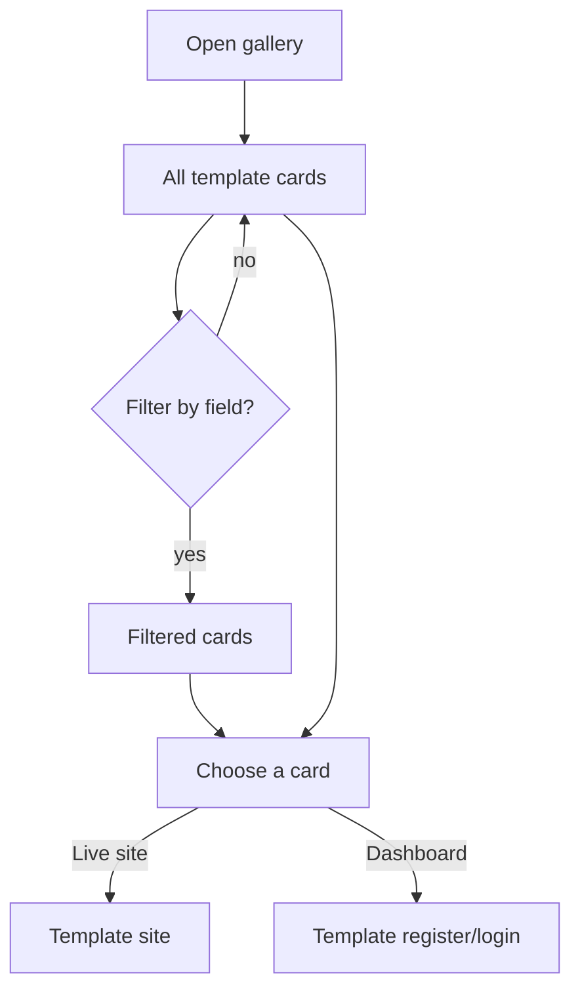

# Feature: Gallery

Status: planned

## Purpose

Show every demo template, open to everyone, so visitors find an example close to their business and open it.

## Flow in plain words

1. The visitor opens `/demos` (from the header, landing, or the wizard result).
2. They see template cards: screenshot, name, business field, one-line value pitch (ar/en).
3. They filter by business field.
4. A card opens the template's live site. A second button opens its dashboard directly.

## User stories

| # | As a visitor I want to… | So that… |
|---|---|---|
| G1 | see all demos without signing up | I explore freely |
| G2 | filter by my business field | I find relevant examples fast |
| G3 | understand each template's value from its card | I choose which to open |

## Flow diagram



## Data

No database. The catalog is a static list built from each template's `meta.ts`
(slug, field, name ar/en, pitch ar/en, screenshot). Adding a template = adding its `meta` to the catalog.

## Files

```
src/features/gallery/
  components/     template-card, field-filter, gallery-grid
  catalog.ts      list of template metas; getTemplatesByField(field)
  types.ts        templateMetaSchema
```

## Out of scope

- Search, ratings, prices.
