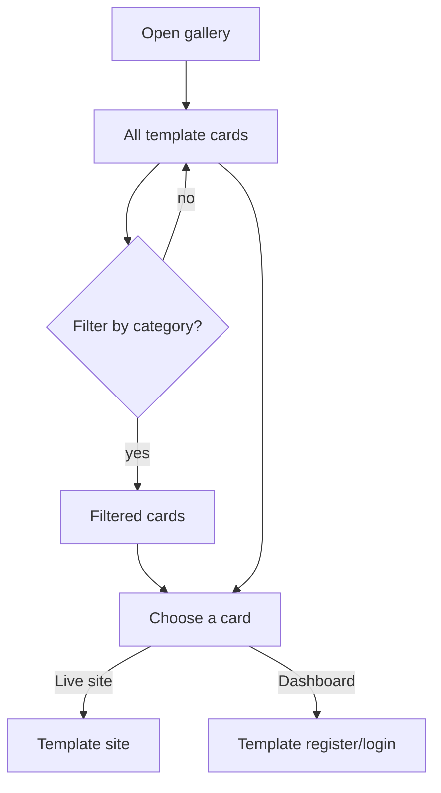

# Feature: Gallery

Status: built (page, filter, grouping). Restaurant demos are added to the catalog later.

## Purpose

Show every demo template, open to everyone, so visitors find an example close to their business and open it.

## Flow in plain words

1. The visitor opens `/demos` (from the header, landing, or the wizard result).
2. They see demo cards grouped by business category. Each category shows its 2 variants: screenshot, name,
   kind of business, one-line value pitch (ar/en).
3. They filter by category.
4. A card opens the template's live site. A second button opens its dashboard directly.

## User stories

| # | As a visitor I want to… | So that… |
|---|---|---|
| G1 | see all demos without signing up | I explore freely |
| G2 | filter by my business category | I find relevant examples fast |
| G3 | understand each template's value from its card | I choose which to open |

## Flow diagram



## Data

No database. Two static lists:
- `categories.ts`: category slug, name ar/en, order. Also used by the wizard.
- `catalog.ts`: every variant's `meta.ts` (slug, category, variant, name ar/en, pitch ar/en, screenshot).
Adding a variant = adding its `meta` to the catalog. A category with no variants yet is hidden in the gallery.

## Gallery screenshots

Each card shows a real screenshot of the demo's **source design** in `theme-sources/`, saved as `public/demos/<slug>.jpg`.
The medical centre has no source design: its card is a screenshot of our own built demo (`/en/demos/clinic/medical-centre`).

| Slug | Source design |
|---|---|
| restaurant-fine-dining | `theme-sources/03-verdant-table.html` |
| restaurant-fast-food | `theme-sources/06-sole-trattoria.html` |
| real-estate-agency | `theme-sources/02-hartwell-realty.html` |
| real-estate-developer | `theme-sources/01-solenne-estates.html` |
| clinic-specialist | `theme-sources/02-dr-adrian-vale.html` |
| logistics-freight | `theme-sources/01-orbis-cargo.html` |
| logistics-warehousing | `theme-sources/03-stackwell-3pl.html` |

Run `npm run screenshots:demos` after a source design changes.
Rows with a `url` (the medical centre, which has no source design) are captured from our built demo when `SCREENSHOT_BASE_URL` points to a running production server (e.g. `http://localhost:3000`); otherwise they are skipped.

## Tests

| Level | Test | Protects |
|---|---|---|
| Contract | every catalog entry valid; categories without variants hidden | G1, G3 |
| Unit | `getDemosByCategory` returns both variants of a category | G2 |
| E2E | filter by category; card opens the site (in a new tab) and the dashboard | G1–G3 |

## Files

```
src/features/gallery/
  components/     gallery-page, gallery-filter (client), demo-card
  messages/       ar.json, en.json
  categories.ts   category list (slug, ar, en)
  catalog.ts      list of variant metas; getDemosByCategory(category)
  grouping.ts     groupDemosByCategory, filterByCategory (pure, take the catalog as a parameter)
  types.ts        templateMetaSchema
```

## Decision: filter

`/ar/demos` and `/en/demos` stay statically generated and render every category. A small client component
(`gallery-filter`) reads `?category=slug` with `useSearchParams` and narrows the list in the browser; the chips are
plain links. Without JavaScript the chips still load the page but show all categories. Chosen over a `searchParams`
page, which would make the whole route dynamic. An unknown or empty category shows the empty state (start the wizard + WhatsApp).

## Out of scope

- Search, ratings, prices.
