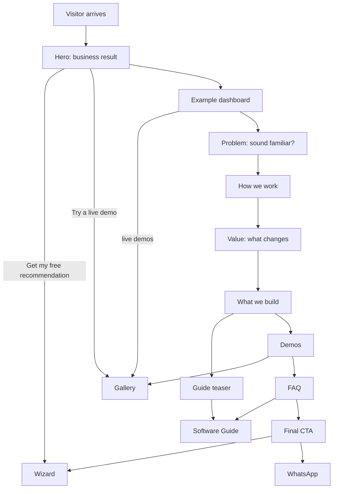

# Feature: Landing

Status: built (copy is a first version; the live demo cards arrive with the gallery)

## Purpose

Explain in a few seconds what the agency delivers and the **value it brings to a business**, and move the visitor
to the Software Guide, the wizard, or the demos.

## Flow in plain words

1. The visitor lands on `/ar` or `/en` (English by default; a remembered choice wins).
2. The hero states the business result we bring and offers two actions: **Get my free recommendation** (wizard) and
   **Try a live demo**.
3. Sections, in order:
   - **Hero**: eyebrow pill, huge light headline, one pill "Get my free recommendation" (with its arrow button, one link),
     a grey note line and a "Try a live demo" text link, over thin guide lines and large orbit arcs.
   - **Floating dashboard**: an example owner dashboard (sidebar, four KPI tiles, weekly bookings chart, latest activity, a
     WhatsApp-style new-booking toast) tilted in 3D and overlapping the bottom of the hero. It is an **example**: the
     caption under it says so and links to the live demos. The numbers are not company statistics.
   - **Industries row**: every demo category (from the gallery categories) with a line icon, linking to the gallery.
   - **Circle statement**: one big sentence inside a thin circle, with "What we do", "Real working demos", and "English / Arabic" badges.
   - **Problem** (two-tone heading): three everyday pains (missed calls, repeated questions, requests lost in chats), a
     grey paragraph and a link to "How we work".
   - **How we work** (id `how`): four numbered cards (brief, plan, build, launch).
   - **What changes (bento, id `value`)**: any hour, one dashboard, languages, you edit it, flow. The flow card shows the
     real number of live demos.
   - **What we build** (id `build`): website, website with dashboard, custom system or SaaS.
   - **Stats row**: live demos (real count from the catalog), 2 languages, business types covered (real count of
     categories that have a demo), 0 sign-ups needed. Computed by `landingStats()`.
   - **Guide teaser** and **Demos**: wide cards linking to the Software Guide and the gallery.
   - **Principle**: one quote and the brand name.
   - **FAQ** (native details/summary, works without JavaScript): price, time, updating, phone, which type, after launch.
   - **Final call to action**: a panel with arcs, wizard button, demos button and WhatsApp.
4. Header: logo, centred capsule nav (Home, How we work, What we build, Guide, Demos; the current page is an off-white pill), language switch, Start. Footer: site links, contact (Start, WhatsApp). Floating feedback and WhatsApp buttons.

## Look

Dark studio identity mirrored from `ui-for-this-project/`: near-black canvas, Inter Tight light headings in two tones,
JetBrains Mono small labels, off-white pill buttons, a teal accent and thin-border gradient cards. Rules: `.claude/rules/design.md`.

## User stories

| # | As a visitor I want to… | So that… |
|---|---|---|
| L1 | understand in one screen what this agency does for my business | I decide to stay |
| L2 | see the value of each kind of product, not a list of features | I connect it to my own problems |
| L3 | see how the agency works step by step | I trust the process |
| L4 | reach the wizard, the guide, or the demos from anywhere on the page | I act when I'm ready |
| L5 | recognise my own problem | I trust they understand my business |
| L6 | have my first questions (price, time, updating, phone, which type, after launch) answered on the page | I contact them without doubts |
| L7 | see an example dashboard and know it is only an example | I understand what I would get without being misled |
| L8 | see real numbers about the demos | I trust that nothing is invented |

## Flow diagram



## Data

None stored. `page_view` and `whatsapp_clicked` are tracked. Text in message files (ar/en). Highlighted demos and the stats come from the gallery catalog.

## Tests

| Level | Test | Protects |
|---|---|---|
| E2E | ar and en render, `dir` correct, CTAs reach wizard, guide, demos, WhatsApp | L1–L4 |
| E2E | the problem heading appears before the value heading | L5 |
| E2E | the closed FAQ answer is hidden, then the price question opens it | L6 |
| E2E | L7: the dashboard preview is labelled as an example and links to the live demos (ar + en) | L7 |
| E2E | L8: the stats show the real number of live demos | L8 |
| Unit | L8: `landingStats` counts only real demos and distinct categories | L8 |
| E2E | axe: no serious accessibility issues; title, description, hreflang present | quality, SEO |

## Files

```
src/features/landing/
  components/      landing-page, hero, dashboard-preview, industries, statement, problem, how-we-work, value, deliver,
                   stats, guide-teaser, demo-highlights, principle, faq, final-cta, section, icons
  stats.ts         landingStats(demos): real demo and category counts

src/features/site-shell/   header (nav, mobile menu, language switch), footer (WhatsApp), skip link
```

## Out of scope

- Pricing, client portfolio, testimonials (may be added later).
