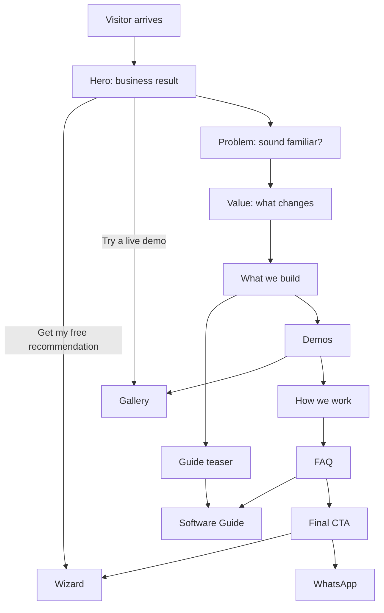

# Feature: Landing

Status: built (copy is a first version; the live demo cards arrive with the gallery)

## Purpose

Explain in a few seconds what the agency delivers and the **value it brings to a business**, and move the visitor
to the Software Guide, the wizard, or the demos.

## Flow in plain words

1. The visitor lands on `/ar` or `/en` (English by default; a remembered choice wins).
2. The hero states the business result we bring and offers two actions: **Get my free recommendation** (wizard) and
   **Try a live demo**.
3. Sections, in order:
   - **Hero**: badge, two-line headline whose last words sit in a green box with a blinking cursor, subtitle, green
     "Get my free recommendation" and white "Try a live demo" buttons, a caption, then three tilted sample-dashboard
     cards telling one story (what arrived overnight, bookings taken while closed, what happened automatically in
     seconds; only the centre one on phones) and green arcs at the bottom corner.
   - **Problem**: "Sound familiar?" three everyday pains (missed calls, repeated questions, requests lost in chats)
     and one line saying a website that works for you solves all three.
   - **What changes (bento)**: customers at any hour (three icon tiles), your day comes back (notification rows), chosen
     over your competitor (green donut), your whole day on one screen (weekday bar chart), every customer in their own
     language (orbit illustration), nothing to copy by hand (node diagram).
   - **What we build**: website, website with dashboard, custom system or SaaS; icon tile, green value line, grey text.
   - **Guide teaser**: one wide glass card linking to the Software Guide.
   - **Demos**: one wide glass card inviting the visitor to try the live demos.
   - **How it works**: a 2x2 grid of glass cards, each with a small green line illustration.
   - **FAQ**: the questions owners ask first (price, time, updating, phone, which type, after launch), each answer in a
     native details/summary so it works without JavaScript.
   - **Final call to action**: a glass card with green glow, wizard button and WhatsApp.
4. Header: logo/brand name, links (Guide, Demos, Start), language switch. Floating feedback and WhatsApp buttons.

## Look

The public site uses the BOCHKE identity: pure black background, dark-green glass cards (1px border, soft green glow in
one corner), white headings with an italic serif accent word (bold upright in Arabic), grey body text and emerald green
`#22c55e` accents. Primary buttons are small green rounded rectangles with an arrow; secondary buttons are white. The hero
has soft green light rays falling from the top and concentric green arcs below. Reference:
[`docs/design-references/bochke-ui.png`](../design-references/bochke-ui.png).

## User stories

| # | As a visitor I want to… | So that… |
|---|---|---|
| L1 | understand in one screen what this agency does for my business | I decide to stay |
| L2 | see the value of each kind of product, not a list of features | I connect it to my own problems |
| L3 | see how the agency works step by step | I trust the process |
| L4 | reach the wizard, the guide, or the demos from anywhere on the page | I act when I'm ready |
| L5 | recognise my own problem | I trust they understand my business |
| L6 | have my first questions (price, time, updating, phone, which type, after launch) answered on the page | I contact them without doubts |

## Flow diagram



## Data

None stored. `page_view` and `whatsapp_clicked` are tracked. Text in message files (ar/en). Highlighted demos come from the gallery catalog.

## Tests

| Level | Test | Protects |
|---|---|---|
| E2E | ar and en render, `dir` correct, CTAs reach wizard, guide, demos, WhatsApp | L1–L4 |
| E2E | the problem heading appears before the value heading | L5 |
| E2E | the closed FAQ answer is hidden, then the price question opens it | L6 |
| E2E | axe: no serious accessibility issues; title, description, hreflang present | quality, SEO |

## Files

```
src/features/landing/
  components/      landing-page, hero, hero-previews, problem, value, deliver, guide-teaser,
                   demo-highlights, how-we-work, faq, final-cta, section
  messages/        ar.json, en.json

src/features/site-shell/   header (nav, mobile menu, language switch), footer (WhatsApp), skip link
```

## Out of scope

- Pricing, client portfolio, testimonials (may be added later).
