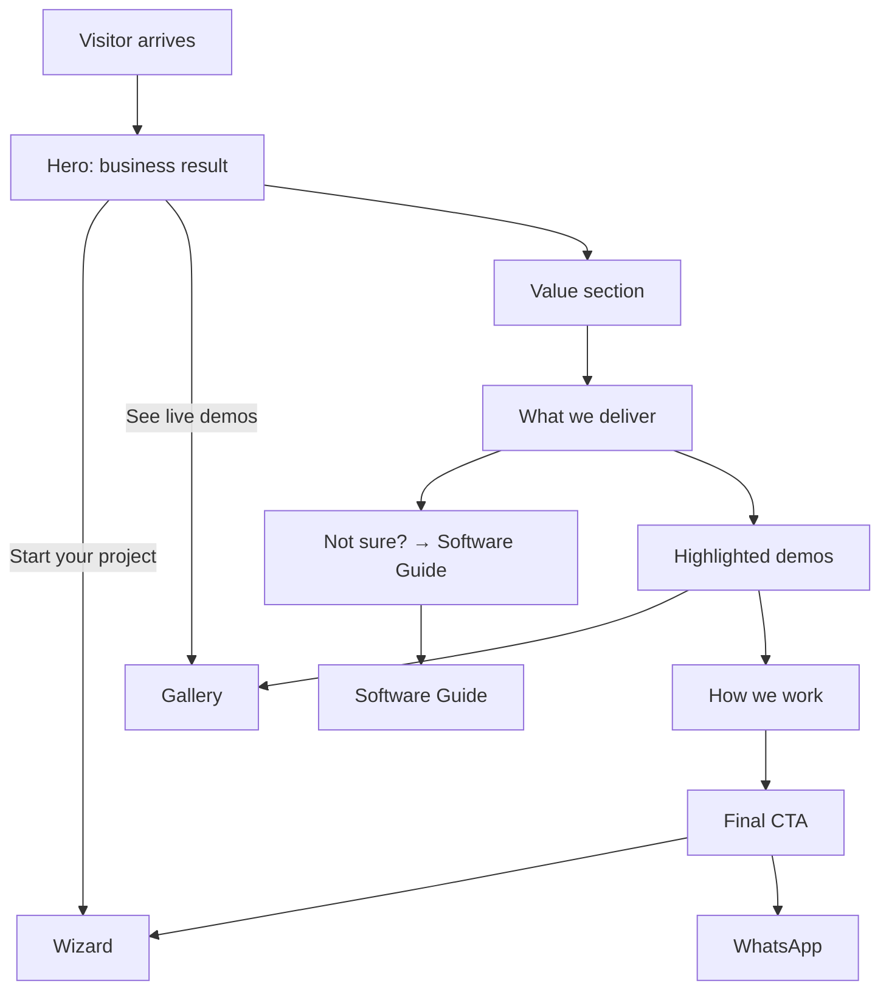

# Feature: Landing

Status: planned (content to be written with the brand)

## Purpose

Explain in a few seconds what the agency delivers and the **value it brings to a business**, and move the visitor
to the Software Guide, the wizard, or the demos.

## Flow in plain words

1. The visitor lands on `/ar` or `/en` (browser language, Arabic fallback).
2. The hero states the business result we bring and offers two actions: **Start your project** (wizard) and **See live demos**.
3. Sections, in order:
   - **The value**: what a good website or system changes for a business (customers, time, trust, sales).
   - **What we deliver**: profile websites, functional websites with dashboards, SaaS / custom systems, each told as value.
   - **Not sure what you need?** short teaser linking to the Software Guide.
   - **Live demos**: a few highlighted templates from the gallery.
   - **How we work**: simple steps from first message to launch.
   - **Final call to action**: wizard + WhatsApp.
4. Header: logo/brand name, links (Guide, Demos, Start), language switch. Floating feedback and WhatsApp buttons.

## User stories

| # | As a visitor I want to… | So that… |
|---|---|---|
| L1 | understand in one screen what this agency does for my business | I decide to stay |
| L2 | see the value of each kind of product, not a list of features | I connect it to my own problems |
| L3 | see how the agency works step by step | I trust the process |
| L4 | reach the wizard, the guide, or the demos from anywhere on the page | I act when I'm ready |

## Flow diagram



## Data

None stored. `page_view` and `whatsapp_clicked` are tracked. Text in message files (ar/en). Highlighted demos come from the gallery catalog.

## Files

```
src/features/landing/
  components/      hero, value, deliver, guide-teaser, demo-highlights, how-we-work, final-cta
```

## Out of scope

- Pricing, client portfolio, testimonials (may be added later).
