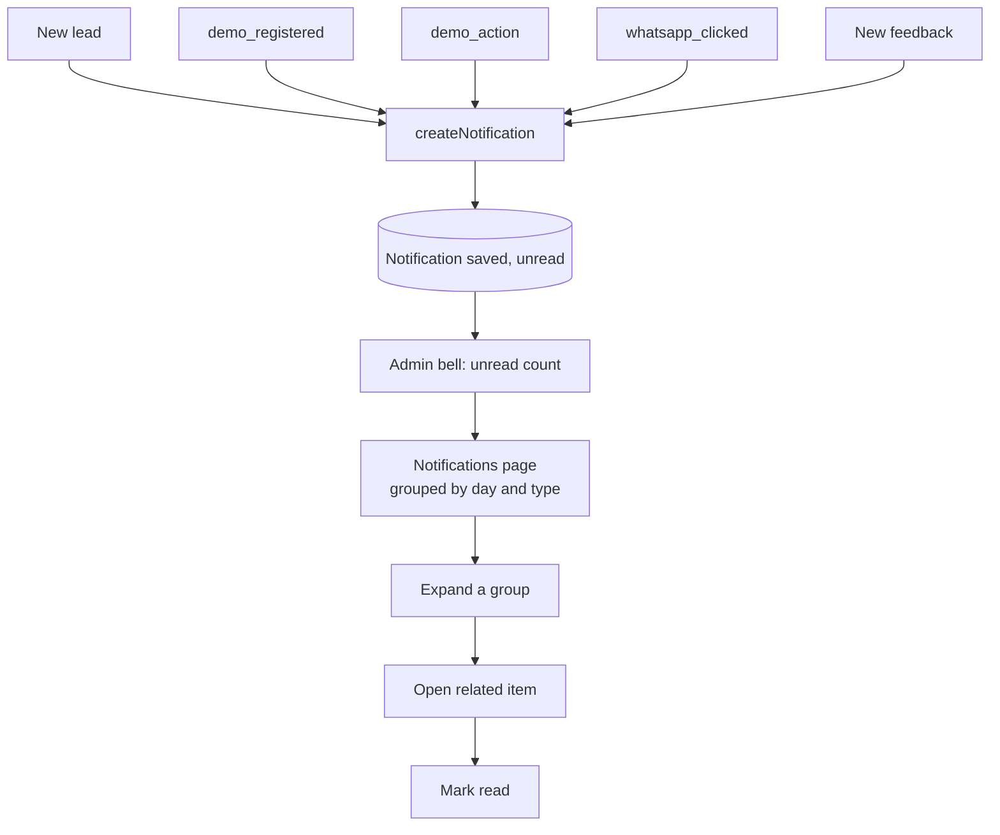

# Feature: Notifications

Status: planned

## Purpose

Tell the admin, inside the admin dashboard, when something important happens: a new lead, a demo registration,
a demo action, a WhatsApp click, new feedback.

## Flow in plain words

1. Other features call `createNotification({ type, title, template?, link? })` from their services.
2. The admin header shows a bell with the unread count (refreshed periodically while the dashboard is open).
3. Each notification is saved on its own. The list **groups them when showing**: by day, then by type with a count
   (e.g. "Today · New registrations (30)"). A group expands to show each item; clicking one opens the related item and marks it read.
4. "Mark all as read" clears the count.

## User stories

| # | As admin I want to… | So that… |
|---|---|---|
| N1 | see an unread count on every admin page | I know something happened |
| N2 | open a notification and go to its lead/feedback/template stats | I act on it in one click |
| N3 | mark all as read | I keep the list clean |

## Flow diagram



## Data

MongoDB `Notification` (see `docs/04-data-and-tracking.md`).

## Tests

| Level | Test | Protects |
|---|---|---|
| Integration | grouping by day and type returns the right counts; unread count | N1 |
| Integration | mark all as read | N3 |
| E2E | opening a notification goes to the related item | N2 |

## Files

```
src/features/notifications/
  components/     bell, notification-list
  model.ts
  repository.ts
  service.ts      createNotification, listNotifications, countUnread, markRead, markAllRead
  types.ts
```

## Out of scope (v1)

- Email, Telegram, or push notifications.
