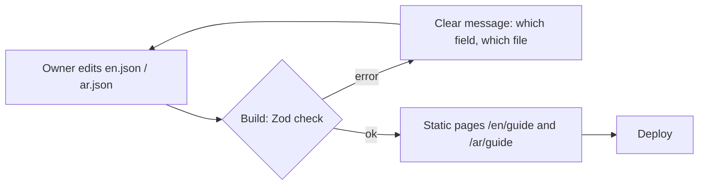
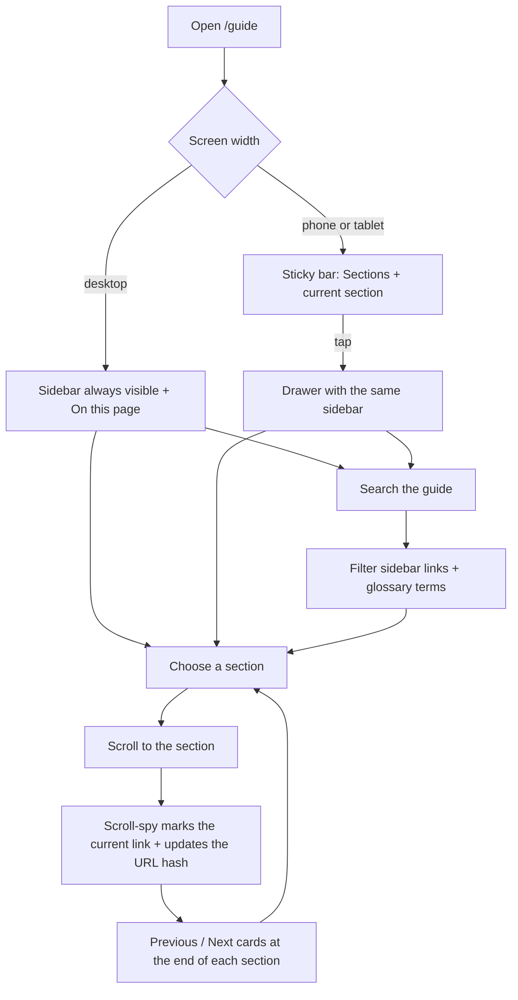
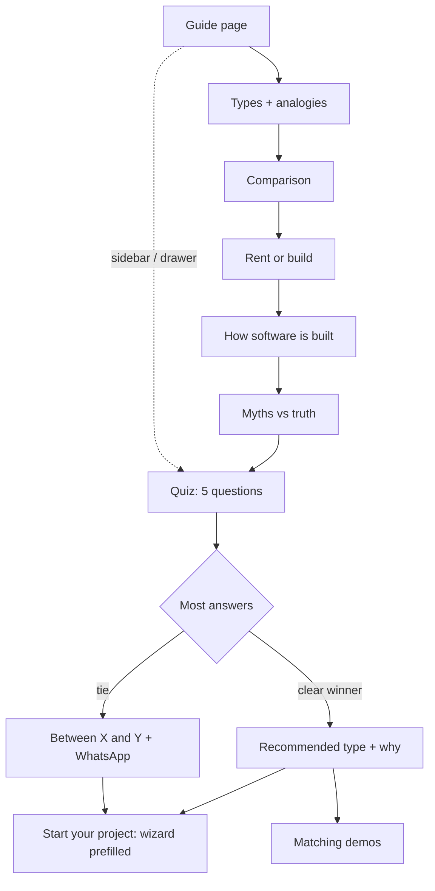

# Feature: Software Guide

Status: built (page at `/[locale]/guide`, statically generated); content from `docs/content/software-guide.md`

## Purpose

Many customers don't know the difference between kinds of software. They ask for "a website" when they need bookings,
or for "a SaaS" when they need a system for their own team. This page explains, for non-technical visitors,
**what each type is, how they differ, how software is built, and which one fits them**, then leads into the wizard.

## Design principle: content is separate from code

The owner must be able to change the text without touching components.

- All text lives in two content files: `src/features/software-guide/content/en.json` and `ar.json`.
- Both files have the **same structure** (same keys and item ids). Only the text differs.
- Components contain **no text**: they only render what the content file says.
- Lists are data: adding a misconception, a glossary term, a quiz question, or a fact = adding an item to a list.
  No code change.
- A Zod schema (`types.ts`) validates both files at build time. A missing field, a typo in a key,
  or an `ar` file that doesn't match `en` fails the build with a clear message, so a broken page is never published.
- The page is statically generated, so after editing a content file the site is rebuilt and redeployed (one command).



### How to edit (for the owner)

| I want to… | Do this |
|---|---|
| Change a sentence | Edit the text in `en.json` and the same key in `ar.json` |
| Add a myth / glossary term / fact | Copy an existing item in the list, give it a new `id`, change the text (both files) |
| Remove an item | Delete it from both files |
| Change the order | Move the items in the list (both files) |
| Change a quiz question | Edit its text and options; each option keeps a `type` (`profile`, `functional`, `system`, `saas`) |

## Page sections

| # | Section | Goal |
|---|---|---|
| 1 | Overview (hero) | Promise: "Know what you need before you pay for it", the four groups of the guide, reading time |
| 2 | Why it matters | Short, general facts on how customers look for businesses today (no exact numbers) |
| 3 | The four types | Profile website · Functional website + dashboard · Custom business system · SaaS product, each with a plain-language analogy (a shop) |
| 4 | Comparison table | Side-by-side: goal, who uses it, examples, effort, ongoing care |
| 5 | Rent or build? | Ready-made tools (rented subscription) vs custom (owned): when each makes sense |
| 6 | How software is built | Front, dashboard, server, database, domain & hosting, ongoing care, explained as parts of a shop |
| 7 | Myths vs truth | Common misconceptions and the truth |
| 8 | Which one fits me? | 5-question quiz → recommendation |
| 9 | Glossary | Simple definitions of words customers hear (domain, hosting, SEO…) |
| - | Call to action (closing block, not in the menu) | Start your project (wizard) · See live demos · WhatsApp |

## Layout: a documentation page

The guide reads like product docs (calm, always clear where you are and what comes next).

- **Desktop (1024px and up):** three columns inside a 7xl container: a sticky **sidebar** (260px, on the start side, so on the
  right in Arabic), the **reading column** (about 720px), and, from 1280px, **On this page** (220px, sticky).
- **Tablet and phone:** no side columns. A sticky bar under the site header shows "Sections · <current section>"; it opens
  the same sidebar as a **drawer** from the start side. The reading progress bar sits at the bottom edge of that bar.
- **Sidebar groups** (one level of sub-links, shown only under the section being read):

| Group | Links |
|---|---|
| Start here | Overview (`overview`), Why this matters (`why`) |
| Understand | The four types (`types`; sub-links `profile`, `functional`, `system`, `saas`), Comparison (`compare`), How it is built (`how-built`) |
| Decide | Rent or build (`rent-or-build`), Myths (`myths`), Find what fits me (`quiz`) |
| Reference | Glossary (`glossary`) |

- **One ordered list** (`guide-nav.ts`, built from `menu.groups` in the content files) drives the sidebar, the previous/next
  cards, the drawer and the scroll-spy, so the page order and the menu order cannot drift apart.
- **Each section:** group name (green eyebrow), H2, short lead, an optional **In short** callout (`summary`: types, comparison,
  rent or build, myths), the content, and **Previous / Next** cards (stacked on phones; arrows flip in Arabic).
- **Myths** are an accordion (`details`), the **glossary** is a definition list with an anchor per term, the comparison table
  scrolls inside its own box with a sticky first column.
- **Reading time** on the overview is computed from the real word count of the content (200 words per minute), never typed by hand.

### Navigation behaviour

- **Scroll-spy:** the section crossing the band 20%-30% below the top of the screen is "current". The sidebar link gets
  `aria-current="location"` and the URL hash follows the reading position without scrolling.
- **Search the guide:** typing filters the sidebar links and the glossary terms (case-insensitive, Arabic diacritics and tatweel
  ignored, alef and ya spellings treated alike). Matching glossary terms also appear in the sidebar and jump to the term.
  "No matching section" shows when nothing matches.
- **Drawer (phone):** a dialog with focus trap; Esc or Close shuts it and returns focus to the button; page scroll is locked
  while open; choosing a link closes it and scrolls. Smooth scrolling is used only when reduced motion is not requested.



## Flow in plain words

1. The visitor opens the guide from the landing page, the header, or the wizard ("Not sure? Read the guide").
2. They read from the top, or jump to any section from the sidebar (on a phone, from the sections drawer), search for a word,
   and move on with the Previous / Next cards.
3. They take the quiz: 5 questions, each answer points to a type.
4. The result shows the recommended type, why, and what they would get, with two buttons:
   **Start your project** (wizard with the type prefilled) and **See matching demos**.
5. Every section ends with a small link to the quiz or the wizard, so they can act at any point.

## Quiz logic (simple)

- Each answer option has a `type`. The type with the most answers wins.
- Tie → the simpler type wins (profile < functional < system < saas), and the result says
  "You're between X and Y. Let's talk to choose the best one" with the WhatsApp button.
- The result maps to the wizard: `profile`/`functional` → **Business website**, `system` → **Custom system for my business**, `saas` → **SaaS product**.
- Nothing is saved; the quiz runs in the browser. `guide_quiz_completed` with the result type is tracked.



## User stories

| # | As a visitor I want to… | So that… |
|---|---|---|
| SG1 | understand the types of software in simple words and examples | I know what I'm asking for |
| SG2 | compare them side by side | I see the trade-offs quickly |
| SG3 | understand how software is built without technical words | I can talk with the agency confidently |
| SG4 | learn the common myths | I avoid costly mistakes |
| SG5 | answer a few questions and get a recommendation | I don't have to decide alone |
| SG6 | go from the recommendation straight to the wizard or demos | I act while I'm convinced |
| SG7 | see all the guide sections in a sidebar and which one I am reading | I never feel lost in a long page |
| SG8 | open the same sections list as a drawer on my phone | I can jump around without scrolling back up |
| SG9 | use Previous / Next at the end of each section | I read the guide in the right order |
| SG10 | search the guide and its glossary | I find a word or topic quickly |

| # | As the owner I want to… | So that… |
|---|---|---|
| SG11 | edit all the text in two content files | I update the guide without code work |
| SG12 | have the build catch mistakes in the content files | a broken page is never published |

## Data

No database. Content in `content/en.json` and `content/ar.json`. Tracking: `page_view`, `guide_quiz_completed`.

## Tests

| Level | Test | Protects |
|---|---|---|
| Contract | `en.json` and `ar.json` parse with the schema and have the same keys and ids; every sidebar link points to a rendered section | SG7, SG11, SG12 |
| Unit | `guide-nav.ts`: section order, groups and sub-links, previous/next (first has no previous, last has no next), search in English and Arabic, no match | SG7, SG9, SG10 |
| Unit | `reading-time.ts`: reading time follows the real word count | SG7 |
| Unit | `pickRecommendation`: most answers wins; tie → simpler type; maps to the wizard type | SG5 |
| E2E | quiz → result → wizard opens with the type prefilled | SG5, SG6 |
| E2E | SG7: sidebar lists sections and marks the one in view (desktop, ar + en) | SG7 |
| E2E | SG8: phone drawer opens, Esc closes it, a link moves to the section and closes it, no sideways scroll (ar + en) | SG8 |
| E2E | SG9: Next from the types goes to the comparison, Previous comes back (ar + en) | SG9 |
| E2E | SG10: search filters sidebar links and glossary terms; no-match message (ar + en) | SG10 |

## Files

```
src/features/software-guide/
  content/
    en.json
    ar.json
  components/     guide-page (server: lays out the grid), guide-hero, guide-section (section frame + pager),
                  section-pager, guide-callout, guide-facts, type-cards, comparison-table, rent-or-build,
                  how-its-built, myths, guide-cta, quiz-link
                  client: guide-sidebar, guide-nav-panel (search + groups), guide-mobile-nav (drawer),
                  on-this-page, reading-progress, quiz, glossary (filters by the search text)
  hooks/          use-active-section (scroll-spy), use-guide-search (search text shared by sidebar and glossary)
  guide-nav.ts    buildGuideNav, prevNext, filterGuideNav, normalizeSearch (pure)
  reading-time.ts readingMinutes(content) (pure)
  guide-content.ts  parses both content files with the schema
  quiz.ts         pickRecommendation(answers) (pure function, tie rule), fillPlaceholders
  quiz.test.ts, guide-content.test.ts, guide-nav.test.ts
  types.ts        guideContentSchema (Zod) + inferred types
src/app/[locale]/(site)/guide/page.tsx   thin route (locale check, metadata, render)
e2e/software-guide.spec.ts
```

## Decisions

- ✅ The wizard has the same four types as the guide (custom system added).
- ✅ `guide_quiz_completed` is tracked with the result type.
- ✅ Facts are general, without exact numbers. An exact figure is added later only after checking the original report.

## Open questions

None. Content draft ready for the owner's review: `docs/content/software-guide.md`.
