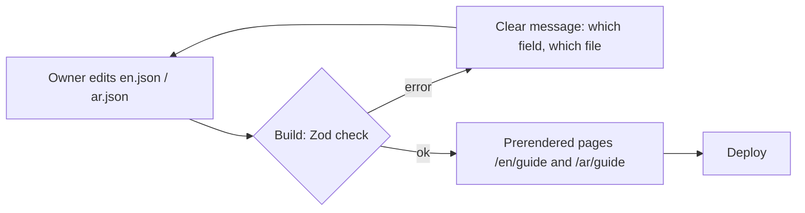
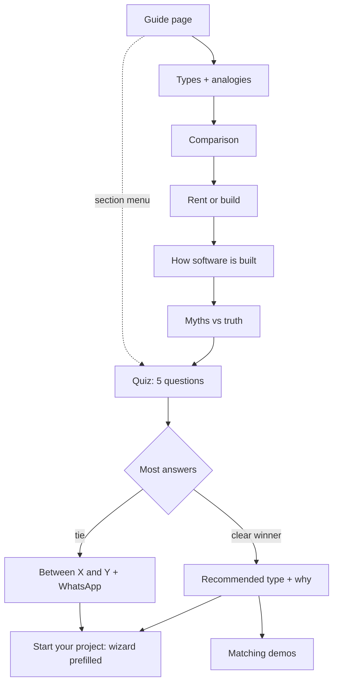

# Feature: Software Guide

Status: planned, decisions closed (draft content ready for review: `docs/content/software-guide.md`)

## Purpose

Many customers don't know the difference between kinds of software. They ask for "a website" when they need bookings,
or for "a SaaS" when they need a system for their own team. This page explains, for non-technical visitors,
**what each type is, how they differ, how software is built, and which one fits them**, then leads into the wizard.

## Design principle: content is separate from code

The owner must be able to change the text without touching components.

- All text lives in two content files: `src/features/software-guide/content/en.json` and `ar.json`.
- Both files have the **same structure** (same keys and item ids). Only the text differs.
- Components contain **no text**: they only render what the content file says.
- Lists are data: adding a misconception, a glossary term, a quiz question, or a fact = adding an item to a list.
  No code change.
- A Zod schema (`types.ts`) validates both files at build time. A missing field, a typo in a key,
  or an `ar` file that doesn't match `en` fails the build with a clear message, so a broken page is never published.
- The page is prerendered, so after editing a content file the site is rebuilt and redeployed (one command).



### How to edit (for the owner)

| I want to… | Do this |
|---|---|
| Change a sentence | Edit the text in `en.json` and the same key in `ar.json` |
| Add a myth / glossary term / fact | Copy an existing item in the list, give it a new `id`, change the text (both files) |
| Remove an item | Delete it from both files |
| Change the order | Move the items in the list (both files) |
| Change a quiz question | Edit its text and options; each option keeps a `type` (`profile`, `functional`, `system`, `saas`) |

## Page sections

| # | Section | Goal |
|---|---|---|
| 1 | Hero | Promise: "Know what you need before you pay for it" |
| 2 | Why it matters | Short, general facts on how customers look for businesses today (no exact numbers) |
| 3 | The four types | Profile website · Functional website + dashboard · Custom business system · SaaS product, each with a plain-language analogy (a shop) |
| 4 | Comparison table | Side-by-side: goal, who uses it, examples, effort, ongoing care |
| 5 | Rent or build? | Ready-made tools (rented subscription) vs custom (owned): when each makes sense |
| 6 | How software is built | Front, dashboard, server, database, domain & hosting, ongoing care, explained as parts of a shop |
| 7 | Myths vs truth | Common misconceptions and the truth |
| 8 | Which one fits me? | 5-question quiz → recommendation |
| 9 | Glossary | Simple definitions of words customers hear (domain, hosting, SEO…) |
| 10 | Call to action | Start your project (wizard) · See live demos · WhatsApp |

## Flow in plain words

1. The visitor opens the guide from the landing page, the header, or the wizard ("Not sure? Read the guide").
2. They scroll through the types with analogies and the comparison table, or jump with a small section menu.
3. They take the quiz: 5 questions, each answer points to a type.
4. The result shows the recommended type, why, and what they would get, with two buttons:
   **Start your project** (wizard with the type prefilled) and **See matching demos**.
5. Every section ends with a small link to the quiz or the wizard, so they can act at any point.

## Quiz logic (simple)

- Each answer option has a `type`. The type with the most answers wins.
- Tie → the simpler type wins (profile < functional < system < saas), and the result says
  "You're between X and Y. Let's talk to choose the best one" with the WhatsApp button.
- The result maps to the wizard: `profile`/`functional` → **Business website**, `system` → **Custom system for my business**, `saas` → **SaaS product**.
- Nothing is saved; the quiz runs in the browser. `guide_quiz_completed` with the result type is tracked.



## User stories

| # | As a visitor I want to… | So that… |
|---|---|---|
| SG1 | understand the types of software in simple words and examples | I know what I'm asking for |
| SG2 | compare them side by side | I see the trade-offs quickly |
| SG3 | understand how software is built without technical words | I can talk with the agency confidently |
| SG4 | learn the common myths | I avoid costly mistakes |
| SG5 | answer a few questions and get a recommendation | I don't have to decide alone |
| SG6 | go from the recommendation straight to the wizard or demos | I act while I'm convinced |

| # | As the owner I want to… | So that… |
|---|---|---|
| SG7 | edit all the text in two content files | I update the guide without code work |
| SG8 | have the build catch mistakes in the content files | a broken page is never published |

## Data

No database. Content in `content/en.json` and `content/ar.json`. Tracking: `page_view`, `guide_quiz_completed`.

## Files

```
src/features/software-guide/
  content/
    en.json
    ar.json
  components/     hero, facts, type-cards, comparison-table, rent-or-build, how-its-built,
                  myths, quiz, glossary, guide-cta, section-menu
  quiz.ts         pickRecommendation(answers) (pure function, tie rule)
  types.ts        guideContentSchema (Zod) + inferred types
```

## Decisions

- ✅ The wizard has the same four types as the guide (custom system added).
- ✅ `guide_quiz_completed` is tracked with the result type.
- ✅ Facts are general, without exact numbers. An exact figure is added later only after checking the original report.

## Open questions

None. Content draft ready for the owner's review: `docs/content/software-guide.md`.
