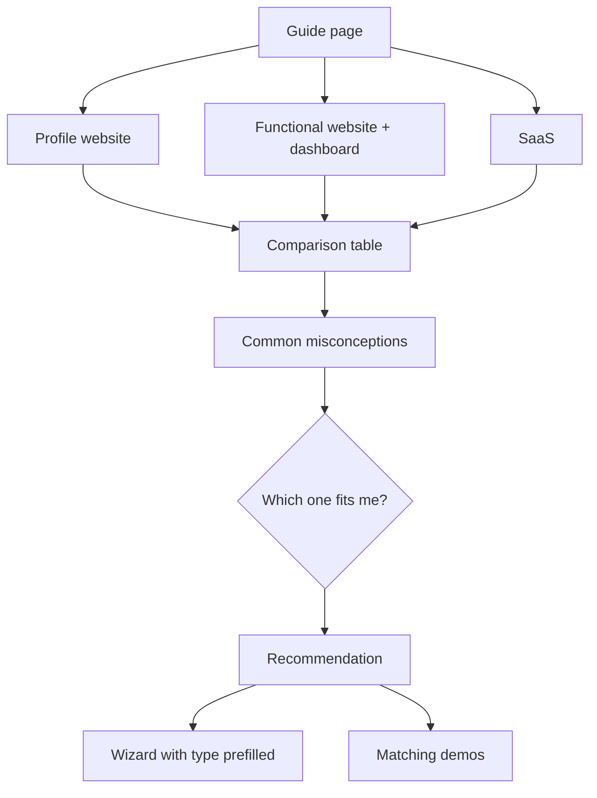

# Feature: Software Guide

Status: **to be planned in detail** (next planning step)

## Purpose

Many customers don't know the difference between kinds of software and ask for the wrong thing.
This section teaches them **what each type is, how they differ, and which one fits them**, so they understand
what they choose before they start fitting it to their needs. It leads into the wizard.

## Planned content (outline)

| Type | What it is | Example | Good for |
|---|---|---|---|
| Profile website | Presents the business: who we are, services, contact | Company or portfolio site | Trust, visibility, being found |
| Functional website + dashboard | A website that does work (bookings, orders, inquiries), managed from a dashboard | Restaurant with bookings, clinic with appointments | Saving time, running daily operations |
| SaaS | A software product many customers subscribe to and use | CRM, booking platform | Selling software itself as a business |

Also planned:
- How software is built (simply explained): front end, dashboard, server, data.
- Common misconceptions customers have.
- "Which one fits me?" questions → recommendation → wizard (prefilled type) or demos.

## Draft flow

## Data

None stored. `page_view` tracked.

## To decide in the detailed plan

- Final copy (ar/en), misconceptions list, the "which one fits me" questions.
- Visual explanations (diagrams/illustrations).
- Whether the result prefills the wizard.
