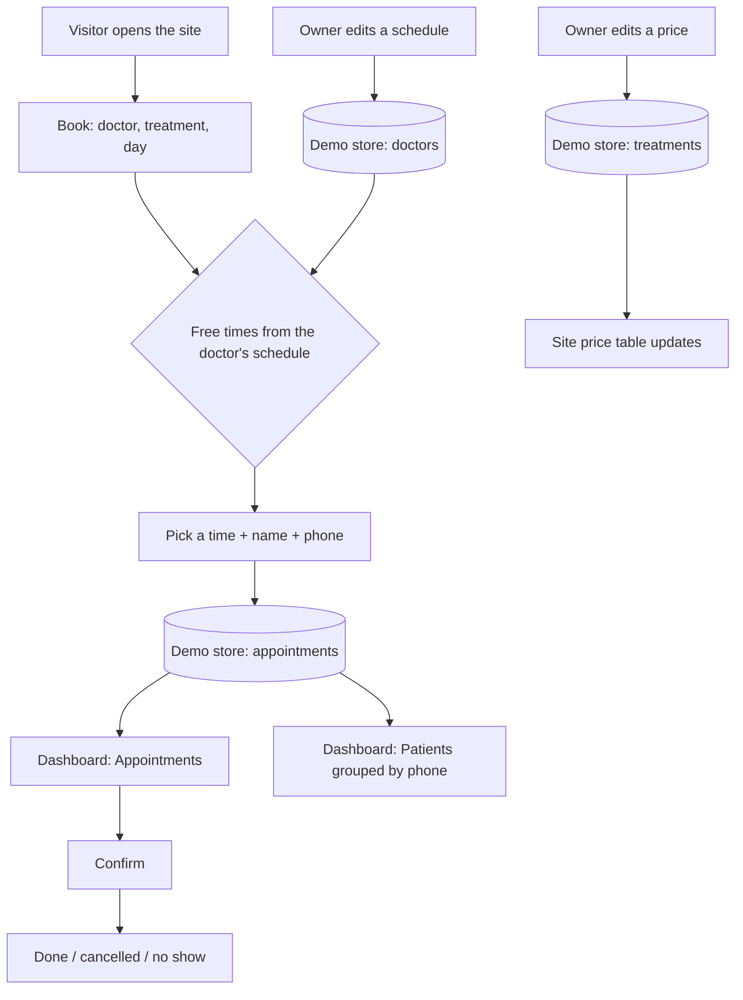
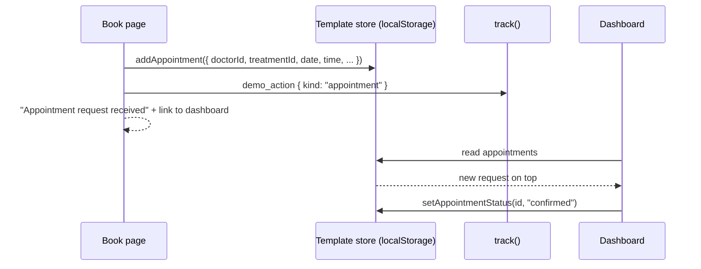

# Template category: Clinics

Status: **built** (shared layer, Variant A specialist, Variant B medical centre). Source: `theme-sources/02-dr-adrian-vale.html` (A, rebuilt as React + Tailwind); B uses the same visual language with a calmer accent (analysed in `docs/09-design-sources.md`).

Two complete clinic websites, each a different kind of business with its own content, sharing one dashboard.
Feature folder: `src/features/template-clinic/`.

| | Variant A: Specialist | Variant B: Medical centre |
|---|---|---|
| Slug | `clinic-specialist` | `clinic-medical-centre` |
| Business (seed) | **Dr. Rayan Al Harthi** · **د. ريان الحارثي**: dental implant and oral surgery specialist, Riyadh (Al Olaya) | **Noor Medical Centre** · **مركز نور الطبي**: multi-specialty centre, Jeddah (Al Rawdah), 6 doctors, 5 departments |
| Design | Dr. Vale: light grey, ink, lime; Onest + IBM Plex Sans Arabic | Same language, calmer teal accent; Onest + IBM Plex Sans Arabic |
| Main value | Turn high-value implant enquiries into booked consultations, even at midnight | Let patients choose the doctor and a real free slot instead of calling reception |
| Main closed loop | Appointment request → Appointments | Appointment with a specific doctor and slot → Appointments (filter by doctor) |
| Second loop | Owner edits a treatment price → the site price table changes | Owner edits a doctor's weekly schedule → the free slots change; price edit → site |

---

## 1. Business profiles

### A. Dr. Rayan Al Harthi (specialist)

- **Who:** an oral and maxillofacial surgeon who places implants and restores full arches, working from his own clinic.
- **Customers:** adults with missing or failing teeth who compare a few specialists before calling; many ask the price first.
- **Owner wants:** more consultations from people who are ready to pay, fewer no-shows, a site that explains the treatment calmly.
- **Pain today:** enquiries arrive on WhatsApp at night and are answered late; prices are discussed by phone; patients do not understand the options.

### B. Noor Medical Centre (medical centre)

- **Who:** a family medical centre in Jeddah with general practice, paediatrics, dermatology, cardiology, and dentistry.
- **Customers:** families and professionals who want a nearby centre with a clear price and a doctor they can pick.
- **Owner wants:** a full diary, less reception phone traffic, every doctor's time used, patients who come back.
- **Pain today:** reception books by phone and paper; patients cannot see which doctor is free; no-shows leave empty slots.

---

## 2. Value map

### A. Dr. Al Harthi site

| Page | Section | Business goal | Value message (EN) |
|---|---|---|---|
| Home | Hero: portrait, title, Book, numbers | trust, bookings | Surgical dentistry where precision starts before the operation |
| Home | Services stage (treatments) | discovery | Everything patients come to me with |
| Home | Techniques panel (4 implant techniques) | educate, reduce fear | An implant technique for every case |
| Home | When full restoration is best | qualify patients | Know if this is for you before you call |
| Home | Before / after slider | trust | The result, in a real smile (illustrations in the demo) |
| Home | About the doctor | trust | Planned on screen, perfected in the chair |
| Home | Prices (from the owner's price list) | remove the first objection | Transparent pricing |
| Home | Testimonials, FAQ | trust, objections | Patients in their words, the questions I hear most |
| Home | Booking form + opening hours | bookings (closed loop) | Choose a free time; the clinic confirms |
| Home | Sticky mobile CTA | bookings | Find out if this is right for you |
| Treatments | One section per treatment: who it is for, steps, duration, price from | decide | What happens, how long, how much |
| Results | Before / after gallery | trust | Smiles rebuilt |
| Prices & FAQ | Full price table, payment note, FAQ | decide | No surprises |
| Book | Booking form, hours, address | bookings | Pick treatment, day, and time |

### B. Noor Medical Centre site

| Page | Section | Business goal | Value message (EN) |
|---|---|---|---|
| Home | Hero with Book | bookings | Care for the whole family, one booking away |
| Home | Departments grid | discovery | Find the right specialty |
| Home | Doctors preview | trust | Meet the doctors |
| Home | Promises (same-week visits, clear prices, one file) | trust | What you can expect |
| Home | Dental results slider | trust | Results from our dental department |
| Home | Testimonials, booking band | trust, bookings | Families who stay with us |
| Departments | Services with prices, doctors of the department | decide | Clear prices per service |
| Doctors | Directory with department filter | decide | Choose your doctor |
| Doctor profile | Bio, credentials, weekly schedule, next free time, Book | trust, bookings | See when the doctor is free |
| Book | Booking by doctor and free slot | bookings (closed loop) | Real free times from the doctor's schedule |
| Contact | Address, phone, WhatsApp, centre hours, FAQ | contact | Visit or message us |

---

## 3. Pages and sections

- **A:** Home, Treatments, Results, Prices & FAQ, Book (`/book?treatment=<id>`).
- **B:** Home, Departments, Doctors, Doctor profile (`/doctors/detail?id=<id>`), Book (`/book?doctor=<id>`), Contact.
- Every page: demo banner, header with language switch and a Book button, footer with contact details and the photo credit (Unsplash). Dashboard needs register / login.
- No medical claims beyond normal marketing; no real patient data (patients in the demo are invented, results are illustrations).

## 4. Closed-loop flows

1. **Appointment:** visitor picks (B: a doctor,) a treatment, a date, and a free time → `addAppointment` → **Appointments** (new → confirmed → done | cancelled | no show). Only free times are offered: the time must be inside the doctor's weekly schedule, not in the past, and not taken by a new or confirmed appointment of the same doctor.
2. **Patients:** the Patients list is built from appointments (grouped by phone number), no separate data entry.
3. **Price edit:** owner edits a treatment price in **Treatments & prices** → the site price table, treatment pages, and booking form show it at once.
4. **Schedule edit:** owner edits a doctor's weekly hours (B: Doctors & schedules; A: Settings) → free slots on the booking form change.

The booking calls `track("demo_action", { meta: { kind: "appointment" } })`; saving content calls `trackEdit` (`content_edited`).





## 5. User stories

| ID | Story |
|---|---|
| C1 | As a patient I want to see only free times so that I never book a taken slot. |
| C2 | As a patient I want to book a specific doctor (B) so that I see the person I trust. |
| C3 | As a patient I want to see prices before I call so that I can decide. |
| C4 | As the owner I want every request in one list with a status so that nobody is forgotten. |
| C5 | As the owner I want to confirm, finish, cancel, or mark a no-show so that my diary is accurate. |
| C6 | As the owner I want my patients listed automatically so that I know who comes back. |
| C7 | As the owner I want to change a price once so that the whole site is correct. |
| C8 | As the owner I want to change a doctor's hours so that patients only see real times. |
| C9 | As the owner I want tips from my own data (requests after hours, no-shows) so that I see the value of the site. |
| C10 | As a visitor I want the site in Arabic or English with correct right-to-left layout. |
| C11 | As the owner I want 5 colour palettes with readable text so that the site matches my brand. |
| C12 | As the owner I want to edit the FAQ, results, testimonials, and texts in both languages. |

## 6. Dashboard

Shared by both variants: **Overview, Appointments, Treatments & prices, Patients, Results gallery, FAQ, Content, Testimonials, Settings**. B adds **Doctors & departments** (with weekly schedules). A edits its single doctor's weekly hours in Settings.

| Module | What the owner does |
|---|---|
| Overview | Cards (new requests, upcoming, patients, completed), latest activity, one value tip |
| Appointments | Filter by status (B: and doctor); confirm / done / cancelled / no show; WhatsApp reminder link |
| Treatments & prices | Add / edit / remove treatments: bilingual name and description, price, "from" flag, note, duration, (B: department), photo |
| Patients | Read-only list: visits, no-shows, last visit, next appointment |
| Results gallery | Before / after pairs (illustrations): title, caption, style, show / hide |
| FAQ | Add / edit / remove questions and answers |
| Content | Hero, about, and contact texts |
| Testimonials | Add / edit / hide / remove |
| Settings | Business name, phone, WhatsApp, address, palette (5), (A: weekly hours), reset demo |
| **B: Doctors & departments** | Departments list; doctors with bio, department, slot length, weekly schedule |

## 7. Data (browser only, key `demo:<slug>`, version 1)

Zod outline (`types.ts`). Every visible text is `{ ar, en }`. Prices are whole SAR.

```
settings     { businessName, nameEdited, palette, phone, whatsapp, address }
content      { hero{title,subtitle}, about{title,text}, contact{title,text} }
doctors      [{ id, name, title, departmentId?, photo, bio, credentials[], years, slotMinutes, schedule[7] }]   schedule[weekday 0=Sun] = { from, to } | null
departments  [{ id, name, description }]            (A: empty)
treatments   [{ id, name, description, steps[], durationMinutes, price, fromPrice, priceNote, photo?, departmentId? }]
appointments [{ id, doctorId, treatmentId?, name, phone, date, time, note?, status, createdAt }]
results      [{ id, title, caption, look 0-2, visible }]
faqs         [{ id, question, answer }]
testimonials [{ id, name, context, text, visible }]
dismissedTips[]
```

Seed: sample appointments with dates relative to today (past done / no-show, upcoming new and confirmed, one request created at night), so the dashboard is never empty. Version bump = reset to seed, account kept.

Tracking: `demo_opened`, `demo_action { kind: "appointment" }`, `content_edited { section }`, plus the engine events.

## 8. Value tips (computed, never invented)

| Tip | Computed from |
|---|---|
| A request is waiting more than a day | appointments with status new and `createdAt` older than 24 h |
| Requests came outside opening hours | appointments whose `createdAt` time is outside every doctor's hours that day |
| No-shows | count and share of no-shows among done + no-show; suggests a WhatsApp reminder |
| Most requested treatment | at least two non-cancelled appointments for one treatment |

## 9. Tests

| Test | Protects |
|---|---|
| `booking.test.ts` (unit) | C1, C8: slots from schedule, past slots, taken slots, cancelled frees a slot, closed days, per-doctor, validation |
| `appointment-status.test.ts` (unit) | C5: transitions |
| `patients.test.ts` (unit) | C6: grouping by phone, counts, next appointment |
| `value-tips.test.ts` (unit) | C9: each tip appears only when the data justifies it |
| `palettes.test.ts` (unit) | C11: both variants, 5 palettes, WCAG AA |
| `variants/*/store.test.ts` (unit) | C5, C7, E3: store actions, price edit, reset keeps account |
| `variants/*/seed/seed.test.ts` (unit) | seed validity, references, real Arabic, sample tips |
| Template contract (automatic) | E2, E3, E5 for both variants |
| `e2e/clinic-specialist.spec.ts` | C1, C4, C5, C7, C10, accessibility |
| `e2e/clinic-medical-centre.spec.ts` | C2, C4, C8, C10, accessibility |
