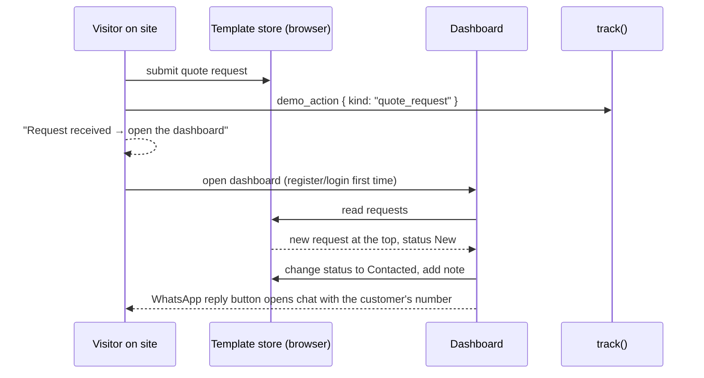
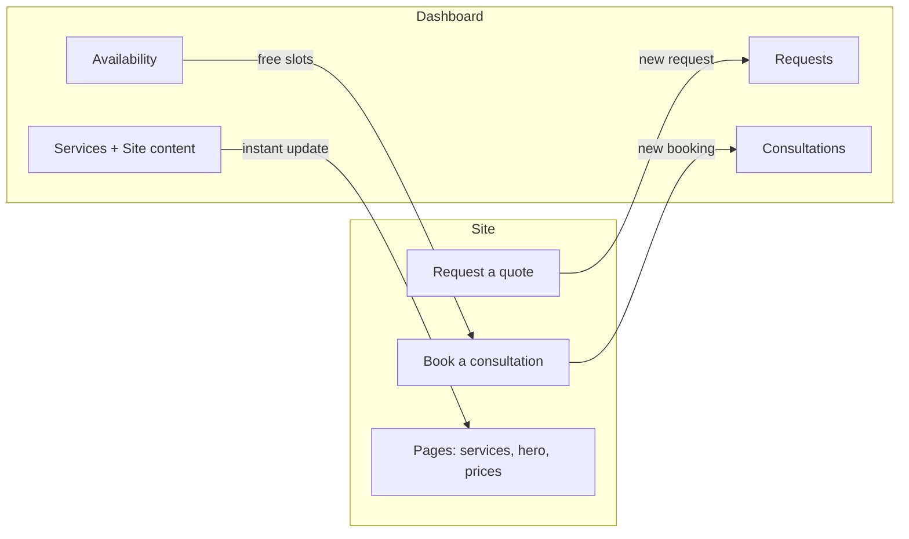
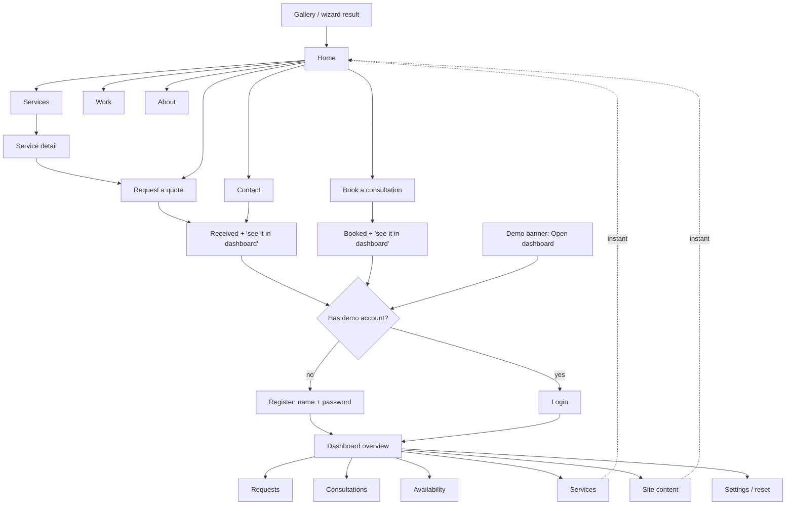

# Feature: Template: Generic Business

Status: **draft for discussion**. Decisions marked ❓ are open (see the end).

## Purpose

The first and most important demo. A complete website + dashboard for a **service business** that almost any visitor
can see themselves in. It must make a business owner think: *"This would bring me customers and save me time."*

It also proves the demo engine and the template contract that every later template follows.

## What "generic" means here

A template without a concrete business becomes filler, and filler breaks our core rule. So:

- **The structure is generic:** home, services, work, about, contact, request a quote, booking, plus a dashboard. It fits
  any service business (consulting, maintenance, cleaning, accounting, marketing, training, legal, design…).
- **The seed content is concrete:** one realistic example business with real services, prices, projects, and reviews.
- **Everything is editable in the dashboard**, so the visitor can rename the business and its services and see *their own* business.

❓ Seed business (proposal): **"Masar Business Services" (مسار لخدمات الأعمال)**, a company that helps small businesses with
setup and operations: business consulting, accounting & bookkeeping, marketing, and company setup paperwork.
Alternatives: a home & office maintenance company, or a marketing agency.

## Business profile (seed)

| | |
|---|---|
| Business | Masar Business Services: helps small and medium businesses start, organize, and grow |
| Customers | Business owners and new entrepreneurs |
| What the owner wants | More qualified requests, fewer back-and-forth calls, look established, follow up with every lead |
| How they get customers today | WhatsApp, referrals, social media |

## Value map (every section has a business goal)

### Public site

| Page | Section | Business goal | Value message (example) |
|---|---|---|---|
| Home | Hero + 2 actions (Request a quote · Book a free consultation) | Leads | "Grow your business without the paperwork headache" |
| Home | Trust bar (years, clients served, satisfaction, client logos) | Trust | Proof before the visitor reads further |
| Home | Services overview (cards → service page) | Leads | Each card ends with "Request this service" |
| Home | Why us (3–4 differentiators) | Trust | Answers "why you and not someone else?" |
| Home | How it works (3 steps: tell us → get a plan → we deliver) | Reduce hesitation | Shows the path is simple |
| Home | Featured work (2–3 results) | Trust | Real outcomes with numbers |
| Home | Testimonials | Trust | Social proof |
| Home | FAQ (top 4) | Fewer repeated calls | Answers before they ask |
| Home | Final CTA + WhatsApp | Leads | Last chance to act |
| Services | List of services | Leads | Overview with "starting from" price (optional) |
| Service detail | What's included, benefits, process, price from, FAQ, CTA (request prefilled with this service) | Leads | Answers everything needed to decide |
| Work | Case studies: problem → what we did → result | Trust | Shows results, not just pictures |
| About | Story, mission, team, numbers | Trust | People trust people |
| Contact | Form, phone, WhatsApp, map, working hours | Leads | Every way to reach you on one page |
| Request a quote | Short form: service, details, budget range, timing, name, phone/WhatsApp | **Leads (closed loop)** | "Get a clear offer within 24 hours" |
| Book a consultation | Pick a date and time from available slots, name, phone, topic | **Bookings (closed loop)** | "Book a free 30-minute call" |

Always present: header (logo, menu, language switch, "Request a quote" button), footer (contacts, hours, links),
floating WhatsApp button, demo banner.

❓ Blog: not included. Without real articles it becomes filler.

### Dashboard

| Module | What the owner does | Business value |
|---|---|---|
| **Overview** | New requests this week, upcoming consultations, requests by service, conversion (won / total), latest activity | See the business at a glance |
| **Requests** | Inbox of quote requests and contact messages; status pipeline: New → Contacted → Offer sent → Won / Lost; notes; reply on WhatsApp | No lead is forgotten |
| **Consultations** | List and week view of bookings; confirm, reschedule, cancel; reply on WhatsApp | No more scheduling back-and-forth |
| **Availability** | Working days, hours, slot length, days off | The booking page shows only free slots |
| **Services** | Add / edit / hide / reorder services (AR/EN, image from library, price from, details) | Site updates instantly |
| **Site content** | Business info (name, phone, WhatsApp, address, hours), hero, why us, steps, about, team, testimonials, work, FAQ | Owner controls the site without a developer |
| **Settings** | ❓ Brand color (choose from a few palettes), account name, logout, reset demo | Make it feel like *their* site |

## Closed loops (the selling moments)

1. **Quote request → Requests inbox.** Visitor submits a request on the site → it appears at the top of Requests, marked *New*.
2. **Booking → Consultations.** Visitor books a slot → it appears in Consultations, and the slot disappears from the booking page.
3. **Reverse loop: dashboard → site.** The owner edits a service, a price, the hero text, or availability → the public site changes immediately.

After each site action the confirmation says: *"Request received. Open the dashboard to see it the way the business owner would."*





## Overall flow



## Sample data (so the dashboard never looks empty)

- The seed includes ~12 sample requests and ~6 consultations spread over the last 3 weeks and the next week,
  with mixed statuses, so the overview shows real-looking numbers and charts.
- Dates are generated **relative to the day the demo is first opened**, so the data always looks fresh.
- The visitor's own requests and bookings are highlighted ("You made this one").

## User stories

### Visitor on the site (acting as the business's customer)

| # | As a visitor I want to… | So that… |
|---|---|---|
| GB1 | understand in seconds what the business offers and why trust it | I see a convincing business site |
| GB2 | read a service page with everything needed to decide | I see how a service page sells |
| GB3 | request a quote in under a minute | I experience how easy it is for customers |
| GB4 | book a consultation from free slots only | I see bookings without phone calls |
| GB5 | switch Arabic/English anywhere | I know it works for all my customers |
| GB6 | contact on WhatsApp from any page | I see how it connects to how my customers talk |

### Visitor in the dashboard (acting as the business owner)

| # | As the owner I want to… | So that… |
|---|---|---|
| GB7 | see my own request appear in the inbox | I understand the value immediately |
| GB8 | move requests through statuses and add notes | I picture following up every lead |
| GB9 | reply to a request on WhatsApp in one click | I see it fits how I already work |
| GB10 | manage consultations and set my availability | I stop scheduling by phone |
| GB11 | edit services, prices, and texts in AR/EN and see the site change | I picture it as *my* site |
| GB12 | see an overview with numbers | I see the business at a glance |
| GB13 | reset the demo | I can start again |

## Data (store outline, Zod schema written at build time)

Key: `demo:generic-business`. Every text field is `{ ar, en }`.

```
account        { name, passwordHash } | null
session        { loggedIn }
business       { name, tagline, phone, whatsapp, email, address, mapUrl, hours[] }
theme          { palette }                         ❓
home           { hero, trustStats[], whyUs[], steps[], featuredWorkIds[], faqIds[] }
services[]     { id, slug, name, summary, details, includes[], priceFrom?, image, visible, order }
projects[]     { id, title, client, problem, solution, result, image }
testimonials[] { id, name, role, quote, rating }
team[]         { id, name, role, image }
faqs[]         { id, question, answer }
about          { story, mission, numbers[] }
requests[]     { id, kind: quote|contact, serviceId?, name, phone, message, budget?, timing?,
                 status: new|contacted|offer_sent|won|lost, notes[], createdAt, isMine }
consultations[] { id, date, time, name, phone, topic, status: booked|confirmed|cancelled, createdAt, isMine }
availability   { days[], from, to, slotMinutes, daysOff[] }
```

## Routes

```
/$locale/demos/generic-business/                     home
/$locale/demos/generic-business/services             services
/$locale/demos/generic-business/services/$slug       service detail
/$locale/demos/generic-business/work                 work
/$locale/demos/generic-business/about                about
/$locale/demos/generic-business/contact              contact
/$locale/demos/generic-business/request              request a quote (?service=slug)
/$locale/demos/generic-business/book                 book a consultation
/$locale/demos/generic-business/register | login
/$locale/demos/generic-business/dashboard/           overview
  .../dashboard/requests, requests/$id
  .../dashboard/consultations
  .../dashboard/availability
  .../dashboard/services, services/$id
  .../dashboard/content/{business,home,about,team,testimonials,work,faq}
  .../dashboard/settings
```

## Tracking

| Event | When | Meta |
|---|---|---|
| `demo_opened` | site home opened | |
| `demo_action` | quote request / contact message / booking | `kind: quote_request \| contact_message \| consultation_booked` |
| `demo_registered`, `demo_login` | fake auth | |
| `content_edited` | save in services / content / availability | `section` |
| `demo_reset` | reset | |
| `whatsapp_clicked` | WhatsApp buttons | `place` |

## Open questions (to debate)

1. ❓ **Seed business:** Masar Business Services (consulting/accounting/marketing/setup), a maintenance company, or a marketing agency?
2. ❓ **Source:** from scratch, or convert one of your HTML/CSS designs from `theme-sources/`?
3. ❓ **Consultation booking in v1?** It's the strongest "saves time" moment but adds the availability module. Proposal: yes.
4. ❓ **Brand color setting** in the dashboard (choose from 4–5 palettes)? Strong "this is mine" effect, small cost. Proposal: yes.
5. ❓ **Business name at register:** ask an optional "Your business name" on register and put it on the site immediately? Proposal: yes. It's the biggest personalization moment.
6. ❓ **Value hints:** small tips in the dashboard tied to value (e.g. "This request arrived at 11:40pm. Without the site, it would have waited until morning"). Proposal: yes, a few, dismissible.
7. ❓ **Pages:** is anything missing (pricing page, careers, blog) or too much (work, team)?
8. ❓ **Request statuses:** New → Contacted → Offer sent → Won / Lost. Fits?
