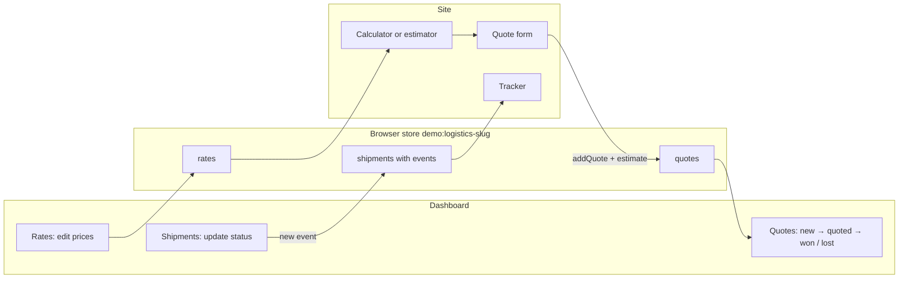
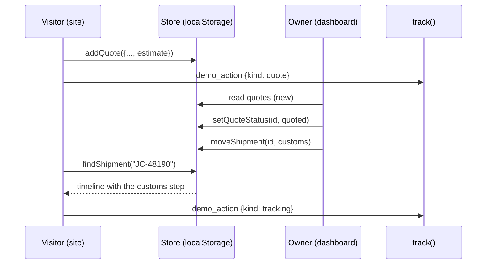

# Template category: Logistics & shipping

Status: in progress (plan written with the build; both variants built in `src/features/template-logistics/`).
Design sources: `theme-sources/01-orbis-cargo.html` + `02-meridian-route.html` (A), `03-stackwell-3pl.html` (B). Rebuilt as React + Tailwind, bilingual, RTL.

Two complete logistics websites, each a different kind of business, sharing one dashboard.

| | Variant A: Freight forwarder | Variant B: Warehousing & 3PL |
|---|---|---|
| Slug | `logistics-freight` | `logistics-warehousing` |
| Business (seed) | **Jisr Cargo** · **جسر كارجو**: Jeddah freight forwarder, cargo from China and Asia to KSA and the Gulf | **Makhzan 3PL** · **مخزن**: warehouses in Riyadh and Jebel Ali, storage and e-commerce fulfilment |
| Main value | More quotes, fewer "where is my cargo?" calls | More qualified quotes: the visitor arrives with pallets and months already priced |
| Closed loops | Quote request → Quotes · Dashboard updates a shipment → public tracker shows the new step · Dashboard edits a rate → calculator changes | Quote request with estimator values → Quotes · Dashboard edits warehouse space → site shows free pallet spots |
| Look | Orbis: light grey, ink, white rounded cards; Meridian accents · Manrope + IBM Plex Sans Arabic | Stackwell: white, red, black; sharp and industrial · Plus Jakarta Sans + Tajawal |
| Photos | Unsplash photos of the source designs, one list in `variants/freight/photos.ts` | One list in `variants/warehousing/photos.ts` |

---

## 1. Business profiles

### A. Jisr Cargo (freight forwarder)

- **Who it is:** a freight forwarder in Jeddah that brings cargo from Shanghai, Shenzhen, Guangzhou and Yiwu to Jeddah, Dammam, Riyadh, Dubai and Kuwait by air, sea, road and rail, with customs clearance.
- **Customers:** importers and online sellers (electronics, fashion, home goods, spare parts) who buy from Chinese suppliers.
- **What the owner wants:** more quote requests from serious importers, fewer phone calls asking where a shipment is, a price visitors can trust before they call.
- **Pain today:** prices are given by phone and WhatsApp only; every client asks for the status of their cargo by message.

### B. Makhzan 3PL (warehousing and fulfilment)

- **Who it is:** a third-party logistics company with two warehouses (Riyadh Second Industrial City, Jebel Ali Dubai) that stores pallets and ships online orders.
- **Customers:** online stores, brands, and distributors who need pallet space and picking/packing without building a warehouse.
- **What the owner wants:** quote requests that already say how many pallets, how long, and whether picking is needed, so sales calls are short.
- **Pain today:** every visitor asks "how much for 40 pallets?" and waits a day for an answer; space is full in one site and empty in the other and nobody sees it.

---

## 2. Value map

### A. Jisr Cargo site

| Page | Section | Business goal | Value message (EN) |
|---|---|---|---|
| Home | Hero + trust points | leads, trust | Cargo from Asia, door to door, insured and tracked |
| Home | Stats | trust | Numbers that show we deliver on time |
| Home | About | trust | One contract, one manager, no surprises |
| Home | Services (5, with "from" price) | decide | Pick the right way to ship |
| Home | Calculator (compact) | leads | Know the price range in seconds |
| Home | Steps | remove doubt | Five clear steps from request to door |
| Home | Popular routes | decide | Routes we run every week |
| Home | Shipment tracker | saves calls | See where your cargo is without calling us |
| Home | Pricing plans | decide | Transparent service tiers |
| Home | Testimonials (visible ones) | trust | Importers who moved all their freight to us |
| Home | FAQ | remove doubt | Answers before the first call |
| Home | Quote band | leads | Tell us about your cargo |
| Services | Five services with photos and "from" rates (from the rates the owner edits) | decide | |
| Calculator | Calculator + quote form with the estimate attached | leads | Ask for an exact quote with your numbers |
| Track shipment | Tracker (number → timeline) | saves calls | |
| Get a quote | Quote form, contact details | leads | |

### B. Makhzan site

| Page | Section | Business goal | Value message (EN) |
|---|---|---|---|
| Home | Hero + two warehouses + years | trust, leads | Storage and fulfilment without delays or hidden costs |
| Home | Standards | trust | Certified processes |
| Home | Smart storage (4 points, extra services) | decide | What storage includes |
| Home | 3PL process (4 steps) | decide | From receiving to your customer's door |
| Home | Stats | trust | |
| Home | Estimator (compact) | leads | Know your monthly cost |
| Home | Warehouses (free spots) | decide | Space available now |
| Home | Case studies (visible ones) | trust | Results for brands like yours |
| Home | Testimonials, FAQ, quote band | trust, remove doubt, leads | |
| Services | Storage and fulfilment sections with "from" rates | decide | |
| Warehouses | Both sites: specs, address, free spots | decide | |
| Case studies | All visible case studies | trust | |
| Get a quote | Estimator + quote form with the estimate attached | leads | |

Sections without a goal were dropped: the designs' blog, "watch our story" video, partner logos of invented companies, and the language-neutral map.

---

## 3. Closed loops



1. **Quote:** the visitor uses the calculator (A) or estimator (B), sends the form; the quote, with the estimate, appears in Quotes as `new`. The owner marks it `quoted`, then `won` or `lost`.
2. **Shipment (A):** the owner updates a shipment's status in Shipments; the new step appears on the public tracker for that tracking number. The owner can also add a shipment.
3. **Rates and space:** editing rates (A) or storage rates and warehouse occupancy (B) changes the numbers visitors see.



## 4. Dashboard

Shared by both variants: **Overview** (cards, activity, value tip), **Quotes**, **Clients** (people behind the quotes, grouped by phone), **FAQ** (bilingual list editor), **Testimonials** (show/hide), **Content** (hero, about, contact; bilingual), **Settings** (business name, phone, WhatsApp, address, office hours, 5 palettes, reset).

| | Variant modules |
|---|---|
| A | **Shipments & tracking**, **Calculator rates** (per mode: SAR per kg, minimum charge, transit days) |
| B | **Warehouses** (capacity and occupied pallets), **Storage rates** (pallet price, discounts, handling, picking, insurance, minimum), **Case studies** (bilingual, show/hide, add/remove) |

Photos are fixed per variant (stock photos from the designs); the owner edits text. Uploads are not decided (`storage.md`).

## 5. Data (Zod, `types.ts` and `modules/*/types.ts`)

Shared: `account`, `settings` (`businessName {ar,en}`, `nameEdited`, `palette`, `phone`, `whatsapp`, `address {ar,en}`, `currency` = SAR, `officeOpen`, `officeClose`), `content` (`hero`, `about`, `contact`, each `{ar,en}`), `quotes[]`, `faq[]`, `testimonials[]`, `dismissedTips[]`.

- **Quote:** `id, name, company, phone, email, service, message, status (new|quoted|won|lost), createdAt, estimate` where `estimate` is `null`, a freight estimate `{kind:"freight", mode, origin, destination, weightKg, volumeCbm, minCost, maxCost}` or a storage estimate `{kind:"storage", pallets, months, ordersPerMonth, insurance, monthlyTotal}`.
- **A shipment:** `id, trackingNumber, customer, origin {ar,en}, destination {ar,en}, mode, cargo, eta, events[{status, at, note?}]`. The current status is the last event's status (never stored twice).
- **A rates:** `modes[{mode, ratePerKg, volumetricKgPerCbm, minimumCharge, daysMin, daysMax}]`, `origins[{id, name, factor}]`, `destinations[{id, name, factor, extraDays}]`.
- **B warehouses:** `id, name, address, city, areaM2, rackHeightM, dockDoors, capacityPallets, occupiedPallets`.
- **B storageRates:** `palletPerMonth, discount6Months, discount12Months, handlingPerMonth, pickingPerOrder, insurancePercent, minimumMonthly`.
- **B caseStudies:** `id, sector, title, text, metricValue, metricLabel, visible`.

Seeds (SAR, dates relative to today): A has 6 quotes, 6 shipments with timelines (one stuck in customs), 4 modes, 6 origins, 6 destinations. B has 5 quotes, 2 warehouses (one 92% full), 3 case studies, 4 testimonials, 5 FAQ. Store version `1`.

## 6. Rules

- **Quote status:** `new → quoted | lost`, `quoted → won | lost`; `won` and `lost` are final.
- **Shipment status order:** `booked → picked_up → in_transit → customs → out_for_delivery → delivered`. A shipment only moves forward (steps may be skipped); each move adds an event whose time is never earlier than the previous event. `delivered` is final. Tracking numbers are `JC-` + five digits, the next one is the highest + 1.
- **Tracking lookup:** ignores case, spaces, and dashes.
- **Freight calculator:** chargeable kg = max(weight, volume × kg per CBM of the mode); cost = chargeable kg × rate per kg × origin factor × destination factor, never below the minimum charge; the estimate is the cost up to the cost + 15%. Transit days = mode days + destination extra days. No weight and no volume → no estimate.
- **Storage estimator:** storage = pallets × pallet price × (1 − discount) where the discount is 0 below 6 months, 8% from 6, 15% from 12; plus handling per month; plus picking (orders per month × price per order); plus insurance (percent of storage) when chosen. The monthly total is never below the minimum monthly charge. Contract total = monthly total × months.
- **Value tips** (facts from the data only): a quote that arrived outside office hours (Fri and Sat are the weekend) · a `new` quote waiting more than 24 hours · a shipment in customs for more than 48 hours (A) · a warehouse 90% full or more (B).
- **Business name at register** replaces the seed name on the site and dashboard until the owner edits it in Settings.

## 7. User stories

| # | As a … I want to… | So that… |
|---|---|---|
| L1 | visitor, estimate my shipping cost by mode, route, weight and volume | I know the price range before I call |
| L2 | visitor, send a quote request with my estimate attached | the forwarder answers with my numbers in front of them |
| L3 | owner, see new quotes and mark them quoted, won or lost | I follow every lead to a decision |
| L4 | client, enter my tracking number and see the steps | I do not have to call the office |
| L5 | owner, update a shipment's status | the client sees it on the site at once |
| L6 | owner, change a rate | the calculator and the services page show it |
| L7 | visitor, estimate monthly storage cost for pallets, months, picking and insurance | I can budget before asking |
| L8 | owner, see the estimator values inside the quote | my first call is about the right numbers |
| L9 | owner, edit warehouse space | visitors see where there is free room |
| L10 | owner, edit content, FAQ, testimonials and case studies in Arabic and English | the site says what I want in both languages |
| L11 | owner, read value tips from my own data | I notice late replies, stuck shipments and full warehouses |
| L12 | visitor, use the site in Arabic (RTL) or English | I read it in my language |

## 8. Tests

| Level | Test | Protects |
|---|---|---|
| Unit | `modules/rates/calculator.test.ts`: modes differ, minimum charge, volumetric weight, route factors, empty cargo | L1, L6 |
| Unit | `modules/storage-rates/estimator.test.ts`: discounts, picking, insurance, minimum, contract total | L7 |
| Unit | `modules/shipments/status.test.ts`: forward-only status, skipping, final delivered, event time order, timeline, next tracking number | L5 |
| Unit | `modules/shipments/tracking.test.ts`: lookup ignores case, spaces, dashes | L4 |
| Unit | `quotes.test.ts`: status transitions, validation | L3, L2 |
| Unit | `clients.test.ts`, `value-tips.test.ts`, `business-name.test.ts` | L3, L11 |
| Unit | `variants/*/store.test.ts`: add quote, status, shipment move, rates, warehouses, reset keeps account | L2, L5, L6, L9 |
| Unit | `variants/*/seed/seed.test.ts`: seed is valid, tracking numbers are unique, tips appear | seed rules |
| Unit | `palettes.test.ts`: 5 palettes per variant, AA contrast | R5 (palettes) |
| Contract | `template-contract.test.ts` runs for both slugs; ar/en parity and logical CSS run on the new files | contract |
| E2E | `e2e/logistics-freight.spec.ts`: calculator → quote → register → mark quoted; shipment update → tracker; rates → calculator; ar/en + RTL; axe | L1–L6, L12 |
| E2E | `e2e/logistics-warehousing.spec.ts`: estimator → quote with values in dashboard; warehouse edit → site; ar/en + RTL; axe | L7–L9, L12 |

## 9. Routes and files

```
src/app/[locale]/demos/logistics/freight/        (site) home, services, calculator, track, quote · dashboard/...
src/app/[locale]/demos/logistics/warehousing/    (site) home, services, warehouses, case-studies, quote · dashboard/...

src/features/template-logistics/
  types.ts shared-slice.ts quotes.ts clients.ts value-tips.ts business-name.ts hours.ts format.ts phone.ts messages.ts
  components/       photo, faq-accordion, quote-form
  dashboard/        frame, overview, quotes, clients, faq, testimonials, content, settings
  modules/          shipments, rates (A) · warehouses, storage-rates, case-studies (B)
  variants/freight/ and variants/warehousing/   site/ seed/ store.ts dashboard.ts meta.ts photos.ts palettes.ts messages/
```

## Out of scope

- Image upload, real tracking carriers, multi-currency (the currency is SAR), invoices and payments.
- A blog (the designs have one; it serves no goal of the demo).
