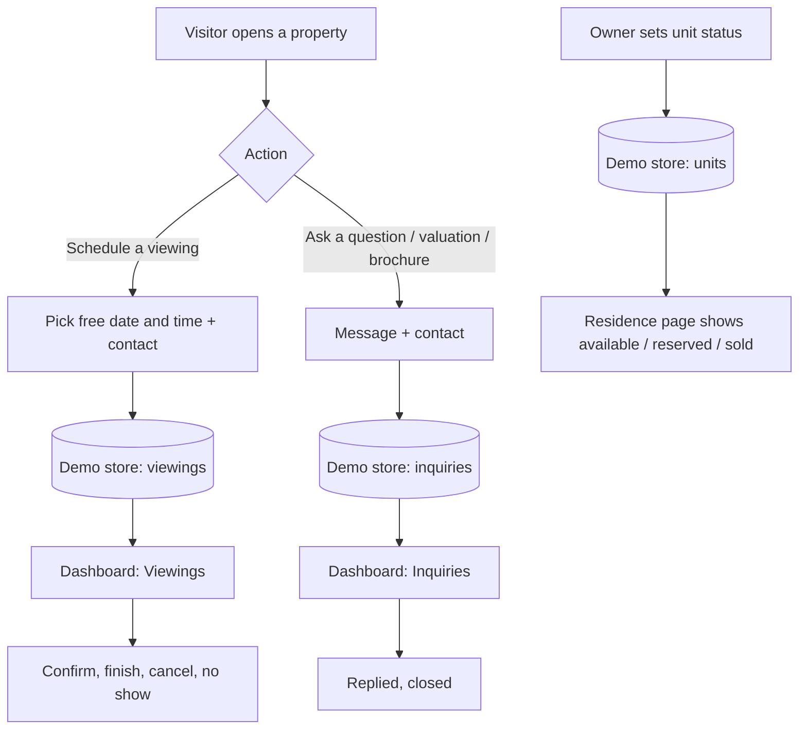
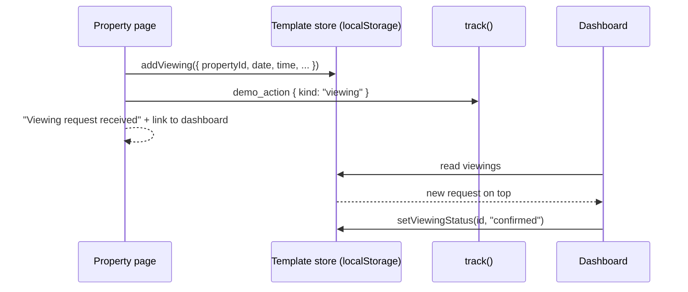

# Template category: Real estate

Status: **built** (shared layer, Variant A agency, Variant B developer). Source: `theme-sources/02-hartwell-realty.html` (A) and `theme-sources/01-solenne-estates.html` (B), analysed in `docs/09-design-sources.md`.

Two complete real estate websites, each a different kind of business with its own content and look, sharing one dashboard.
Feature folder: `src/features/template-real-estate/`.

| | Variant A: Agency | Variant B: Developer |
|---|---|---|
| Slug | `real-estate-agency` | `real-estate-developer` |
| Business (seed) | **Hartwell & Co. Realty** · **هارتويل وشركاه العقارية**: residential brokerage, buy and rent (the source design's own business) | **Solenne Estates** · **سولين للعقارات**: villa and penthouse developer (the source design's own business) |
| Design | Hartwell: warm white, black, bronze; Montserrat + IBM Plex Sans Arabic. **The home page, header and footer mirror the source exactly** (`docs/design-specs/02-hartwell-realty.md`) | Solenne: black, sand; light Montserrat + IBM Plex Sans Arabic. **The home page, header and footer mirror the source exactly** (`docs/design-specs/01-solenne-estates.md`) |
| Main value | More viewings and a trusted brand against portals and phone tag | Sell units: qualified viewings and live availability instead of PDF price lists |
| Main closed loop | Viewing request on a property → Viewings | Viewing request on a residence → Viewings |
| Second loop | Property inquiry or valuation request → Inquiries | Owner marks a unit available / reserved / sold → the site shows it; unit inquiry → Inquiries |

---

## 1. Business profiles

### A. Hartwell & Co. Realty (agency)

- **Who it is:** an established residential brokerage selling and renting houses, apartments, and villas across four neighbourhoods (Riverside, Old Town, Hillcrest, Harbour District). Prices are shown in riyals (the source's dollars x3.75).
- **Customers:** families buying a first or bigger home, expats and young professionals renting yearly, owners who want to sell or rent out.
- **What the owner wants:** more serious viewings booked directly, fewer missed calls and WhatsApp threads, owners who trust the agency to list their property.
- **Pain today:** listings live in portals that take the lead; viewings are arranged by phone and forgotten; buyers cannot tell what the monthly cost will be.

### B. Solenne Estates (developer)

- **Who it is:** a small developer delivering a handful of villas, coastal homes, and penthouses per year (Hallmark Ridge, Cape Linden, Aurelia Tower and more), founded in 2009 by an architect and builders. Prices are in SAR (the source's USD x 3.75).
- **Customers:** high-income families and investors buying off-plan or ready units; many arrive from Instagram and WhatsApp.
- **What the owner wants:** a premium image, qualified viewing requests, and an always-correct list of which units are still for sale.
- **Pain today:** availability lives in a PDF and in the sales manager's head; the same unit is promised twice; brochures are requested by chat.

---

## 2. Value map

Every section has a business goal. Sections without one are not built.

### A. Hartwell & Co. Realty site (home sections in the source's order)

| Page | Section | Business goal | Value message (EN) |
|---|---|---|---|
| Home | Hero (round-topped photo, two hotspots) with Buy / Rent search that filters the listings below | leads | Find the place you will call home |
| Home | Numbers strip (homes sold, sales volume, agents, years) that counts up | trust | Neighbourhood experts you can rely on |
| Home | Current listings with All / Houses / Apartments / Villas / For rent tabs, heart favourite | sales, viewings | Current listings |
| Home | Three principles (dark band) | trust | Local insight, transparent pricing, full-service |
| Home | Neighbourhoods (night photo, four columns, each links to that area's listings) | discovery | Where we work |
| Home | Mortgage calculator (four sliders, principal / interest bar) + valuation request link | qualify buyers | Plan your monthly payment |
| Home | Agents (portrait, social icons on hover, phone) | trust, contact | Meet the team |
| Home | Client stories slider (arrows, dots, auto-advance) | trust | Client stories |
| Home | **Schedule a visit** form (closed loop to Viewings) + office info and map | viewings | Schedule a visit |
| Listings | Filters (buy/rent, type, area, price, bedrooms, text) + sort + cards | decide | Find it fast, see what is available |
| Property detail | Gallery, key facts, description, features | desire | Everything needed to decide |
| Property detail | Mortgage calculator (buy only) | qualify | Monthly payment for this home |
| Property detail | Agent card + WhatsApp | contact | Talk to the agent who knows it |
| Property detail | **Schedule a viewing** form | viewings (closed loop) | Choose a free time; the agent confirms |
| Property detail | Inquiry form | leads (closed loop) | Ask a question without calling |
| About & team | Story, numbers, agents, principles | trust | Why owners and buyers choose us |
| Contact | Viewing form, valuation / question form, address, hours | viewings, listing leads | Sell or rent with us: free valuation |

### B. Solenne Estates site (the home page follows the source section by section)

| Page | Section | Business goal | Value message (EN) |
|---|---|---|---|
| Home | Hero with three feature hotspots, counting numbers | premium image | Homes shaped by landscape |
| Home | Principles | trust | Site first, honest materials, quiet luxury |
| Home | Panorama of residence types (forest villas, coastal, penthouses, bespoke) | discovery | Choose the way you want to live |
| Home | Collection: residences with type tabs | sales | Residences available |
| Home | About: studio story, founder, team | trust | Built slowly, lived in for generations |
| Home | Four-step process | reduce fear | From first sketch to final key |
| Home | Client voices slider | trust | Owners tell the story |
| Home | Book a viewing (form, studio details, map) | viewings | Book a viewing |
| Residences | Filters (type, project area, price, available only) + cards | decide | Only what is for sale, always up to date |
| Residence detail | Gallery, features, description | desire | |
| Residence detail | **Unit availability table** (available / reserved / sold) | urgency, honesty | Know which units are left, live |
| Residence detail | Request a viewing form, request brochure / ask about a unit form | viewings, leads (closed loops) | Reserve your private tour |
| Process & studio | Process steps, studio story, team | trust | What the journey looks like |
| Contact | Viewing form, inquiry form, address, hours | viewings | Visit our sales studio |

---

## 3. Pages and sections

- **A (agency):** Home, Listings, Property detail (`/listings/detail?id=<id>`), About & team, Contact. Register/login guards the dashboard.
- **B (developer):** Home, Residences, Residence detail (`/residences/detail?id=<id>`), Process & studio, Contact.
- Every page: demo banner, header with language switch and a "Schedule a viewing" button, footer with contact details.

## 4. Closed-loop flows

1. **Viewing:** visitor picks a property, a date, and a free time → `addViewing` → appears in **Viewings** (status new) → owner confirms → done / cancelled / no show.
2. **Inquiry:** visitor sends a question, valuation (A) or brochure / unit request (B) → `addInquiry` → **Inquiries** (new → replied → closed).
3. **Unit availability (B):** owner sets a unit to available / reserved / sold in **Projects & units** → the residence page, cards, and filters show it at once; reserved and sold units cannot be requested.

Both actions call `track("demo_action", { meta: { kind: "viewing" | "inquiry" } })`.





## 5. Dashboard

Shared by both variants (one dashboard shell): **Overview, Properties, Viewings, Inquiries, [variant modules], Content, Testimonials, Settings**.

| Module | What the owner does |
|---|---|
| Overview | Cards (new viewings, upcoming viewings, new inquiries, variant card), latest activity, one value tip |
| Properties | Add / edit / remove listings (A) or residences (B): bilingual title and description, purpose, type, area, price, rooms, size, features, photo, featured, status (A) |
| Viewings | List grouped by status, confirm / mark done / cancel / no show |
| Inquiries | List, mark replied / closed |
| Content | Edit hero, about, and contact texts in Arabic and English |
| Testimonials | Add / edit / hide / remove client stories |
| Settings | Business name, phone, WhatsApp, address, hours text, mortgage rate (A), palette (5), reset demo |
| **A only: Agents** | Add / edit / remove agents shown on the site |
| **B only: Projects & units** | Per residence: units table, add unit, set status available / reserved / sold, price |

## 6. Data (browser only, key `demo:<slug>`)

Zod outline (`types.ts`); every visible text is `{ ar, en }`.

```
settings   { businessName, nameEdited, palette, phone, whatsapp, address, hours, mortgageRate }
content    { hero{title,subtitle}, about{title,text}, contact{title,text} }
properties [{ id, title, description, purpose: sale|rent, type, area, price (SAR, rent = per year),
              bedrooms, bathrooms, size, features[], photos[], featured, status: available|reserved|closed,
              agentId?, units[] }]
unit       { id, label, floor, size, price, status: available|reserved|sold }     (B)
viewings   [{ id, propertyId?, unitId?, name, phone, date, time, note?, status, createdAt }]
inquiries  [{ id, propertyId?, unitId?, kind: question|valuation|brochure, name, phone, message, status, createdAt }]
testimonials [{ id, name, context, text, visible }]
agents     [{ id, name, role, phone, photo }]                                        (A)
dismissedTips string[]
```

Seed: A has 8 listings (5 sale, 3 rent), 4 agents, 3 testimonials, 6 sample viewings and 4 inquiries. B has 6 residences with 3 to 4 units each, 3 testimonials, 5 sample viewings and 3 inquiries. Dates are relative to today.
Photos come from CDN URLs (Unsplash) in one list per variant (`photos.ts`), always through `photoUrl` / `photoSrcSet`.

## 7. Rules

**Statuses**

- Viewing: `new → confirmed → done`; `new / confirmed → cancelled`; `confirmed → no_show`. Nothing else, nothing to itself.
- Inquiry: `new → replied → closed`; `new → closed` (spam or irrelevant).
- Unit (B): the owner may set any of available / reserved / sold. A residence is **sold out** when no unit is available or reserved, **reserved** when none is available but some are reserved, otherwise **available**.

**Viewing slots:** visitors pick one of the next 14 days (Friday is closed) and one of six fixed times. A time is offered only when it is still in the future today, fewer than `capacity` (2) active viewings already hold it, and the same property has no active viewing at that time.

**Mortgage calculator (A, SAR):** loan = price × (1 − down payment %). Monthly payment with standard amortization `loan × i / (1 − (1 + i)^−n)`, where `i = annual rate / 12` and `n = years × 12`. At 0% rate: `loan / n`. Returns monthly payment, total paid, total interest. Invalid input (price ≤ 0, down payment outside 0–100 %, rate < 0, years < 1) gives no result, never `NaN`.

**Listing filters:** purpose, type, area, price range, minimum bedrooms, text search over title and area (Arabic and English), available only (B). Sort: featured first, price low to high, price high to low.

**Business name:** the optional name at register replaces the seed name in both languages until the owner edits the name in Settings.

**Value tips (facts computed from the demo data, never invented numbers):**
- a viewing request waiting for confirmation for more than a day (name),
- an inquiry waiting for a reply for more than a day (name),
- a property with two or more viewing requests: your most wanted property,
- B only: a residence with exactly one unit left available.

**Tracking:** `demo_opened` on the site, `demo_action` (`kind`: viewing or inquiry), `content_edited` (`section`), plus the engine's register / login / reset events. Nothing typed is sent.

**Palettes:** 5 per variant as CSS tokens, contrast checked (WCAG AA) by a unit test.

## 8. User stories

| # | As a … I want to… | So that… |
|---|---|---|
| RE1 | visitor, search and filter properties by buy/rent, type, area, price and bedrooms | I see only homes that fit me |
| RE2 | visitor, open a property and see photos, facts, and features | I can decide before calling |
| RE3 | visitor, schedule a viewing at a free time | I do not have to phone and wait |
| RE4 | visitor, ask a question or request a valuation / brochure | the agency contacts me |
| RE5 | buyer, calculate the monthly payment (A) | I know if I can afford it |
| RE6 | buyer, see which units are available, reserved, or sold (B) | I do not waste time on gone units |
| RE7 | owner, register and see viewing requests in my dashboard | I never miss a lead |
| RE8 | owner, confirm, finish, or cancel a viewing | my calendar is clear |
| RE9 | owner, reply and close inquiries | no lead is forgotten |
| RE10 | owner, edit listings, content, agents, and testimonials in Arabic and English | the site always shows the truth |
| RE11 | developer, set a unit to reserved or sold | the site shows it immediately |
| RE12 | owner, see value tips from my own data | I learn where I lose clients |
| RE13 | owner, give my business name and pick a palette | the demo feels like my brand |
| RE14 | visitor, switch between Arabic and English with correct RTL | I use the site in my language |

## 9. Tests

| Level | Test | Protects |
|---|---|---|
| Unit | mortgage: normal case, 0 % rate, 100 % down payment, invalid input | RE5 |
| Unit | listing filters, text search in both languages, sort | RE1 |
| Unit | viewing slots: capacity, past times today, same property, Friday | RE3 |
| Unit | status transitions for viewings and inquiries | RE8, RE9 |
| Unit | unit availability: counts, residence state, last unit | RE6, RE11 |
| Unit | value tips are facts, absent without data | RE12 |
| Unit | business name at register, then Settings | RE13 |
| Unit | palette contrast (both variants) | RE13 |
| Unit | store actions (viewing, inquiry, property, unit, reset keeps account) | RE3, RE4, RE7, RE11 |
| Unit | seed validity, relative dates, sample activity | RE7 |
| Contract | generic template contract (catalog driven), ar/en parity, logical CSS | all |
| E2E | A: filter listings → open property → viewing → register → confirm; inquiry; ar/en + RTL; axe | RE1 to RE4, RE7, RE8, RE14 |
| E2E | B: unit marked reserved in dashboard → residence page shows reserved; viewing; ar/en + RTL; axe | RE6, RE11, RE14 |

## 10. Routes and files

```
src/app/[locale]/demos/real-estate/agency/
  (site)/ layout, page, listings/page, listings/detail/page, about/page, contact/page
  dashboard/ layout, page, properties, viewings, inquiries, agents, content, testimonials, settings
src/app/[locale]/demos/real-estate/developer/
  (site)/ layout, page, residences/page, residences/detail/page, process/page, contact/page
  dashboard/ layout, page, properties, viewings, inquiries, projects, content, testimonials, settings

src/features/template-real-estate/
  types.ts  shared-slice.ts  listings.ts  value-tips.ts  format.ts (formatPrice, whole SAR)  phone.ts  messages/
  context.tsx  dashboard/   frame, overview, properties, content, testimonials, settings
  Shared API from the engine (not in this folder): Moved to the engine (see `docs/05-demo-engine.md`): dashboard UI pieces, photo, palette scope, contrast, dates, format, phone, business name, `trackEdit`, dashboard context.
  modules/     viewings/  inquiries/  mortgage/ (A)  agents/ (A)  units/ (B)
  site/        photo (SitePhoto: the engine Photo with this category's widths), property-card, property-gallery, filter-bar, site-ui (shared building blocks)
  variants/agency/    site/ seed/ photos.ts fonts.ts palettes.ts dashboard.ts store.ts meta.ts messages/
  variants/developer/ site/ seed/ photos.ts fonts.ts palettes.ts dashboard.ts store.ts meta.ts messages/
```

## 11. Out of scope

- Real map, real payments, uploads (photos come from the built-in list), a favourites list, newsletter sign-up, and a separate "Sell" page (a valuation request is an inquiry kind).
- Developer team members and the process steps are fixed site content (not edited in the dashboard).
