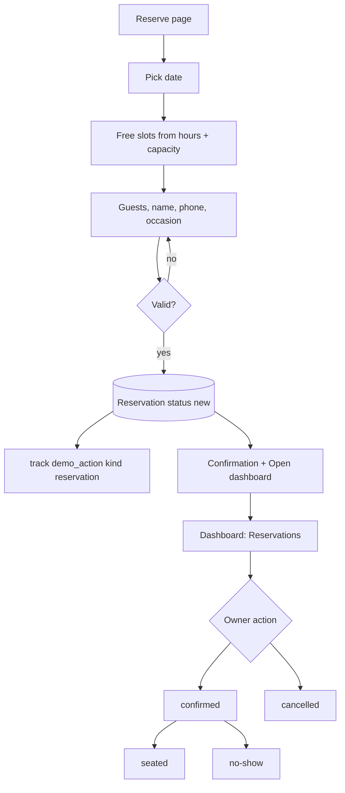
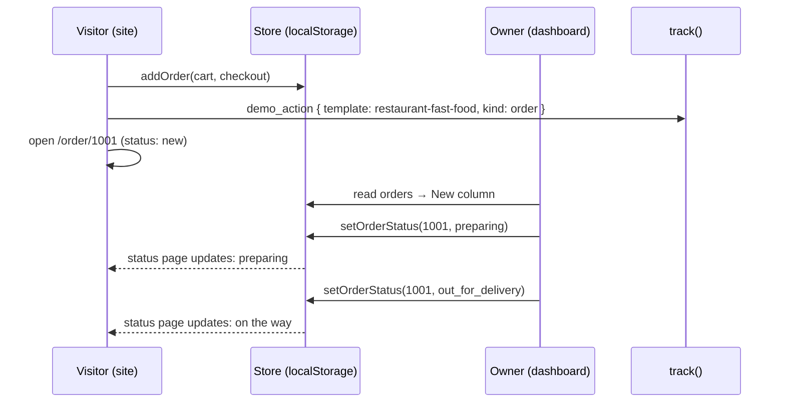

# Template category: Restaurants & cafés

Status: plan draft for discussion (not built). Design: from scratch until the owner adds HTML/CSS in `theme-sources/`.

Two complete restaurant websites, each a different kind of restaurant with its own content and look,
sharing one dashboard. Feature folder: `src/features/template-restaurant/`.

| | Variant A: Fine dining | Variant B: Fast food |
|---|---|---|
| Slug | `restaurant-fine-dining` | `restaurant-fast-food` |
| Business (seed) | **Zaytouna** · **زيتونة**: Levantine fine-dining restaurant | **Smash Lab** · **سماش لاب**: smash burgers, fries, shakes |
| Main value | Fill tables: reservations day and night, no missed calls | Sell directly: online orders without delivery-app commission |
| Main closed loop | Reservation on the site → Reservations in the dashboard | Order on the site → live Orders board → customer sees status |
| Second loop | Private event request → Event requests | Owner creates an offer → it appears on the site |

---

## 1. Business profiles

### A. Zaytouna (fine dining)

- **Who it is:** a Levantine restaurant for dinners, families, and occasions. Signature dishes, a chef with a story, a calm atmosphere.
- **Customers:** couples, families, companies booking dinners, people celebrating birthdays and anniversaries.
- **What the owner wants:** a full room on weekends, fewer phone calls, more private events (high revenue),
  a premium image that justifies the prices.
- **Pain today:** reservations by phone only; calls missed at night and during service; no-shows; events booked by chance.

### B. Smash Lab (fast food)

- **Who it is:** a burger shop with pickup and delivery, young brand, busy evenings.
- **Customers:** students, young professionals, families ordering at night.
- **What the owner wants:** more direct orders, less dependence on delivery apps and their commission,
  repeat customers, offers that move sales on quiet days.
- **Pain today:** orders by WhatsApp messages get lost or mixed up; customers keep calling "where is my order?".

---

## 2. Value map

Every section has a business goal. Sections without one are not built.

### A. Zaytouna site

| Page | Section | Business goal | Value message (EN) |
|---|---|---|---|
| Home | Hero + "Reserve a table" | bookings | Reserve your table in seconds, any time |
| Home | Signature dishes (from Menu, `featured`) | desire, sales | Dishes people come back for |
| Home | The experience (atmosphere, 3 points) | justify premium | More than a meal: an evening |
| Home | Chef's story teaser | trust | Recipes from our family, done with care |
| Home | Reviews (visible ones) | trust | What our guests say |
| Home | Private events teaser | high-value leads | Celebrate with us: private dining for your occasion |
| Home | Hours, location, contact | remove friction | Find us, call us, or message on WhatsApp |
| Menu | Menu by course, prices, tags | decide before coming | Know what you'll enjoy before you arrive |
| About | Chef & story, values, photos | trust, premium image | |
| Private events | What we offer + request form | high-value leads | Birthdays, business dinners, family gatherings |
| Reserve | Reservation form | bookings | Choose day, time, and guests; we confirm fast |
| Contact | Map image, hours, phone, WhatsApp | remove friction | |

### B. Smash Lab site

| Page | Section | Business goal | Value message (EN) |
|---|---|---|---|
| Home | Hero + "Order now" | sales | Hot burgers, ordered in two minutes |
| Home | Today's offers (from Offers) | sales on quiet days | Deals made for today |
| Home | Best sellers (from Menu, `featured`) | sales | Our most ordered |
| Home | How it works (choose, pickup or delivery, track) | remove doubt | Order, track, enjoy |
| Home | Delivery areas + fees | remove doubt | We deliver to your area |
| Home | Reviews | trust | |
| Home | Hours + contact | remove friction | |
| Menu | Categories, items, add to cart | sales | |
| Cart | Items, quantities, note, total | sales | |
| Checkout | Pickup/delivery, area, address, name, phone, pay on delivery/pickup | sales | No sign-up needed |
| Order status | Live status of the order | fewer "where is my order?" calls | Follow your order live |
| Contact | Hours, phone, WhatsApp, location | remove friction | |

---

## 3. Shared dashboard

One dashboard for both variants (`dashboard/`). It shows the shared modules plus the modules listed in the variant's `dashboard.ts`.

| Module | Shared / variant | What the owner does | Value shown |
|---|---|---|---|
| Overview | shared | Today's cards (from active modules), latest activity, value tips | "Your restaurant at a glance" |
| Reservations | **A only** | See reservations by day; confirm, mark seated, cancel, no-show; set time slots and max guests per slot | No missed bookings, plan the evening |
| Event requests | **A only** | See private event requests; mark replied / booked / closed; reply on WhatsApp | Catch high-value events |
| Orders | **B only** | Live board: new → preparing → ready / out for delivery → completed (or cancelled) | Every order in one place, customers informed |
| Offers | **B only** | Create, edit, activate/deactivate offers shown on the site | Push sales when you want |
| Delivery areas | **B only** | Areas with fee and minimum order | Clear rules, fewer questions |
| Menu | shared | Categories and items: name, description, price, image, tags, available, featured | Change the menu in seconds, in both languages |
| Content | shared | Site texts and images: hero, about, experience, contact, hours | Your website is always up to date |
| Customers | shared | List built from reservations/orders: name, phone, count, last visit/order; WhatsApp button | Know your regulars |
| Reviews | shared | Show or hide reviews on the site | Choose what builds trust |
| Settings | shared | Business name, colors (palettes), phone, WhatsApp, address, currency, reset demo | Make it yours |

### Value tips (examples)

Small, dismissible notes in the dashboard that explain the value of what just happened. Both languages.

- "This reservation arrived at 11:40 pm, when the restaurant was closed. Without the website it would have been a missed call."
- "4 orders today came directly from your website, with no delivery-app commission."
- "The customer can follow this order's status live, so they won't need to call you."
- "Mark a reservation as no-show: in a real project you can send reminders to reduce no-shows."

Rules: a tip is computed from store data (time vs opening hours, counts); max one tip per page; never invented numbers.

---

## 4. Closed loops

### A1. Reservation

1. On **Reserve**, the visitor picks a date (today to +30 days), a time from the free slots, guests (1–12), name, phone,
   optional occasion (birthday, anniversary, business, other) and note.
2. Free slots come from the opening hours and reservation settings; a slot with no capacity left is hidden.
3. Submit → reservation saved with status `new` → `track("demo_action", { kind: "reservation" })`.
4. Confirmation screen: summary + "Open your dashboard to see it" + WhatsApp.
5. In the dashboard it appears at the top of **Reservations** and in Overview, with a value tip when it came outside opening hours.
6. The owner confirms, marks seated, cancels, or marks no-show. The customer appears in **Customers**.



Statuses: `new` → `confirmed` → `seated` · `new`/`confirmed` → `cancelled` · `confirmed` → `no_show`.

### A2. Private event request

Form: event type, date, guests, budget range (optional), name, phone, details → status `new` → `track demo_action { kind: "event_request" }`.
Dashboard statuses: `new` → `replied` → `booked` or `closed`. A "Reply on WhatsApp" button opens WhatsApp with the customer's number.

### B1. Order (two-way loop)

1. The visitor adds items to the cart (quantity + optional note per order).
2. Checkout: **pickup** or **delivery**. Delivery needs an area (fee and minimum order apply) and an address.
   Name, phone, payment on delivery/pickup (cash or card). No sign-up.
3. Submit → order saved with number `#1001…`, status `new` → `track demo_action { kind: "order" }`.
4. The visitor lands on **Order status** (`/order/$id`), which shows the status live from the store.
5. In the dashboard the order appears in the **New** column. The owner moves it forward.
6. **The selling moment:** the owner changes the status in the dashboard and the customer page updates. The banner suggests
   opening both side by side. (Same browser, same store. The engine listens to the browser `storage` event and reloads the store, so two tabs stay in sync.)
7. If the shop is closed, the checkout says "We'll prepare your order when we open at …" and still accepts it.



Statuses: `new` → `preparing` → `ready` (pickup) or `out_for_delivery` (delivery) → `completed` · any before completed → `cancelled`.

### B2. Offer

The owner creates an offer (title, description, price, image, active) → it appears in "Today's offers" on the home page
and at the top of the menu. Adding an offer to the cart adds it as one line.

---

## 5. Register, login, and personalization

Uses `demo-engine` fake auth (see `docs/05-demo-engine.md`).

- Register: name, password, and an **optional business name**. If given, it replaces "Zaytouna" / "Smash Lab"
  in the site header, footer, and titles, in both languages (same text for ar and en until the user edits it).
- Settings → **colors**: 5 palettes made for each variant (e.g. Zaytouna: olive, wine, charcoal, sand, navy).
  The site and dashboard update immediately. Palettes are tokens, so contrast is always checked.
- The account is per variant: registering in Zaytouna does not register in Smash Lab.

---

## 6. Sample data

So the dashboard is never empty, the seed includes sample activity **with dates relative to today**
(created when the store is first seeded or reset):

- Zaytouna: 8 reservations (yesterday to next weekend, mixed statuses, two with occasions), 2 event requests, 6 reviews.
- Smash Lab: 10 orders today and yesterday (mixed pickup/delivery and statuses), 3 offers (2 active), 4 delivery areas, 6 reviews.
- Customers are computed from reservations/orders, not stored separately.

The visitor's own actions are added on top. Reset restores the seed with fresh relative dates.

---

## 7. Seed content outline

Prices use the currency in Settings and are formatted with `Intl`. Full copy (ar + en) is written in
`variants/<variant>/seed/` during the build; Arabic is written as real Arabic.

### Zaytouna · زيتونة

- Tagline: "Levantine flavors, served for your best evenings" · "نكهات شامية أصيلة لأجمل أمسياتك"
- Menu courses and sample items:

| Course | Items (EN · AR) |
|---|---|
| Cold mezze · مقبلات باردة | Hummus with pine nuts · حمّص بالصنوبر; Muhammara · محمّرة; Fattoush · فتّوش; Tabbouleh · تبّولة |
| Hot mezze · مقبلات ساخنة | Cheese rakakat · رقاقات بالجبن; Kibbeh with yogurt · كبّة لبنيّة; Grilled halloumi · حلّوم مشوي |
| Mains · الأطباق الرئيسية | Lamb ouzi · أوزي لحم; Mixed grill · مشاوي مشكّلة; Sayadieh fish · صيادية سمك; Chicken shish tawook · شيش طاووق |
| Desserts · الحلويات | Kunafa · كنافة; Mouhalabieh with pistachio · مهلّبية بالفستق |
| Drinks · المشروبات | Fresh lemon mint · ليمون بالنعناع; Arabic coffee · قهوة عربية; Jallab · جلّاب |

- Experience: private room for 20, live oud on Thursdays, family recipes.
- Private events: birthdays, business dinners, engagement dinners, family gatherings.

### Smash Lab · سماش لاب

- Tagline: "Smashed fresh, delivered hot" · "برجر طازج يُحضَّر أمامك ويصلك ساخنًا"
- Menu:

| Category | Items (EN · AR) |
|---|---|
| Burgers · برجر | Classic Smash · كلاسيك سماش; Double Smash · دبل سماش; Truffle Smash · ترافل سماش; Crispy Chicken · كرسبي تشيكن |
| Sides · أطباق جانبية | Fries · بطاطس; Cheese fries · بطاطس بالجبن; Onion rings · حلقات البصل |
| Shakes & drinks · ميلك شيك ومشروبات | Vanilla shake · ميلك شيك فانيلا; Lotus shake · ميلك شيك لوتس; Soft drinks · مشروبات غازية |
| Kids · للأطفال | Mini burger meal · وجبة ميني برجر |

- Offers: "Double Tuesday" · "ثلاثاء الدبل"; "Family box" · "بوكس العائلة"; "Late-night combo" · "كومبو آخر الليل".

---

## 8. Data (localStorage, Zod outline)

Keys: `demo:restaurant-fine-dining`, `demo:restaurant-fast-food`. Every visible text is `{ ar, en }`.

```
shared (types.ts, both variants)
  account?        { name, passwordHash, businessName? }
  settings        { businessName {ar,en}, palette, phone, whatsapp, address {ar,en}, currency,
                    hours: [{ day, open, close, closed }] }
  content         { hero, about, experience/howItWorks, contact … each {ar,en} + image ids }
  menu            { categories: [{ id, name }], items: [{ id, categoryId, name, description, price,
                    image, tags: ("new"|"spicy"|"vegetarian"|"chef")[], available, featured }] }
  reviews         [{ id, author, rating 1–5, text {ar,en}, visible }]
  dismissedTips   string[]

fine-dining only
  reservations        [{ id, date, time, guests, name, phone, occasion?, note?, status, createdAt }]
  reservationSettings { slotMinutes, slots: ["18:00", …], maxGuestsPerSlot }
  eventRequests       [{ id, type, date, guests, budget?, name, phone, details, status, createdAt }]

fast-food only
  cart      [{ itemId | offerId, qty }]
  orders    [{ id, number, lines: [{ name {ar,en}, price, qty }], type: "pickup"|"delivery",
               areaId?, address?, name, phone, payment: "cash"|"card", note?,
               subtotal, deliveryFee, total, status, createdAt }]
  offers    [{ id, title, description, price, image, active }]
  areas     [{ id, name, fee, minOrder }]
```

Order lines keep a snapshot of name and price, so editing the menu never changes past orders.

## 9. Tracking

| Event | When | meta |
|---|---|---|
| `demo_opened` | site of a variant opened | |
| `demo_registered` / `demo_login` | fake auth | |
| `demo_action` | reservation / event request / order submitted | `kind`: `reservation`, `event_request`, `order` |
| `content_edited` | save in Menu, Content, Offers, Settings, Reviews | `section` |
| `demo_reset`, `language_switched`, `whatsapp_clicked` | as usual | |

Status changes in the dashboard are not tracked (noise).

---

## 10. Flow in plain words (visitor journey)

1. From the gallery or the wizard result, the visitor opens Zaytouna or Smash Lab.
2. The demo banner says it is a live demo saved in their browser.
3. They browse the site like a real customer and make a reservation or an order.
4. The confirmation invites them to open the dashboard. They register (name, password, optional business name).
5. They see their own reservation/order next to the sample data, with a value tip.
6. They change a status, edit a dish, change the colors, put their business name, switch to Arabic/English.
7. They go back to the site and see their changes live.
8. The banner and dashboard offer "Talk to us on WhatsApp" when they want the real thing.


## 11. User stories

| # | As a visitor (restaurant owner) trying the demo I want to… | So that… |
|---|---|---|
| R1 | reserve a table / place an order like my customers would | I feel the customer experience |
| R2 | see my reservation or order arrive in the dashboard | I see the website working for my business |
| R3 | change an order status and see the customer page update | I see how it cuts "where is my order?" calls |
| R4 | edit dishes and prices in Arabic and English | I know I can run it myself |
| R5 | put my restaurant name and pick colors | I imagine it as mine |
| R6 | see tips about missed calls and commissions | I understand the money value |
| R7 | talk to the agency on WhatsApp from anywhere in the demo | I can start when I'm convinced |

| # | As the owner (agency) I want to… | So that… |
|---|---|---|
| R8 | know which variant gets more registrations and actions | I know what restaurant owners value |

## 12. Routes

```
/$locale/demos/restaurant/fine-dining/                 home
  menu · about · events · reserve · contact · register · login
  dashboard/  (overview) · reservations · events · menu · content · customers · reviews · settings
/$locale/demos/restaurant/fast-food/                   home
  menu · cart · checkout · order/$id · contact · register · login
  dashboard/  (overview) · orders · offers · areas · menu · content · customers · reviews · settings
```

## 13. Files

```
src/features/template-restaurant/
  dashboard/        overview, menu, content, customers, reviews, settings (shared)
  modules/
    reservations/   fine dining (site form + dashboard module)
    event-requests/ fine dining
    orders/         fast food (cart, checkout, status page, orders board)
    offers/         fast food
    areas/          fast food
  types.ts          shared schemas
  value-tips.ts     pure functions: data → tip or nothing
  variants/
    fine-dining/    site/ seed/ dashboard.ts store.ts meta.ts
    fast-food/      site/ seed/ dashboard.ts store.ts meta.ts
```

## 14. Out of scope (said in the demo as "available in a real project")

- Real payments, SMS/WhatsApp notifications to customers, printing kitchen tickets, item options (sizes/extras),
  table maps, loyalty points, delivery-driver app.

## Open questions

1. **Default currency** in the seed (changeable in Settings): SAR, AED, EGP, or another?
2. **Food photos:** free stock photos (commercial use allowed) for v1, or AI-generated, or your own later?
3. **Modules:** are Event requests (Zaytouna) and Offers (Smash Lab) worth it in v1, or only the main loop first?
