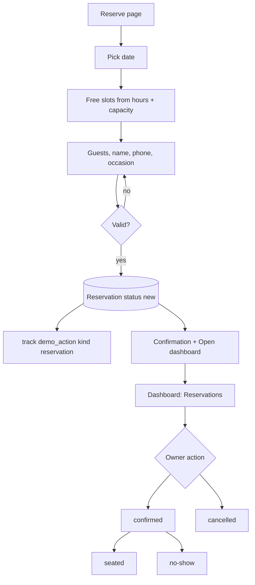
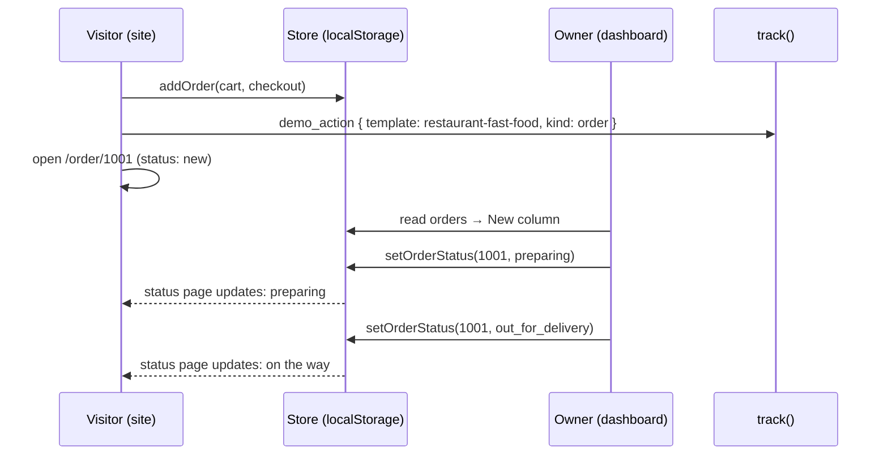
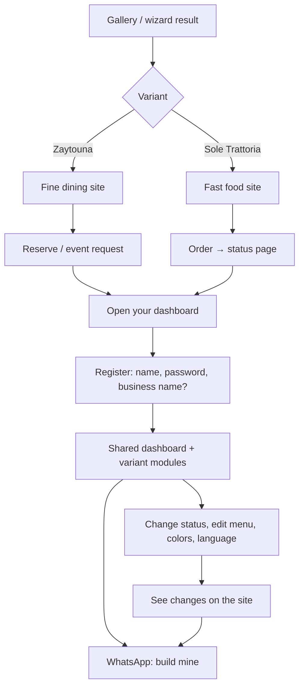

# Template category: Restaurants & cafés

Status: shared layer + **both variants built**: Zaytouna (restyled to the Verdant Table look) and Sole Trattoria (pizza & pasta, orders two-way loop).
Design: inspired by `theme-sources/` (see "Design mapping" below).

Two complete restaurant websites, each a different kind of restaurant with its own content and look,
sharing one dashboard. Feature folder: `src/features/template-restaurant/`.

| | Variant A: Fine dining | Variant B: Fast food |
|---|---|---|
| Slug | `restaurant-fine-dining` | `restaurant-fast-food` |
| Business (seed) | **Zaytouna** · **زيتونة**: Levantine fine-dining restaurant | **Sole Trattoria** · **سولي تراتوريا**: wood-fired pizza, fresh pasta, pickup and delivery |
| Main value | Fill tables: reservations day and night, no missed calls | Sell directly: online orders without delivery-app commission |
| Main closed loop | Reservation on the site → Reservations in the dashboard | Order on the site → live Orders board → customer sees status |
| Second loop | Private event request → Event requests | Owner creates an offer → it appears on the site |

---

## 1. Business profiles

### A. Zaytouna (fine dining)

- **Who it is:** a Levantine restaurant for dinners, families, and occasions. Signature dishes, a chef with a story, a calm atmosphere.
- **Customers:** couples, families, companies booking dinners, people celebrating birthdays and anniversaries.
- **What the owner wants:** a full room on weekends, fewer phone calls, more private events (high revenue),
  a premium image that justifies the prices.
- **Pain today:** reservations by phone only; calls missed at night and during service; no-shows; events booked by chance.

### B. Sole Trattoria (fast food)

- **Who it is:** a family-owned Italian trattoria for wood-fired pizza and fresh pasta, with pickup and delivery,
  a warm room, and busy evenings.
- **Customers:** families, couples, young professionals, and offices ordering dinner.
- **What the owner wants:** more direct orders, less dependence on delivery apps and their commission,
  repeat customers, offers that move sales on quiet days.
- **Pain today:** orders by WhatsApp messages get lost or mixed up; customers keep calling "where is my order?".

---

## 2. Value map

Every section has a business goal. Sections without one are not built.

### A. Zaytouna site

| Page | Section | Business goal | Value message (EN) |
|---|---|---|---|
| Home | Hero + "Reserve a table" | bookings | Reserve your table in seconds, any time |
| Home | Signature dishes (from Menu, `featured`) | desire, sales | Dishes people come back for |
| Home | The experience (atmosphere, 3 points) | justify premium | More than a meal: an evening |
| Home | Chef's story teaser | trust | Recipes from our family, done with care |
| Home | Reviews (visible ones) | trust | What our guests say |
| Home | Private events teaser | high-value leads | Celebrate with us: private dining for your occasion |
| Home | Hours, location, contact | remove friction | Find us, call us, or message on WhatsApp |
| Menu | Menu by course, prices, tags | decide before coming | Know what you'll enjoy before you arrive |
| About | Chef & story, values, photos | trust, premium image | |
| Private events | What we offer + request form | high-value leads | Birthdays, business dinners, family gatherings |
| Reserve | Reservation form | bookings | Choose day, time, and guests; we confirm fast |
| Contact | Map image, hours, phone, WhatsApp | remove friction | |

### B. Sole Trattoria site

| Page | Section | Business goal | Value message (EN) |
|---|---|---|---|
| Home | Hero + "View menu" / "Reserve now" | sales | Fresh from the oven: pizza and pasta, ordered in two minutes |
| Home | 4 promises (oven, pasta, produce, recipes) | trust | Wood-fired, handmade daily, local produce, family recipes |
| Home | Today's offers + Chef's Specials (from Offers + Menu, `featured`) | sales | Deals made for today, dishes people come back for |
| Home | Menu preview (category tabs, price list) | decide | Taste of Italy |
| Home | About story + "Since 1998" | trust | A sunlit table for family and friends |
| Home | Delivery areas + fees (in the reservation slot) | remove doubt | We deliver to your area |
| Home | Reviews | trust | What People Say |
| Home | Opening hours + contact + map | remove friction | |
| Menu | Categories, items, add to cart | sales | |
| Cart | Items, quantities, note, total | sales | |
| Checkout | Pickup/delivery, area, address, name, phone, pay on delivery/pickup | sales | No sign-up needed |
| Order status | Live status of the order | fewer "where is my order?" calls | Follow your order live |
| Contact | Hours, phone, WhatsApp, location | remove friction | |

---

## 3. Shared dashboard

One dashboard for both variants (`dashboard/`). It shows the shared modules plus the modules listed in the variant's `dashboard.ts`.

| Module | Shared / variant | What the owner does | Value shown |
|---|---|---|---|
| Overview | shared | Today's cards (from active modules), latest activity, value tips | "Your restaurant at a glance" |
| Reservations | **A only** | See reservations by day; confirm, mark seated, cancel, no-show; set time slots and max guests per slot | No missed bookings, plan the evening |
| Event requests | **A only** | See private event requests; mark replied / booked / closed; reply on WhatsApp | Catch high-value events |
| Orders | **B only** | Live board: new → preparing → ready / out for delivery → completed (or cancelled) | Every order in one place, customers informed |
| Offers | **B only** | Create, edit, activate/deactivate offers shown on the site | Push sales when you want |
| Delivery areas | **B only** | Areas with fee and minimum order | Clear rules, fewer questions |
| Menu | shared | Categories and items: name, description, price, image, tags, available, featured | Change the menu in seconds, in both languages |
| Content | shared | Site texts and images: hero, about, experience, contact, hours | Your website is always up to date |
| Customers | shared | List built from reservations/orders: name, phone, count, last visit/order; WhatsApp button | Know your regulars |
| Reviews | shared | Show or hide reviews on the site | Choose what builds trust |
| Settings | shared | Business name, colors (palettes), phone, WhatsApp, address, currency, reset demo | Make it yours |

### Value tips (examples)

Small, dismissible notes in the dashboard that explain the value of what just happened. Both languages.

- "This reservation arrived at 11:40 pm, when the restaurant was closed. Without the website it would have been a missed call."
- "4 orders today came directly from your website, with no delivery-app commission."
- "The customer can follow this order's status live, so they won't need to call you."
- "Mark a reservation as no-show: in a real project you can send reminders to reduce no-shows."

Rules: a tip is computed from store data (time vs opening hours, counts); max one tip per page; never invented numbers.

---

## 4. Closed loops

### A1. Reservation

1. On **Reserve**, the visitor picks a date (today to +30 days), a time from the free slots, guests (1–12), name, phone,
   optional occasion (birthday, anniversary, business, other) and note.
2. Free slots come from the opening hours and reservation settings; a slot with no capacity left is hidden.
3. Submit → reservation saved with status `new` → `track("demo_action", { kind: "reservation" })`.
4. Confirmation screen: summary + "Open your dashboard to see it" + WhatsApp.
5. In the dashboard it appears at the top of **Reservations** and in Overview, with a value tip when it came outside opening hours.
6. The owner confirms, marks seated, cancels, or marks no-show. The customer appears in **Customers**.



Statuses: `new` → `confirmed` → `seated` · `new`/`confirmed` → `cancelled` · `confirmed` → `no_show`.

### A2. Private event request

Form: event type, date, guests, budget range (optional), name, phone, details → status `new` → `track demo_action { kind: "event_request" }`.
Dashboard statuses: `new` → `replied` → `booked` or `closed`. A "Reply on WhatsApp" button opens WhatsApp with the customer's number.

### B1. Order (two-way loop)

1. The visitor adds items to the cart (quantity + optional note per order).
2. Checkout: **pickup** or **delivery**. Delivery needs an area (fee and minimum order apply) and an address.
   Name, phone, payment on delivery/pickup (cash or card). No sign-up.
3. Submit → order saved with number `#1001…`, status `new` → `track demo_action { kind: "order" }`.
4. The visitor lands on **Order status** (`/order/$id`), which shows the status live from the store.
5. In the dashboard the order appears in the **New** column. The owner moves it forward.
6. **The selling moment:** the owner changes the status in the dashboard and the customer page updates. The banner suggests
   opening both side by side. (Same browser, same store. The engine listens to the browser `storage` event and reloads the store, so two tabs stay in sync.)
7. If the shop is closed, the checkout says "We'll prepare your order when we open at …" and still accepts it.



Statuses: `new` → `preparing` → `ready` (pickup) or `out_for_delivery` (delivery) → `completed` · any before completed → `cancelled`.

### B2. Offer

The owner creates an offer (title, description, price, image, active) → it appears in "Today's offers" on the home page
and at the top of the menu. Adding an offer to the cart adds it as one line.

---

## 5. Register, login, and personalization

Uses `demo-engine` fake auth (see `docs/05-demo-engine.md`).

- Register: name, password, and an **optional business name**. If given, it replaces "Zaytouna" / "Sole Trattoria"
  in the site header, footer, and titles, in both languages (same text for ar and en until the user edits it).
- Settings → **colors**: 5 palettes made for each variant (e.g. Zaytouna: olive, wine, charcoal, sand, navy).
  The site and dashboard update immediately. Palettes are tokens, so contrast is always checked.
- The account is per variant: registering in Zaytouna does not register in Sole Trattoria.

---

## 6. Sample data

So the dashboard is never empty, the seed includes sample activity **with dates relative to today**
(created when the store is first seeded or reset):

- Zaytouna: 8 reservations (yesterday to next weekend, mixed statuses, two with occasions), 2 event requests, 6 reviews.
- Sole Trattoria: 10 orders today and yesterday (mixed pickup/delivery and statuses), 3 offers (2 active), 4 delivery areas, 3 reviews.
- Customers are computed from reservations/orders, not stored separately.

The visitor's own actions are added on top. Reset restores the seed with fresh relative dates.

---

## 7. Seed content outline

Prices use the currency in Settings and are formatted with `Intl`. Full copy (ar + en) is written in
`variants/<variant>/seed/` during the build; Arabic is written as real Arabic.

### Zaytouna · زيتونة

- Tagline: "Levantine flavors, served for your best evenings" · "نكهات شامية أصيلة لأجمل أمسياتك"
- Menu courses and sample items:

| Course | Items (EN · AR) |
|---|---|
| Cold mezze · مقبلات باردة | Hummus with pine nuts · حمّص بالصنوبر; Muhammara · محمّرة; Fattoush · فتّوش; Tabbouleh · تبّولة |
| Hot mezze · مقبلات ساخنة | Cheese rakakat · رقاقات بالجبن; Kibbeh with yogurt · كبّة لبنيّة; Grilled halloumi · حلّوم مشوي |
| Mains · الأطباق الرئيسية | Lamb ouzi · أوزي لحم; Mixed grill · مشاوي مشكّلة; Sayadieh fish · صيادية سمك; Chicken shish tawook · شيش طاووق |
| Desserts · الحلويات | Kunafa · كنافة; Mouhalabieh with pistachio · مهلّبية بالفستق |
| Drinks · المشروبات | Fresh lemon mint · ليمون بالنعناع; Arabic coffee · قهوة عربية; Jallab · جلّاب |

- Experience: private room for 20, live oud on Thursdays, family recipes.
- Private events: birthdays, business dinners, engagement dinners, family gatherings.

### Sole Trattoria · سولي تراتوريا

- Tagline: "PIZZA & PASTA" with the script "Fresh from the oven" · "بيتزا وباستا" مع "طازجة من الفرن"
- Menu (SAR, whole-number prices; three `featured` specials):

| Category | Items (EN · AR) |
|---|---|
| Pizza · بيتزا | Margherita · مارغريتا; Wood-Fired Margherita · مارغريتا فرن الحطب; Diavola · ديافولا; Quattro Formaggi · أربعة أجبان; Prosciutto e Rucola · بروشوتو وجرجير |
| Pasta · معكرونة | Tagliatelle al Ragu · تالياتيلي بالراجو; Spaghetti Pomodoro · سباغيتي بومودورو; Pappardelle Funghi · بابارديلي بالفطر; Carbonara · كاربونارا |
| Antipasti · مقبلات | Bruschetta · بروسكيتا; Caprese · كبريزي; Burrata · بوراتا; Arancini · أرانشيني |
| Dolci · حلويات | Tiramisu · تيراميسو; Panna Cotta · بانا كوتا; Cannoli · كانولي; Affogato · أفوجاتو |
| Drinks · مشروبات | Aperol Spritz · أبيرول سبرتز; Chianti Classico · كيانتي كلاسيكو; Limonata · ليموناتا; Espresso · إسبريسو |

- Offers: "Pizza Night" · "ليلة البيتزا"; "Family pasta box" · "بوكس الباستا العائلي"; "Date night" · "سهرة إيطالية".
- Reviews: Marta R. (Local guide, 5), Daniel K. (Regular, 5), Sofia L. (Verified diner, 4).

---

## 8. Data (localStorage, Zod outline)

Keys: `demo:restaurant-fine-dining`, `demo:restaurant-fast-food`. Every visible text is `{ ar, en }`.

```
shared (types.ts, both variants)
  account?        { name, passwordHash, businessName? }
  settings        { businessName {ar,en}, palette, phone, whatsapp, address {ar,en}, currency,
                    hours: [{ day, open, close, closed }] }
  content         { hero, about, experience/howItWorks, contact … each {ar,en} + image ids }
  menu            { categories: [{ id, name }], items: [{ id, categoryId, name, description, price,
                    image, tags: ("new"|"spicy"|"vegetarian"|"chef")[], available, featured }] }
  reviews         [{ id, author, role?, rating 1–5, text {ar,en}, visible }]
  dismissedTips   string[]

fine-dining only
  reservations        [{ id, date, time, guests, name, phone, occasion?, note?, status, createdAt }]
  reservationSettings { slotMinutes, slots: ["18:00", …], maxGuestsPerSlot }
  eventRequests       [{ id, type, date, guests, budget?, name, phone, details, status, createdAt }]

fast-food only
  cart      [{ itemId | offerId, qty }]
  orders    [{ id, number, lines: [{ name {ar,en}, price, qty }], type: "pickup"|"delivery",
               areaId?, address?, name, phone, payment: "cash"|"card", note?,
               subtotal, deliveryFee, total, status, createdAt }]
  offers    [{ id, title, description, price, image, active }]
  areas     [{ id, name, fee, minOrder }]
```

Order lines keep a snapshot of name and price, so editing the menu never changes past orders.

## 9. Tracking

| Event | When | meta |
|---|---|---|
| `demo_opened` | site of a variant opened | |
| `demo_registered` / `demo_login` | fake auth | |
| `demo_action` | reservation / event request / order submitted | `kind`: `reservation`, `event_request`, `order` |
| `content_edited` | save in Menu, Content, Offers, Settings, Reviews | `section` |
| `demo_reset`, `language_switched`, `whatsapp_clicked` | as usual | |

Status changes in the dashboard are not tracked (noise).

---

## 10. Flow in plain words (visitor journey)

1. From the gallery or the wizard result, the visitor opens Zaytouna or Sole Trattoria.
2. The demo banner says it is a live demo saved in their browser.
3. They browse the site like a real customer and make a reservation or an order.
4. The confirmation invites them to open the dashboard. They register (name, password, optional business name).
5. They see their own reservation/order next to the sample data, with a value tip.
6. They change a status, edit a dish, change the colors, put their business name, switch to Arabic/English.
7. They go back to the site and see their changes live.
8. The banner and dashboard offer "Talk to us on WhatsApp" when they want the real thing.



## 11. User stories

| # | As a visitor (restaurant owner) trying the demo I want to… | So that… |
|---|---|---|
| R1 | reserve a table / place an order like my customers would | I feel the customer experience |
| R2 | see my reservation or order arrive in the dashboard | I see the website working for my business |
| R3 | change an order status and see the customer page update | I see how it cuts "where is my order?" calls |
| R4 | edit dishes and prices in Arabic and English | I know I can run it myself |
| R5 | put my restaurant name and pick colors | I imagine it as mine |
| R6 | see tips about missed calls and commissions | I understand the money value |
| R7 | talk to the agency on WhatsApp from anywhere in the demo | I can start when I'm convinced |

| # | As the owner (agency) I want to… | So that… |
|---|---|---|
| R8 | know which variant gets more registrations and actions | I know what restaurant owners value |

## 12. Routes

```
/[locale]/demos/restaurant/fine-dining/                 home
  menu · about · events · reserve · contact · register · login
  dashboard/  (overview) · reservations · events · menu · content · customers · reviews · settings
/[locale]/demos/restaurant/fast-food/                   home
  menu · cart · checkout · order/$id · contact · register · login
  dashboard/  (overview) · orders · offers · areas · menu · content · customers · reviews · settings
```

## 12b. Tests

| Level | Test | Protects |
|---|---|---|
| Unit | free slots: hide full slots, closed days, past times; guests 1–12 | R1 |
| Unit | reservation, event request, and order status paths: only allowed transitions | R2, R3 |
| Unit | order totals, delivery fee, minimum order per area; order keeps its name/price snapshot after a menu edit | R1, R4 |
| Unit | value tips: shown only when data justifies them (outside hours, direct orders count) | R6 |
| Unit | business name at register replaces the seed name in both languages; palettes apply | R5 |
| Contract | both variants pass the template contract checks | rules |
| E2E | fine dining: reserve → register → see it in Reservations → confirm | R1, R2 |
| E2E | fast food: order → status page → dashboard changes status → status page updates | R1–R3 |
| E2E | edit a dish in ar/en → visible on the site; reset restores the seed | R4 |

## 13. Files

Built so far (Variant B will add `variants/fast-food/` and `modules/orders|offers|areas/`):

```
src/features/template-restaurant/
  types.ts                  shared Zod schemas (settings, content, menu, reviews) + restaurantDataSchema
  shared-slice.ts           createSharedActions(set): settings, content, menu CRUD, reviews, dismissTip
  restaurant-store.ts       RestaurantState / RestaurantStore types any variant store fits
  value-tips.ts, customers.ts, hours.ts   pure helpers
  images.ts, restaurant-photo.tsx   photo library type, picks a photo by id and renders the engine Photo
  messages.ts + messages/   dashboard, forms, modules text (ar/en)
  dashboard/                RestaurantProvider (createVariantContext), DashboardFrame, Overview, Menu, Content, Customers, Reviews, Settings
  modules/reservations/     types, slots (free slots, validation), status, store-slice, form, dashboard page, tips
  modules/event-requests/   types, validate, status, store-slice, form, dashboard page, tips
  variants/fine-dining/     slug, data (schema), store, seed/, palettes, dashboard (config), overview (hooks),
                            site/, messages/, metadata, dashboard-pages, meta
src/app/[locale]/demos/restaurant/fine-dining/   (site)/ pages + dashboard/ pages (thin)
tests/contracts/template-contract.test.ts + template-registry.ts   contract for every catalog variant
e2e/restaurant-fine-dining.spec.ts
```

### Shared API for the next variant (fast food)

1. Schema: `restaurantDataSchema.extend({ ...yourModuleShapes })`, seed returns that shape with `account: null`.
2. Store: `createTemplateStore({ slug, version, schema, createSeed, actions: (set) => ({ ...createSharedActions(set), ...yourActions(set) }) })`.
3. Config (`RestaurantConfig`): `slug`, `templateName`, `basePath`, `palettes` (5, contrast-tested), `modules` (sidebar items),
   `useOverview(locale)` (cards, activity, tip facts), `useCustomers()`.
Engine pieces to reuse, not copy: Moved to the engine (see `docs/05-demo-engine.md`): dashboard UI pieces, photo, palette scope, contrast, dates, format, phone, business name, `trackEdit`, dashboard context.
4. Wrap the dashboard routes in `DashboardFrame` (see `variants/fine-dining/dashboard-pages.tsx`); the shared pages
   (`OverviewPage`, `MenuPage`, `ContentPage`, `CustomersPage`, `ReviewsPage`, `SettingsPage`) read the store from context.
5. Variant module pages take a typed store prop (like `ReservationsStore`); add `useXStore` types per module.
6. Add the slug to `tests/contracts/template-registry.ts` and the meta to `gallery/catalog.ts`.

Planned layout of the whole category:

```
src/features/template-restaurant/
  dashboard/        overview, menu, content, customers, reviews, settings (shared)
  modules/
    reservations/   fine dining (site form + dashboard module)
    event-requests/ fine dining
    orders/         fast food (cart, checkout, status page, orders board)
    offers/         fast food
    areas/          fast food
  types.ts          shared schemas
  value-tips.ts     pure functions: data → tip or nothing
  variants/
    fine-dining/    site/ seed/ dashboard.ts store.ts meta.ts
    fast-food/      site/ seed/ dashboard.ts store.ts meta.ts
```

## Design mapping (docs/09)

| Variant | Source design | What was kept | Fonts (self-hosted by next/font/google, applied inside the template only) |
|---|---|---|---|
| Zaytouna | `03-verdant-table` (+ promise strip and footer ideas from `02-ironhorn-steakhouse`) | deep green / cream / gold as the default palette "Verdant"; round plates; script accent; hero, 4-point promise strip, story, signature dishes panel, experience band (3 round plates), menu preview tabs, reviews, events teaser, reserve band with hours, map, phone | Cormorant Garamond + Jost + Pinyon Script (English only) · Amiri + IBM Plex Sans Arabic |
| Sole Trattoria | `06-sole-trattoria` (+ cart drawer behaviour from `01-hearthbean-cafe`) | cream / tomato / basil, Bebas hero, Lora headings, Yellowtail script accents, pill buttons, dashed ring around the hero plate, promise card, red info strip; hero + View menu / Reserve now, 4 promises, Chef's Specials, menu preview, about, reviews, delivery areas, info strip; cart drawer | Bebas Neue + Lora + Poppins + Yellowtail · Lalezar + IBM Plex Sans Arabic + Aref Ruqaa |

Both variants keep their photos in one list (`variants/<variant>/photos.ts`, Unsplash URLs through `photoUrl`/`photoSrcSet`).
The engine `Photo` (used by `RestaurantPhoto`) shows a neutral box with the alt text when a photo cannot load.
Photo ids of Sole Trattoria pizzas, pastas, and the dining room come from the source design's Unsplash photos:
open the gallery once in a real browser and replace any that do not show the right food.

## 14. Out of scope (said in the demo as "available in a real project")

- Real payments, SMS/WhatsApp notifications to customers, printing kitchen tickets, item options (sizes/extras),
  table maps, loyalty points, delivery-driver app.

## Decisions

Built with Zaytouna (phase 5, part 1):

4. **Images are placeholders.** Downloads were not possible, so the image library (`images.ts`) points to small local SVG
   illustrations in `public/demos/restaurant/`. To use real photos, replace the files (same names, optimized WebP 800x600)
   or change `src` in `images.ts`; nothing else changes. Gallery screenshot: `public/demos/restaurant-fine-dining.svg`.
5. **Business name:** register stores it in the account; `businessNameOf()` shows it in both languages until the owner
   edits the name in Settings (`settings.nameEdited`), then Settings wins. Reset keeps the account, so the name stays.
6. **Slots:** `reservationSettings.slots` are the times offered; `slotMinutes` is how long a table is held. A reservation
   counts against every slot it overlaps, so back-to-back slots do not block each other. Cancelled and no-show free the table.
   Parties above 12 are sent to the event request form.
7. **Event requests:** 4 to 60 guests, date today to +1 year, budget optional (3 ranges).
8. **Customers** are computed by a hook each variant provides (`useCustomers`), grouped by phone number.
9. **Value tips** are facts (`value-tips.ts`: after-hours, no-show, event waiting, empty category), turned into text by the
   dashboard. The seed contains one reservation created at 23:50 (closed), so the first tip is visible from the start.
10. **Confirmation screens** link to the dashboard; the WhatsApp button of the banner is already visible on the same page,
    so it is not repeated.
11. **Language switch:** Zaytouna's site header has its own (the demo area has no agency header).
12. **Routes:** the site pages live in the `(site)` route group, the dashboard under `dashboard/`, so the dashboard
    has no site header. Register/login is `DashboardGuard` inside the dashboard layout (no separate pages).

1. Default currency in the seed: **SAR** (changeable in Settings).
2. Food photos: **free stock photos** that allow commercial use, optimized into the image library.
3. **Event requests** (Zaytouna) and **Offers** (Sole Trattoria) are in v1.

Built with Sole Trattoria (phase 5, part 2):

13. **Order status page is `/order?id=<order id>`**, not `/order/<id>`: the page is generated once and orders exist only in the
    browser, so a dynamic path would need a server. The page lives in a `Suspense` boundary because it reads the query.
14. **Cart is a drawer** (native `dialog`, slides from the end side, Esc closes), not a separate Cart page. The cart is stored in the
    template store, so it survives a refresh. Cart lines point to a menu item or an offer; names and prices are read at order time.
15. **Order numbers** start at 1001 and continue after the highest. An order stores a snapshot of each line's name and price,
    the area name, the fee, and the total.
16. **Placing an order** (`placeOrder`) re-checks everything (cart not empty, name, phone, area, address, minimum order) and returns
    `null` when invalid; the checkout form shows the reasons first. A closed shop still accepts the order and says when it opens.
17. **Statuses:** new → preparing → ready (pickup) or out_for_delivery (delivery) → completed; any unfinished order can be cancelled.
18. **Value tips for orders:** `directOrders` (count of today's non-cancelled orders; no money amount is invented) and
    `orderTracking` (newest order being worked on), plus the shared `afterHours` and `emptyCategory`.
19. **Photos:** each variant has its own list (`photos.ts`); `RestaurantConfig.photos` feeds the Menu and Content pickers
    and the Offers page. The old SVG placeholders were removed.
20. **WhatsApp button text color** is white (`shared/ui/button-styles.ts`): it used the palette's `on-primary`, which is dark in
    dark palettes (Verdant, Charcoal, Midnight) and failed contrast on the fixed green.
21. **Customers** column names are now "Visits" / "Latest visit" because they count reservations, orders, and requests.

### Files added for Sole Trattoria

```
src/features/template-restaurant/
  images.ts, restaurant-photo.tsx   shared: photo type, photo by id (fallback box comes from the engine Photo)
  modules/orders/    types, totals (cart, fees, minimum, validation), status, opening, tips, store-slice, orders-store,
                     use-cart, cart-view, checkout-form, order-status-view, orders-page (+ tests)
  modules/offers/    types, store-slice, offers-page
  modules/areas/     types, store-slice, areas-page
  variants/fast-food/  slug, data, store, fonts, photos, palettes, overview, dashboard, dashboard-pages, messages/, metadata, meta,
                       seed/ (content, menu, sample-data), site/ (frame, cart drawer, home, menu, checkout, order, contact, footer)
src/app/[locale]/demos/restaurant/fast-food/   (site)/ menu, checkout, order, contact + dashboard/ orders, offers, areas + shared pages
e2e/restaurant-fast-food.spec.ts
```
