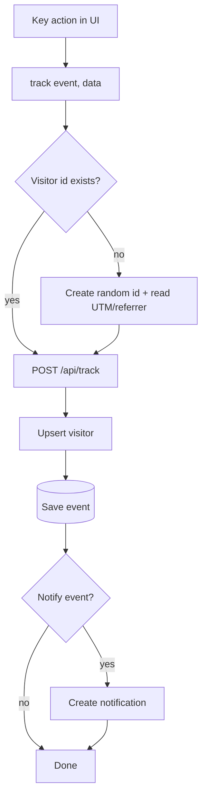

# Feature: Tracking

Status: planned

## Purpose

Record anonymous visitors and key actions so the admin knows what works: marketing sources, wizard conversion,
which demos attract registrations and real use.

## Flow in plain words

1. On first visit the browser creates a random visitor id and keeps it in localStorage (`demo:visitor-id`).
   UTM parameters and referrer of the first visit are sent with the first event.
2. Components call `track(event, data)` for key actions only (list in `.claude/rules/analytics.md`).
3. The server upserts the visitor (country from header, device from user agent, locale) and saves the event.
4. If the event is in the notify list, a notification is created for the admin.
5. `track()` never blocks or breaks the UI; failures are ignored.

## User stories

| # | As admin I want to… | So that… |
|---|---|---|
| T1 | know how many visitors come and from where | I judge my marketing |
| T2 | know which templates get opened, registered in, and used | I improve or replace them |
| T3 | get notified of important actions | I react quickly |

| # | As a visitor I want to… | So that… |
|---|---|---|
| T4 | not have my personal data or demo content collected | I trust the site |

## Flow diagram



## Sequence

See `docs/04-data-and-tracking.md`.

## Data

MongoDB `Visitor` and `Event`. No raw IP. No demo content or demo account data.

## Files

```
src/features/tracking/
  client/         track(), visitor id
  model.ts        Visitor, Event
  repository.ts
  service.ts      recordEvent, stats queries for admin
  types.ts        eventInputSchema, event names
```

## Out of scope

- Session replay, heatmaps, cookies, third-party analytics.
