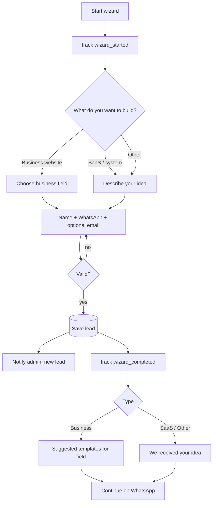
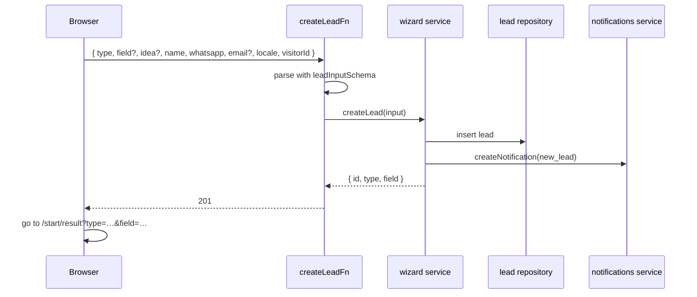

# Feature: Wizard

Status: planned

## Purpose

Let a visitor tell us what they want to build in under a minute, without a call. Every submission becomes a lead
in the admin dashboard, and the visitor immediately sees matching demos and a WhatsApp shortcut.

## Flow in plain words

1. Step 1, "What do you want to build?": **Business website**, **SaaS / system**, or **Other**.
2. Step 2:
   - Business website → choose a business field from a suggested list (or "other" + text). Optional short note.
   - SaaS / Other → describe the idea in a few lines.
3. Step 3: name, WhatsApp number, optional email.
4. Submit → the lead is saved and the admin gets a notification.
5. Result page:
   - Business → suggested templates for the chosen field (Generic Business when none match).
   - SaaS / Other → "We received your idea".
   - Always → **Continue on WhatsApp** with a prefilled message (type, field/idea, name).
6. Back and forth between steps keeps the answers. Errors are shown next to the field.

## User stories

| # | As a visitor I want to… | So that… |
|---|---|---|
| W1 | choose what I want to build from clear options | I don't need technical words |
| W2 | pick my business field from suggestions | it's quick |
| W3 | describe a SaaS or other idea in my words | my idea reaches the agency |
| W4 | see demos for my field right after | I see what I could get |
| W5 | continue on WhatsApp with my request prefilled | I talk to someone immediately |

| # | As admin I want to… | So that… |
|---|---|---|
| W6 | get every submission as a lead with a notification | I follow up fast |

## Flow diagram



## Sequence



## Data

MongoDB `Lead` (see `docs/04-data-and-tracking.md`). The business field list is a static list in the feature (ar/en labels, slug).
Suggested templates come from the gallery catalog filtered by field.

## Files

```
src/features/wizard/
  components/     steps, progress, result
  fields.ts       business field list (slug, ar, en)
  model.ts        Lead
  repository.ts
  server-functions.ts  createLeadFn
  service.ts      createLead, listLeads, updateLeadStatus
  types.ts        leadInputSchema, Lead types
```

## Out of scope

- File uploads, budgets, scheduling calls.
