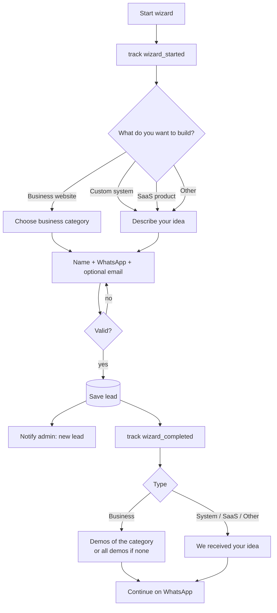
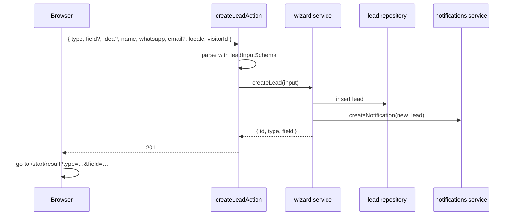

# Feature: Wizard

Status: planned

## Purpose

Let a visitor tell us what they want to build in under a minute, without a call. Every submission becomes a lead
in the admin dashboard, and the visitor immediately sees matching demos and a WhatsApp shortcut.

## Flow in plain words

1. Step 1, "What do you want to build?": **Business website**, **Custom system for my business**, **SaaS product**, or **Other**.
   (Same types as the Software Guide; the guide quiz can open the wizard with the type already chosen.)
2. Step 2:
   - Business website → choose a business category (same list as the gallery categories, or "other" + text). Optional short note.
   - Custom system / SaaS / Other → describe the idea in a few lines.
3. Step 3: name, WhatsApp number, optional email.
4. Submit → the lead is saved and the admin gets a notification.
5. Result page:
   - Business → the 2 variants of the chosen category. If the category has no demo yet, or "other" was chosen:
     "We build for your field too" + all available demos.
   - Custom system / SaaS / Other → "We received your idea".
   - Always → **Continue on WhatsApp** with a prefilled message (type, field/idea, name).
6. Back and forth between steps keeps the answers. Errors are shown next to the field.

## User stories

| # | As a visitor I want to… | So that… |
|---|---|---|
| W1 | choose what I want to build from clear options | I don't need technical words |
| W2 | pick my business category from suggestions | it's quick |
| W3 | describe a SaaS or other idea in my words | my idea reaches the agency |
| W4 | see the demos for my category right after | I see what I could get |
| W5 | continue on WhatsApp with my request prefilled | I talk to someone immediately |

| # | As admin I want to… | So that… |
|---|---|---|
| W6 | get every submission as a lead with a notification | I follow up fast |

## Flow diagram



## Sequence



## Data

MongoDB `Lead` (see `docs/04-data-and-tracking.md`). The category list (`field` in the lead) is the gallery's category list plus "other",
so the wizard and gallery always agree. Suggested demos come from the gallery catalog filtered by category.

## Tests

| Level | Test | Protects |
|---|---|---|
| Unit | lead schema: business needs a category; system/saas/other need an idea; WhatsApp format | W1–W3 |
| Unit | WhatsApp prefilled message contains type, category/idea, name | W5 |
| Integration | `createLead` saves the lead and creates a `new_lead` notification | W6 |
| E2E | each type path to the result page; back/forward keeps answers; errors next to fields; result shows category demos or all demos | W1–W5 |

## Files

```
src/features/wizard/
  components/     steps, progress, result
  model.ts        Lead
  repository.ts
  actions.ts  createLeadAction
  service.ts      createLead, listLeads, updateLeadStatus
  types.ts        leadInputSchema, Lead types
```

## Out of scope

- File uploads, budgets, scheduling calls.
