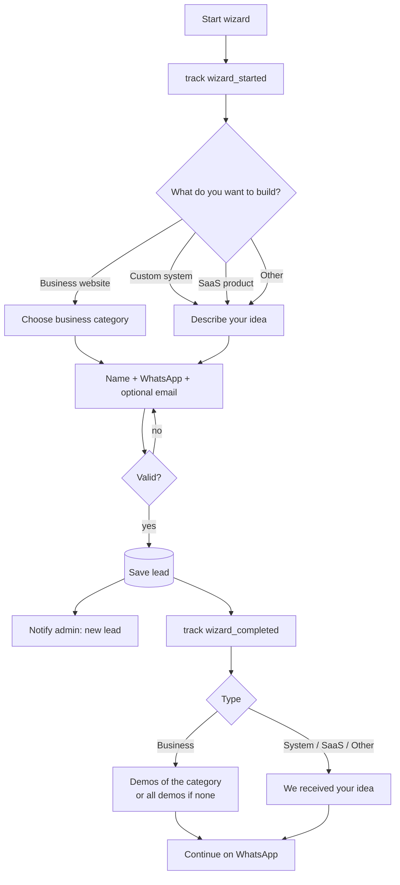
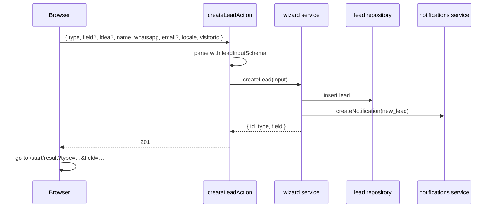

# Feature: Wizard

Status: built (integration test and E2E run in CI)

## Purpose

Let a visitor tell us what they want to build in under a minute, without a call. Every submission becomes a lead
in the admin dashboard, and the visitor immediately sees matching demos and a WhatsApp shortcut.

## Flow in plain words

1. Step 1, "What do you want to build?": **Business website**, **Custom system for my business**, **SaaS product**, or **Other**.
   (Same types as the Software Guide; the guide quiz can open the wizard with the type already chosen.)
2. Step 2:
   - Business website → choose a business category (same list as the gallery categories, or "other" + text). Optional short note.
   - Custom system / SaaS / Other → describe the idea in a few lines.
3. Step 3: name, WhatsApp number, optional email.
4. Submit → the lead is saved and the admin gets a notification.
5. Result page:
   - Business → the 2 variants of the chosen category. If the category has no demo yet, or "other" was chosen:
     "We build for your field too" + all available demos.
   - Custom system / SaaS / Other → "We received your idea".
   - Always → **Continue on WhatsApp** with a prefilled message (type, field/idea, name).
6. Back and forth between steps keeps the answers. Errors are shown next to the field.

## User stories

| # | As a visitor I want to… | So that… |
|---|---|---|
| W1 | choose what I want to build from clear options | I don't need technical words |
| W2 | pick my business category from suggestions | it's quick |
| W3 | describe a SaaS or other idea in my words | my idea reaches the agency |
| W4 | see the demos for my category right after | I see what I could get |
| W5 | continue on WhatsApp with my request prefilled | I talk to someone immediately |

| # | As admin I want to… | So that… |
|---|---|---|
| W6 | get every submission as a lead with a notification | I follow up fast |

## Flow diagram



## Sequence



## Data

MongoDB `Lead` (see `docs/04-data-and-tracking.md`). The category list (`field` in the lead) is the gallery's category list plus "other",
so the wizard and gallery always agree. Suggested demos come from the gallery catalog filtered by category.

## Tests

| Level | Test | Protects |
|---|---|---|
| Unit | lead schema: business needs a category; system/saas/other need an idea; WhatsApp format | W1–W3 |
| Unit | WhatsApp prefilled message contains type, category/idea, name | W5 |
| Integration | `createLead` saves the lead and creates a `new_lead` notification | W6 |
| Integration | `submitLead` limits one client to five leads per hour; the 6th is not saved (`service.test.ts`) | W6 |
| E2E | each type path to the result page; back/forward keeps answers; errors next to fields; result shows category demos or all demos | W1–W5 |

## Decisions made while building

- **WhatsApp message and privacy:** the result URL carries only `type` and `field` (never the name). After a saved lead the
  form keeps `{ name, idea }` in `sessionStorage` (`wizard:lead-summary`); the result page reads it in the browser and builds the
  prefilled message with the pure function `buildWhatsAppMessage`. If sessionStorage is empty (page opened directly),
  the message still has the type and field, just without the name.
- **`?type=` prefill:** `/start?type=system` opens at step 2 with the type chosen; Back returns to step 1.
- **Tracking:** `wizard_started` fires once when the wizard opens (also when the prefill skips step 1);
  `wizard_completed` fires after the lead is saved.
- **Business + "other" field** requires a description of 10 to 1000 characters (so the lead is never empty);
  a known category needs no text and the note is optional.
- **Validation:** the same `leadInputSchema` runs in the browser (per step) and on the server. The server returns the wrong
  field names; the browser shows a translated message next to each field.
- **WhatsApp number:** spaces, dashes and brackets are removed before saving.
- **Result page** is rendered on demand (it reads the query), `noindex`. Its language switch keeps the path but not the query.
- Demos shown on the result page come from `getDemosByCategory`; the catalog is empty until the first template is built,
  so the "We build for your field too" fallback is what visitors see today.

## Files

```
src/features/wizard/
  components/     wizard-shell, lead-form (steps), result-view, result-whatsapp
  messages/       ar.json, en.json (+ messages.ts: getWizardT)
  model.ts        Lead
  repository.ts   insertLead, findLeads
  service.ts      createLead (saves + new_lead notification), listLeads
  actions.ts      createLeadAction
  types.ts        leadInputSchema, field errors helper
  lead-summary.ts sessionStorage summary for the WhatsApp message
  whatsapp-message.ts  buildWhatsAppMessage (pure)
src/features/gallery/   categories.ts, types.ts, catalog.ts (data only for now)
src/app/[locale]/start/page.tsx, start/result/page.tsx
e2e/wizard.spec.ts
```

## Out of scope

- File uploads, budgets, scheduling calls.
